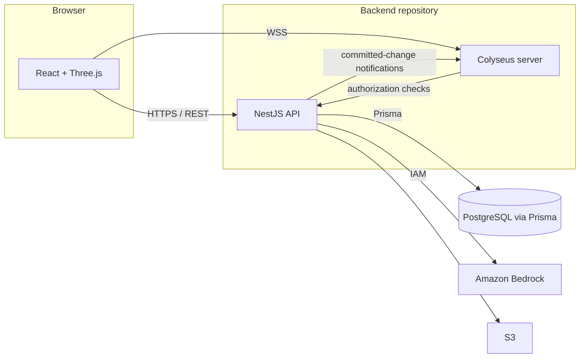
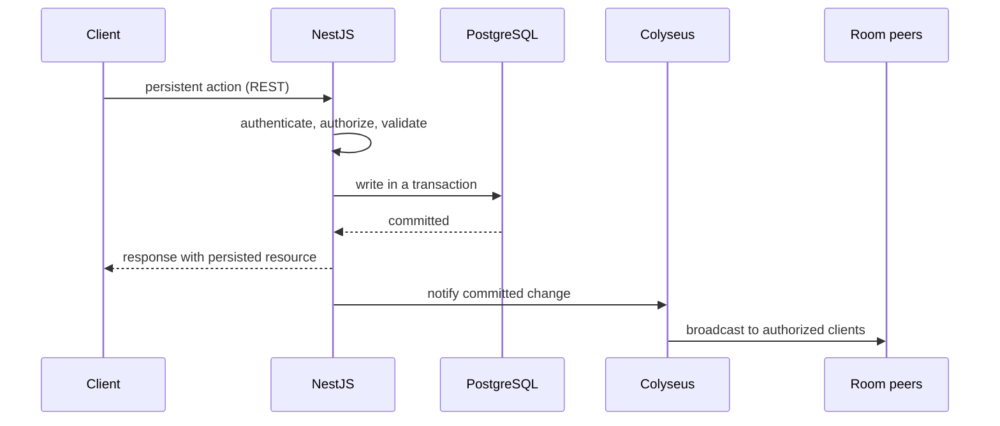
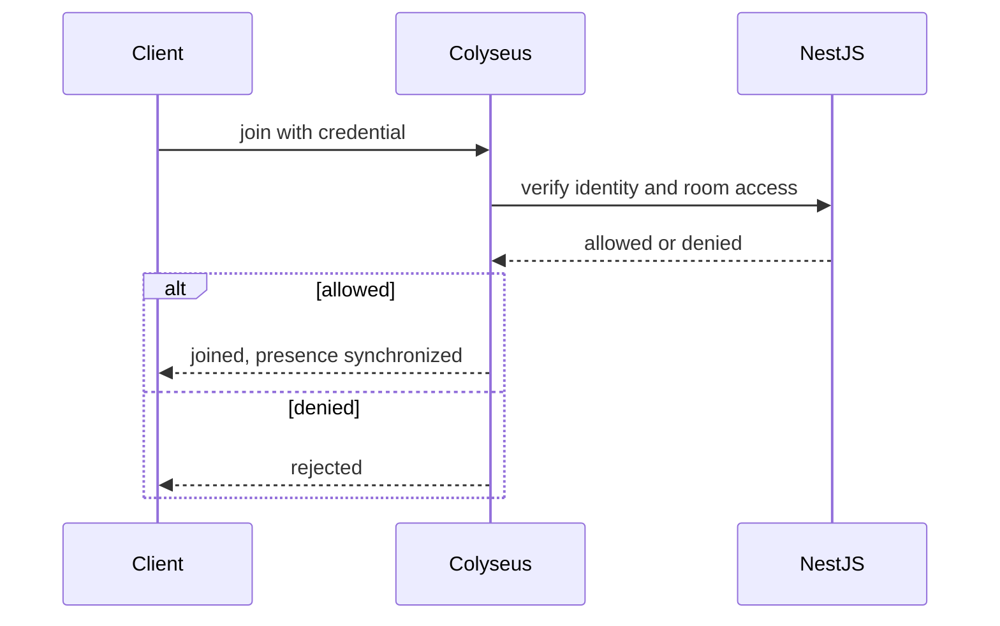
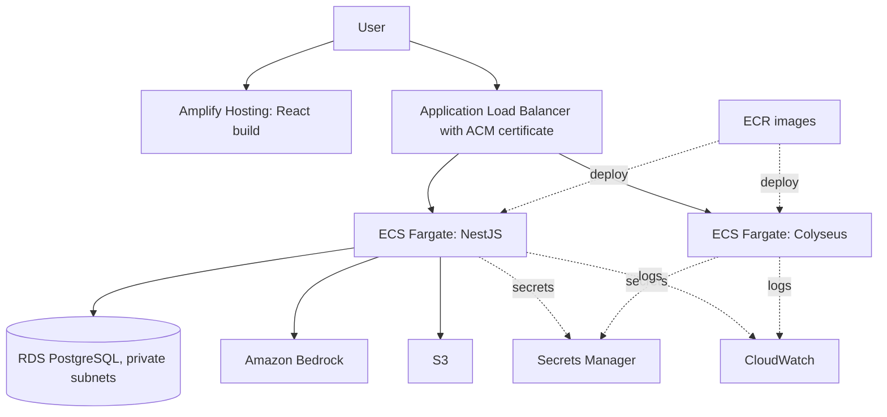

# Architecture Overview

This overview summarizes the backend architecture and links to the rules that govern it. It is a target design: it does not claim that any of it is deployed. The authoritative sources are the [project document](../master-document.md) (sections 6 and 7) and the rules linked below.

## Components

NestJS and Colyseus are separate deployable services. NestJS is the only service that reads and writes PostgreSQL and the only one that calls the AI provider. Colyseus holds live, ephemeral room state.

Rules: [Architecture](../rules/architecture.md), [Realtime and presence](../rules/realtime-and-presence.md), [Data](../rules/data.md).

## Write path

Persistent changes follow one path: validate and authorize in NestJS, commit to PostgreSQL, then notify the live room. Colyseus never persists.

## Realtime join

Rules: [Authentication and session](../rules/authentication-and-session.md), [Rooms and permissions](../rules/rooms-and-permissions.md).

## AWS deployment

IAM least-privilege roles apply to each service, and AWS Budgets monitors cost. Rules: [AWS infrastructure](../rules/aws-infrastructure.md), [Deployment and operations](../rules/deployment-and-operations.md), [Configuration and environments](../rules/configuration-and-environments.md).

## Responsibilities by rule

| Concern | Rule |
|---|---|
| Authentication and sessions | [Authentication and session](../rules/authentication-and-session.md) |
| Offices, rooms, roles, invitations | [Offices, rooms, and permissions](../rules/rooms-and-permissions.md) |
| Tasks and boards | [Tasks and productivity](../rules/tasks-and-productivity.md) |
| Chat, announcements, meetings | [Communication and meetings](../rules/communication-and-meetings.md) |
| Bot and daily briefing | [AI bot and daily briefing](../rules/ai-bot-and-daily-briefing.md) |

The reasoning behind these choices is in the [technical justification](./technical-justification.md).

## Open points

- Session mechanism and contract distribution between repositories.
- Internal transport between NestJS and Colyseus.
- Unmerged team diagram proposals differ from the requirements in role scoping, board status modeling, and the room model; the requirements prevail until the team reconciles them.
