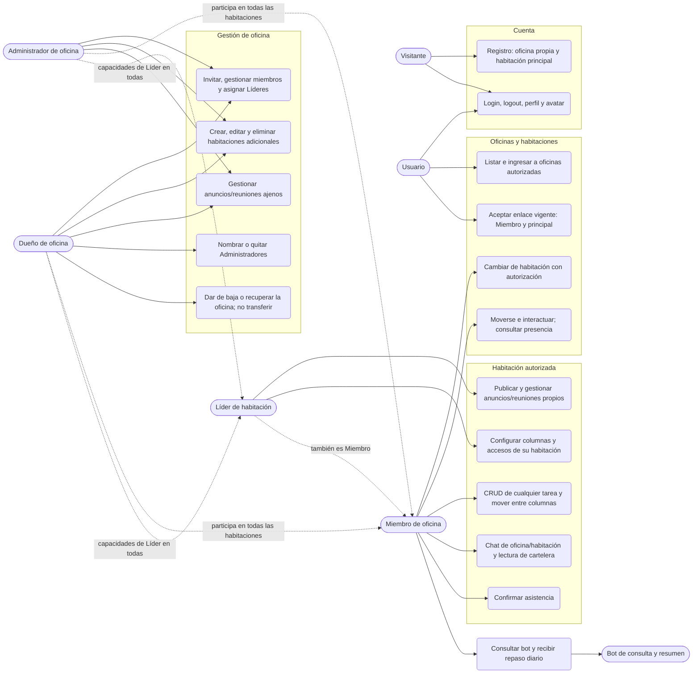

# Casos de uso

> Vista funcional derivada de la [ERS](../../functional-requirements.md) y sus [historias de usuario](../../user-stories.md). Parte del [índice de diagramas](../README.md).

**En este archivo**

- [1. Casos de uso](#1-casos-de-uso)
  - [1.1 Actores y glosario](#11-actores-y-glosario)
  - [1.2 Diagrama general de casos de uso](#12-diagrama-general-de-casos-de-uso)
  - [1.3 Catálogo granular](#13-catálogo-granular)
  - [1.4 Matriz de permisos por rol](#14-matriz-de-permisos-por-rol)

[Índice](../README.md) · [Arquitectura](../02-system-architecture/deployment-and-network.md) →

## 1. Casos de uso

El comportamiento y las prioridades provienen de RF/RN, no de los identificadores UC locales de esta vista. Los UC conservados se reinterpretan explícitamente donde cambió el dominio; no son endpoints ni contratos consumidos por código. Los nombres de eventos, tickets, DTOs y transportes específicos siguen siendo **propuestas técnicas**, sujetas a las [reglas de contratos](../../../rules/api-contracts.md). El repositorio todavía no implementa estos casos de uso.

### 1.1 Actores y glosario

| Actor | Alcance | Modelo técnico propuesto |
|---|---|---|
| Visitante | Registro, login, recuperación de contraseña y apertura de enlace de invitación | Sin sesión |
| Usuario | Cuenta, avatar y lista de oficinas propia e invitadas | `User`, `Session` |
| Miembro | Participa en una oficina y sus habitaciones autorizadas | `OfficeMember.role = member` |
| Administrador | Gestión delegada de una oficina; no gestiona al Dueño ni nombra Administradores | `OfficeMember.role = admin` |
| Dueño | Único por oficina; nombra/quita Administradores; baja y recuperación de su oficina | `OfficeMember.role = owner` |
| Líder de habitación | Rol adicional sobre una habitación concreta; puede haber varios | `RoomLeadership`, separado del rol de oficina |
| Bot | Consulta y resume únicamente datos autorizados; **no modifica datos en el MVP** | `BotService` con consultas filtradas |
| Sistema | Alta de oficina/principal, vencimientos, repaso diario y eliminación tras baja | Procesos de backend por diseñar |
| Colyseus | Presencia, movimiento y difusión a destinatarios autorizados | Servicio realtime, no autoridad de datos persistentes |

El rol de oficina es uno por usuario/oficina. El liderazgo se suma por habitación: no existe una jerarquía global de Moderador ni un Superadmin. Dueño y Admin acceden a todas las habitaciones con capacidades de Líder (RN-07); el Líder solo habilita a miembros existentes y no invita gente nueva (RN-11). La ERS mantiene los supuestos pendientes identificados en su sección 9.

### 1.2 Diagrama general de casos de uso

### 1.3 Catálogo granular

Este catálogo resume recorridos y su trazabilidad; no reemplaza los 118 requisitos de la ERS. La columna **Fase/prioridad** conserva MoSCoW: pertenecer al MVP no convierte un Should o Could en Must. REST para escrituras y WSS para difusión es la propuesta de [consistencia](../02-system-architecture/realtime-colyseus.md#13-regla-de-consistencia-y-autoridad), no un catálogo aprobado de endpoints.

| UC | Recorrido y actor | Regla funcional / entidades | RF de origen | Fase/prioridad |
|---|---|---|---|---|
| 01 | Registro del Visitante | Crea `User`, `Office`, `OfficeMember(owner)`, principal y avatar; no otra oficina independiente | AUT-001, OFI-001 | Must · MVP |
| 02–03 | Login, sesión y logout del Usuario | Sesión expirable/renovable; logout corta acceso protegido | AUT-002 a AUT-005 | Must · MVP |
| 04 | Perfil y avatar del Usuario | Apariencia persistente y personalización | AUT-007, MUN-011 | Should · MVP |
| 05–06 | Listar oficinas e ingresar a habitación | Oficina activa, membresía activa y acceso vigente; principal para todos | OFI-002/003, HAB-001/009/011 | Must · MVP |
| 07 | Movimiento e interacción | WASD, clic, colisiones y presencia; entrada táctil y menú alternativo según prioridad | MUN-002 a MUN-012 | Must/Should · MVP |
| 08 | Aceptar invitación | Enlace de oficina vigente, revocable y con límite opcional de usos; solo acceso inicial a principal | OFI-005 a OFI-009 | Must/Should · MVP |
| 09 | Solicitud de ingreso | Alternativa futura a invitación, resuelta por Dueño/Admin | OFI-018 | Could · Evolución |
| 10 | Abandonar oficina | Admin/Miembro dejan de pertenecer; Dueño no abandona ni transfiere | OFI-013, RN-15 | Should · MVP |
| 11–12 | CRUD y movimiento de tareas | Cualquier miembro con acceso, también tareas ajenas; columnas configurables, asignación válida y tareas huérfanas | TAR-001 a TAR-012 | Must/Should · MVP |
| 13 | Chat | Canales separados de oficina y habitación; historial persistente y autorización vigente | CHA-001 a CHA-008 | Must/Should · MVP |
| 14–15 | Cartelera, reuniones y asistencia | Contenido por habitación; asistencia **no es complementaria** | CAR-001, CAR-007 a CAR-010 | Must/Should · MVP |
| 16–17 | Consultas y repaso diario | Solo lectura; una entrega por usuario/día Buenos Aires, con resumen sin IA si falla proveedor | BOT-001 a BOT-009 | Must/Should/Could · MVP |
| 20–21 | Gestionar habitaciones y accesos | Dueño/Admin crean hasta 5 adicionales; principal no se elimina; Líder gestiona accesos solo de su habitación | HAB-001 a HAB-008 | Must/Should · MVP |
| 22 | Generar/revocar invitación | Dueño o Admin de oficina; Líder no invita gente nueva | OFI-005 a OFI-009 | Must/Should · MVP |
| 23 | Resolver solicitudes | Dueño/Admin, no Líder por su rol de habitación | OFI-018 | Could · Evolución |
| 24 | Roles y liderazgo | Solo Dueño nombra/quita Admin; Dueño/Admin asignan Líderes | OFI-011, HAB-008 | Should · MVP |
| 25 | Expulsión | Dueño/Admin: baja lógica de membresía, conserva contenido; Admin no expulsa Dueño ni otro Admin | OFI-012 | Must · MVP |
| 26 | Publicar y gestionar comunicación | Líder gestiona los propios; Dueño/Admin también los ajenos | CAR-002 a CAR-006 | Must · MVP |
| 27 | Personalizar objetos | Dueño/Admin, sin convertir decoración ampliada en obligación MVP | OBJ-007 | Could · Evolución |
| 28 | Baja y recuperación de oficina | Solo Dueño; 15 días de recuperación, después eliminación definitiva; no transferencia | OFI-014 a OFI-016 | Should · MVP |
| — | Recuperación de contraseña | Email de un solo uso y vencimiento; supuesto pendiente P-04 explícito | AUT-006 | Should · MVP |
| — | Notificaciones | Usuario destinatario, lectura y permisos; tiempo real opcional según MoSCoW | NOT-001 a NOT-005 | Must/Should/Could · MVP |
| — | Mensajería privada / acciones del bot | Fuera del MVP; no se habilitan por aparecer en un objeto o herramienta | CHA-009, BOT-010 | Could · Evolución |

### 1.4 Matriz de permisos por rol

Resumen de la [matriz de la ERS](../../functional-requirements.md#3-permisos). Requiere oficina/membresía activas; las acciones por habitación requieren acceso vigente.

| Acción | Miembro | Líder de esa habitación | Admin | Dueño |
|---|---|---|---|---|
| Chat de oficina y presencia de miembros | Sí | Sí | Sí | Sí |
| Entrar, chat/historial, CRUD de cualquier tarea y asistencia en habitación autorizada | Sí | Sí | Sí, todas | Sí, todas |
| Configurar columnas y accesos de habitación | No | Solo la propia y miembros existentes | Sí | Sí |
| Publicar anuncios/reuniones y gestionar los propios | No | Solo la propia | Sí | Sí |
| Gestionar anuncios/reuniones ajenos | No | No | Sí | Sí |
| Crear/editar/eliminar habitaciones adicionales | No | No | Sí | Sí |
| Invitar o expulsar miembros de oficina | No | No | Sí, sin expulsar Dueño/Admin | Sí |
| Nombrar/quitar Administradores | No | No | No | Sí |
| Asignar/quitar Líderes | No | No | Sí | Sí |
| Abandonar oficina | Sí | Sí | Sí | No |
| Dar de baja/recuperar oficina | No | No | No | Sí |
| Transferir propiedad | No | No | No | No |

Toda operación se valida en servidor: sin sesión `401`; con sesión pero sin permiso `403` (RN-16). Para recursos de otra oficina, la elección uniforme `403`/`404` sigue abierta en [Authentication and session](../../../rules/authentication-and-session.md#authorization-responses); los ejemplos no la resuelven. La [matriz normativa](../../../rules/rooms-and-permissions.md#permission-matrix) y [Tasks](../../../rules/tasks-and-productivity.md) gobiernan esta vista. Ocultar botones no sustituye autorización. La pérdida de acceso también impide leer historial, desconecta presencia de esa habitación y deja tareas asignadas huérfanas (RN-12, HAB-010); la expulsión preserva los contenidos generados (RN-13).

[Índice](../README.md) · [Arquitectura](../02-system-architecture/deployment-and-network.md) →
