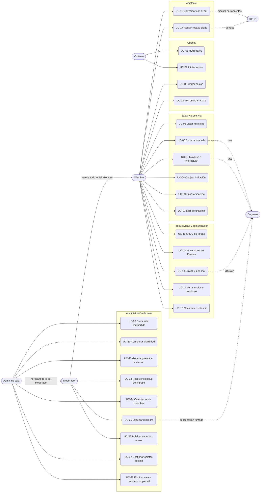

# Casos de uso

> Qué puede hacer cada actor y qué entidades, canales y señales intervienen. Parte del [índice de diagramas](./README.md).

**En este archivo**

- [1. Casos de uso](#1-casos-de-uso)
  - [1.1 Actores y glosario](#11-actores-y-glosario)
  - [1.2 Diagrama general de casos de uso](#12-diagrama-general-de-casos-de-uso)
  - [1.3 Catálogo granular](#13-catálogo-granular)
  - [1.4 Matriz de permisos por rol (propuesto)](#14-matriz-de-permisos-por-rol-propuesto)

[Índice](./README.md) · [Arquitectura y comunicación](./02-architecture.md) →

---

## 1. Casos de uso

Esta sección describe **qué puede hacer cada actor** y qué entidades, canales y señales intervienen. Es diseño objetivo (to-be): los endpoints, nombres de evento y códigos marcados **(propuesto)** no están definidos en el [documento maestro](../../master-document.md). La fuente exige como mínimo dos niveles de rol, administrador de sala (dueño) y miembro (`master-document.md:85`) y deja abiertos otros roles; el **Moderador** es un tercer rol de sala **(propuesto)**. La matriz exacta sigue pendiente (hueco 8).

### 1.1 Actores y glosario

| Actor | Descripción | Mapeo en el modelo |
|---|---|---|
| **Visitante** | Persona sin sesión; solo puede registrarse o iniciar sesión | Sin `Session` |
| **Miembro** | Usuario autenticado con `Membership.role = member` en una sala | `Membership.role = member` |
| **Moderador** | **(propuesto)** Usuario con permisos intermedios: gestiona personas y comunicación de la sala, pero no su configuración ni su propiedad | `Membership.role = moderator` |
| **Admin de sala** | Usuario autenticado que administra una sala; es el "administrador de sala (dueño)" del documento maestro | `Membership.role = owner` |
| **Bot IA** | Actor secundario: ejecuta herramientas del servidor en nombre del usuario, con sus mismos permisos | Servicio `BotService` + `ToolRegistry` |
| **Colyseus** | Actor secundario del sistema: valida ingreso, sincroniza presencia y difunde eventos ya confirmados | Servicio de tiempo real |

**Regla de herencia:** Admin ⊃ Moderador ⊃ Miembro. Cada rol puede todo lo del anterior dentro de su sala. El rol es **por sala** (vive en `Membership`), no global: la misma persona puede ser Admin en una sala y Miembro en otra. En la sala personal, el dueño es siempre Admin y no admite Moderadores.

### 1.2 Diagrama general de casos de uso

### 1.3 Catálogo granular

Convenciones de las tablas: **Canal** es el transporte del disparo; todo efecto persistente pasa por NestJS ([04-realtime §1.3](./04-realtime.md#13-regla-de-consistencia-y-autoridad)). **Señales** son los eventos realtime que se emiten después de confirmar. Los códigos de error siguen la [08-conventions §1.1](./08-conventions.md#11-códigos-de-error). Endpoints y eventos son **(propuesto)**. **MVP** según `master-document.md:312-327`.

#### Cuenta

| ID | Caso de uso | Actor | Precondición | Entidades | Canal | Señales y errores | MVP |
|---|---|---|---|---|---|---|---|
| UC-01 | Registrarse | Visitante | Email no registrado | `User`, `Room` personal, `Membership(owner)`, `AvatarConfiguration`, `Session` | REST `POST /auth/register` | `201`; `409` email duplicado; `422` DTO inválido | Sí |
| UC-02 | Iniciar sesión | Visitante | Cuenta existente | `User`, `Session` | REST `POST /auth/login` | `200`; `401` credenciales inválidas | Sí |
| UC-03 | Cerrar sesión | Miembro | Sesión válida | `Session.revokedAt` | REST `POST /auth/logout` | `204`; luego `presence:changed` de salida | Sí |
| UC-04 | Personalizar avatar | Miembro | Sesión válida | `AvatarConfiguration` | REST `PATCH /me/avatar` | `200`; `avatar:state` refleja el cambio visual | Sí |

#### Salas y presencia

| ID | Caso de uso | Actor | Precondición | Entidades | Canal | Señales y errores | MVP |
|---|---|---|---|---|---|---|---|
| UC-05 | Listar mis salas | Miembro | Sesión válida | `Room`, `Membership` | REST `GET /rooms` | `200`; `401` | Sí |
| UC-06 | Entrar a una sala | Miembro | Membresía en la sala | `Membership`, `Room` | REST (autorización y ticket) + WSS | `room:joined`, `presence:changed`; `401` sesión vencida, `403` sin membresía | Sí |
| UC-07 | Moverse e interactuar con objetos | Miembro | Conectado a la sala | `RoomItem` (lectura) | WSS `avatar:input` | `avatar:state`; input inválido se descarta y corrige | Sí |
| UC-08 | Canjear invitación | Miembro | Invitación vigente | `Invitation`, `Membership` | REST `POST /invitations/:code/redeem` | `201`; `410` expirada o revocada, `404` código inexistente (propuesto) | Sí |
| UC-09 | Solicitar ingreso | Miembro | Sala con ingreso por solicitud | `JoinRequest` | REST `POST /rooms/:id/join-requests` | `201`; `joinrequest:created` al Admin; `409` solicitud pendiente | Complementario |
| UC-10 | Salir de una sala | Miembro | Es miembro y no es el último Admin | `Membership` | REST `DELETE /rooms/:id/membership` | `204`; `room:left`, `presence:changed`; `409` si es el último `owner` | Sí |

#### Productividad y comunicación

| ID | Caso de uso | Actor | Precondición | Entidades | Canal | Señales y errores | MVP |
|---|---|---|---|---|---|---|---|
| UC-11 | CRUD de tareas | Miembro | Membresía; Miembro edita o borra solo tareas propias o asignadas; Moderador y Admin cualquiera (propuesto, ver 8.4) | `Task` | REST `/rooms/:id/tasks` | `task:changed`; `403`, `422` | Sí |
| UC-12 | Mover tarea en Kanban | Miembro | Membresía | `Task.status` | REST `PATCH /tasks/:id` | `task:changed` con `revision` | Sí |
| UC-13 | Enviar y leer chat | Miembro | Membresía | `Message` | REST `POST` y `GET /rooms/:id/messages` | `chat:message`; `403` | Sí |
| UC-14 | Ver anuncios y reuniones | Miembro | Membresía | `Announcement`, `Meeting` | REST `GET` | `meeting:announced` en vivo | Sí |
| UC-15 | Confirmar asistencia | Miembro | Reunión existente | `Attendance` (propuesto) | REST `PUT /meetings/:id/attendance` | `200`; sin evento obligatorio | Complementario |

#### Asistente

| ID | Caso de uso | Actor | Precondición | Entidades | Canal | Señales y errores | MVP |
|---|---|---|---|---|---|---|---|
| UC-16 | Conversar con el bot | Miembro | Sesión válida | `BotConversation`; herramientas sobre `Task`, `Room` | REST `POST /bot/ask` | `429` límite de consumo (propuesto); el bot hereda los permisos del usuario | Sí |
| UC-17 | Recibir repaso diario | Miembro | Primera conexión del día en `America/Argentina/Buenos_Aires` | `DailyReviewDelivery` | REST, disparo en la primera conexión | `bot:summary-ready`; si Bedrock falla, resumen estructurado | Sí |

#### Administración de sala (Moderador y Admin)

| ID | Caso de uso | Actor | Precondición | Entidades | Canal | Señales y errores | MVP |
|---|---|---|---|---|---|---|---|
| UC-20 | Crear sala compartida | Admin | Sesión válida | `Room(shared)`, `Membership(owner)` | REST `POST /rooms` | `201`; el creador queda como `owner` | Sí |
| UC-21 | Configurar visibilidad | Admin de esa sala | Es `owner` | `Room.visibility` | REST `PATCH /rooms/:id` | `200`; `403` si es Miembro | Sí |
| UC-22 | Generar y revocar invitación | Admin de esa sala | Es `owner` | `Invitation` | REST `POST` y `DELETE /rooms/:id/invitations` | `201` con código; `invitation:revoked` (propuesto) | Sí |
| UC-23 | Resolver solicitud de ingreso | Moderador o Admin de esa sala | Solicitud pendiente | `JoinRequest`, `Membership` | REST `POST /join-requests/:id/approve` o `reject` | `member:joined` o rechazo; `403` si es Miembro | Complementario |
| UC-24 | Cambiar rol de miembro | Admin de esa sala | El destino es miembro; queda al menos un `owner` | `Membership.role` | REST `PATCH /rooms/:id/members/:userId` | `member:role-changed`; `409` si dejaría la sala sin `owner` | Complementario |
| UC-25 | Expulsar miembro | Moderador o Admin de esa sala | El destino es `member` (el Moderador no expulsa a otro Moderador ni al Admin); el Admin puede expulsar a un Moderador | `Membership` | REST `DELETE /rooms/:id/members/:userId` | `member:kicked`, desconexión forzada del WSS; `403` si es Miembro o si el destino tiene igual o mayor rol | Complementario |
| UC-26 | Publicar anuncio o reunión | Moderador o Admin de esa sala | Sala `shared` o `general` | `Announcement`, `Meeting` | REST `POST` | `meeting:announced`; `403` | Sí |
| UC-27 | Gestionar objetos de sala | Admin de esa sala | Es `owner` | `RoomItem` | REST `POST`, `PATCH`, `DELETE` | difusión del nuevo estado de la sala | Complementario |
| UC-28 | Eliminar sala o transferir propiedad | Admin de esa sala | Sala no personal; para transferir, el destino es miembro | `Room`, `Membership` | REST `DELETE /rooms/:id` o `POST /rooms/:id/transfer` | `room:error` a los conectados; `409` | Complementario |

> **Regla negativa transversal.** Un Miembro que intenta cualquier UC-2x recibe `403`; un Moderador que intenta UC-20 a UC-22, UC-24, UC-27 o UC-28 también recibe `403`; sin sesión, `401`. Alterar un identificador ajeno nunca debe exponer datos de otra sala o usuario (`master-document.md:88`); si el recurso existe pero no es visible para el usuario, devolver `403` o `404` es una decisión pendiente (propuesto: `404`, para no confirmar su existencia).

### 1.4 Matriz de permisos por rol (propuesto)

| Acción | Miembro | Moderador | Admin |
|---|:-:|:-:|:-:|
| Entrar a la sala, moverse, interactuar, chat, ver anuncios (UC-06, 07, 13, 14) | Sí | Sí | Sí |
| Crear, editar y mover tareas propias o asignadas (UC-11, 12) | Sí | Sí | Sí |
| Editar o borrar tareas ajenas (UC-11) | No | Sí | Sí |
| Resolver solicitudes de ingreso (UC-23) | No | Sí | Sí |
| Expulsar a un Miembro (UC-25) | No | Sí | Sí |
| Expulsar a un Moderador (UC-25) | No | No | Sí |
| Publicar anuncios y reuniones (UC-26) | No | Sí | Sí |
| Generar y revocar invitaciones (UC-22) | No | No | Sí |
| Cambiar rol de un miembro (UC-24) | No | No | Sí |
| Configurar visibilidad y objetos de la sala (UC-21, 27) | No | No | Sí |
| Eliminar la sala o transferir propiedad (UC-28) | No | No | Sí |

Restricciones: ningún rol puede actuar sobre otro de igual o mayor jerarquía salvo el Admin sobre el resto; el último Admin no puede salir, degradarse ni ser expulsado (`409`). La matriz se verifica siempre en el servidor con `RoomAdminGuard` y `RoomModeratorGuard` ([clases](./05-classes.md#12-clases-adicionales)); ocultar un botón en el cliente no otorga ni quita permisos.

---

[Índice](./README.md) · [Arquitectura y comunicación](./02-architecture.md) →
