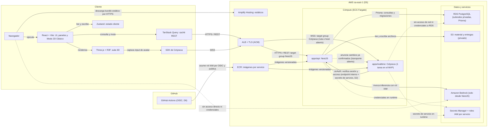
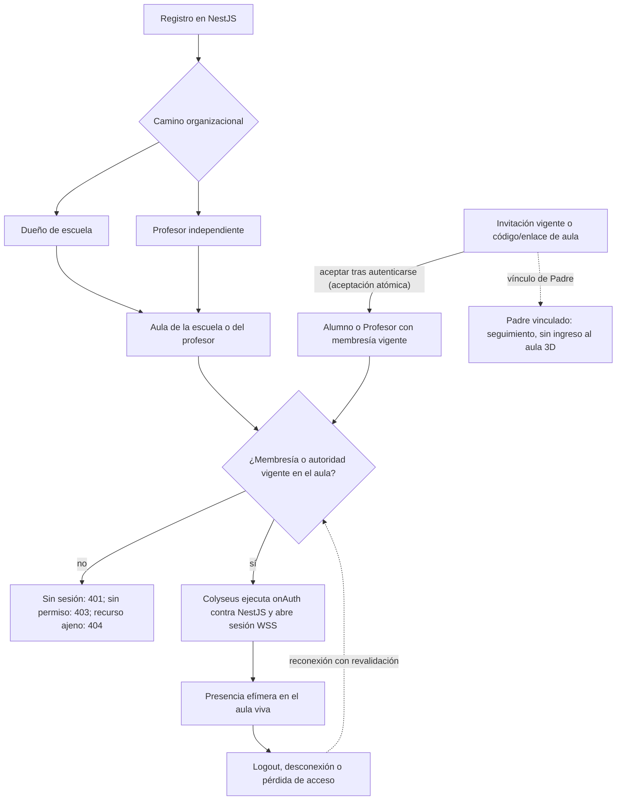
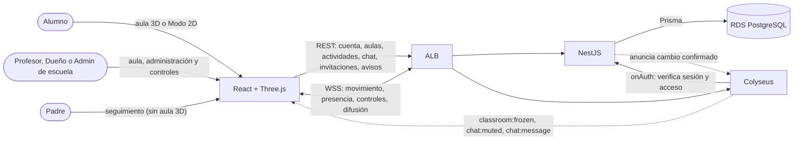

# Arquitectura y comunicación

> Cómo se conectan frontend, NestJS y Colyseus, y quién es la autoridad de cada dato en el aula virtual escolar. Parte del [índice de diagramas](../README.md).

**En este archivo**

- [1. Conexiones frontend y backend](#1-conexiones-frontend-y-backend)
  - [1.1 Arquitectura de despliegue y comunicación](#11-arquitectura-de-despliegue-y-comunicación)
  - [1.2 Matriz de canales](#12-matriz-de-canales)
  - [1.3 Flujo de usuarios y aulas](#13-flujo-de-usuarios-y-aulas)
  - [1.4 Comunicación por actor](#14-comunicación-por-actor)

← [Casos de uso](../01-functional/use-cases.md) · [Índice](../README.md) · [Modelo de datos](../03-structural/data-model.md) →

---

## 1. Conexiones frontend y backend

Esta sección muestra cómo se comunican el frontend React y los dos servicios backend del producto, qué transporte corresponde a cada operación y quién es la autoridad de cada dato. Todo lo descrito es **diseño objetivo (to-be) propuesto**: el repositorio solo contiene documentación y no hay código de aplicación ni infraestructura implementados ([estado del repositorio](../../../README.md)), así que no existen todavía endpoints, DTOs ni eventos definitivos. Los nombres de eventos son ilustrativos. Las decisiones D1 a D6 de la [justificación técnica](../../technical-justification.md#7-architecture-decisions-recorded-on-2026-11-02) fueron tomadas por Agustín el 2026-11-02 y están **pendientes de aprobación del equipo**; los puntos que las reglas dejan sin resolver se marcan **abierto**.

### 1.1 Arquitectura de despliegue y comunicación

Esta vista muestra tráfico de aplicación, no un plan de aprovisionamiento ni infraestructura desplegada. Los recursos deben gestionarse con [Terraform](../../../rules/infrastructure-as-code.md), respetando [AWS infrastructure](../../../rules/aws-infrastructure.md); el pipeline se autentica por OIDC contra un rol IAM, sin claves de larga duración (D6), según [Deployment and operations](../../../rules/deployment-and-operations.md). Alternativas y concesiones se explican en la [justificación técnica](../../technical-justification.md). El layout propuesto del repositorio de servicios es un monorepo pnpm con `apps/api`, `apps/realtime` y `packages/contracts` (D3).

**Autoridad de cada dato**

| Dato | Autoridad | Persistencia | Transporte |
|---|---|---|---|
| Credenciales y sesión | NestJS: JWT de acceso de vida corta, refresh token opaco hasheado y rotado, e identificador de sesión verificado en cada petición protegida (D1) | `Session` en RDS; hash de contraseña con algoritmo adaptativo | HTTPS / REST |
| Escuelas, aulas, membresías e invitaciones | NestJS | `School`, `SchoolMember`, `Classroom`, `ClassroomMembership`, `ParentLink`, `Invitation` | HTTPS / REST |
| Actividades, entregas y calificaciones | NestJS | `Activity`, `Submission`, `Grade` en RDS; archivos en S3 | HTTPS / REST; difusión WSS al aula tras confirmar |
| Mensajes y avisos | NestJS (historial y autorización); camino de envío del chat: abierto | `Message` y avisos en RDS | HTTPS / REST; difusión WSS |
| Posición y presencia de avatares | Colyseus, como estado de la `Room` viva | Efímera; no se escriben posiciones por fotograma | WSS |
| Controles de aula (congelar, silenciar, bloquear colaboración) | Colyseus acepta solo de quien NestJS confirmó con autoridad docente; los estados persistentes los escribe NestJS | Bloqueo de congelamiento efímero; silencio de chat y juegos deshabilitados persistidos por NestJS | WSS + REST |
| Repaso diario del bot | NestJS, con Bedrock solo del lado servidor | `DailyReviewDelivery` por usuario y fecha, zona `America/Argentina/Buenos_Aires` | HTTPS / REST en la primera conexión autenticada del día |

> **Lectura del diagrama.** El navegador solo tiene dos canales de aplicación hacia AWS: HTTPS/REST hacia el `target group` de NestJS y WSS hacia el de Colyseus, ambos a través del ALB con TLS ([documento maestro](../../../master-document.md)). Bedrock se invoca únicamente desde NestJS con permisos IAM; la arista punteada marca que el cliente no tiene acceso directo. RDS es la base relacional persistente: solo NestJS la escribe con Prisma, y Colyseus no tiene acceso de red ni credenciales a ella ([AWS infrastructure](../../../rules/aws-infrastructure.md#network-and-access)). El canal interno entre Colyseus y NestJS no se expone por el listener público. Un aula del producto en PostgreSQL no equivale a una instancia `Room` de Colyseus. El video y la voz no pasan por Colyseus; el servicio de medios sigue abierto ([Live classroom tools](../../../rules/live-classroom-tools.md)).

> **Puntos abiertos de infraestructura** ([AWS infrastructure](../../../rules/aws-infrastructure.md#open-decisions)):
>
> | Tema | Estado |
> |---|---|
> | Ruteo del ALB hacia Colyseus (ruta o host) | abierto |
> | Dominio y propiedad del certificado ACM | abierto |
> | Dimensionamiento de tareas y de la instancia de RDS | abierto |
> | Disponibilidad de modelos de Bedrock en `sa-east-1`; podría requerir inferencia entre regiones (D5) | abierto |
> | Escalado de Colyseus más allá de una instancia (presencia, matchmaking, ruteo, reconexión) | abierto |
> | Uso de S3 (las cargas de archivos no están definidas) | abierto |
> | Transporte de anuncios de NestJS a Colyseus | abierto ([Architecture](../../../rules/architecture.md#open-decisions)) |
> | Si Terraform gestiona Amplify, entornos además de producción, propiedad de la task definition | abierto ([Infrastructure as code](../../../rules/infrastructure-as-code.md#open-decisions)) |
> | Almacenamiento de tokens en el cliente (D1) | abierto |

### 1.2 Matriz de canales

| Operación | Origen | Destino | Transporte | Autorización | Persiste |
|---|---|---|---|---|---|
| Registro, login, refresh y logout | Usuario en el navegador | NestJS | HTTPS / REST | Credenciales validadas en el servidor; 401 si faltan, son inválidas o la sesión fue revocada (D1) | RDS PostgreSQL, entidad `Session` |
| CRUD de aulas, actividades, entregas y calificaciones | Panel React | NestJS | HTTPS / REST | Sesión válida y membresía o autoridad sobre el aula; 403 sin permisos; 404 para recursos de otra escuela o aula (RN-04) | RDS PostgreSQL; archivos en S3 |
| Historial de mensajes y avisos | Cliente | NestJS | HTTPS / REST | Membresía vigente del aula; el Padre solo ve lo de su ámbito (RN-16) | RDS PostgreSQL |
| Posición de avatares y presencia | Cliente | Colyseus | WSS | Identidad verificada por NestJS y acceso vigente al aula | Efímero, estado de `Room` |
| Entrada, salida y reconexión | Cliente | Colyseus | WSS con `onAuth` | Colyseus consulta un endpoint interno de NestJS con secreto de servicio; si NestJS no puede verificar, rechaza el ingreso (D2); el Padre no ingresa al aula 3D | Efímero |
| Controles de aula | Profesor, Dueño o Admin | Colyseus | WSS | Solo quien NestJS confirmó con autoridad docente sobre el aula (RN-10); otros emisores se ignoran | Bloqueo efímero; silencio de chat y juegos deshabilitados persistidos vía NestJS |
| Estado persistente de ítems del aula | Cliente | NestJS y luego Colyseus | HTTPS / REST + difusión WSS | Acceso verificado en NestJS; difusión solo a destinatarios autorizados | RDS PostgreSQL + difusión efímera |
| Notificación de cambio en aula activa | Colyseus, tras confirmar NestJS | Clientes conectados al aula | WSS | Canal ya autorizado al ingresar | Efímero |
| Consultas y repaso del bot | Cliente | NestJS y Bedrock | HTTPS | Solo lectura, con permisos del usuario (RN-14); bloqueo en exámenes (RN-13) | `DailyReviewDelivery` y registro de auditoría del bot |
| Mensajería en vivo | Cliente | NestJS y Colyseus | REST para envío y WSS para difusión (propuesto); mensaje realtime validado (abierto) | Acceso vigente al aula; mensaje persistido antes de difundir | RDS PostgreSQL (`Message`) |
| Video y voz | Cliente | Servicio de medios (abierto) | WebRTC | NestJS emite credenciales de acceso | No |

> **Huecos declarados.** No hay catálogo de endpoints, verbos ni DTOs; los eventos (`avatar:input`, `avatar:state`, `presence:changed`, `classroom:joined`, `classroom:frozen`, `chat:message`, `chat:muted`, `activity:published`, `grade:published`, `bot:summary-ready`) son ilustrativos y no definitivos ([documento maestro](../../../master-document.md#62-canales-y-propiedad-de-los-datos)). Los contratos REST salen de un documento OpenAPI generado por NestJS y servido con Scalar, del que el frontend genera sus tipos (D4); la distribución de tipos realtime sigue abierta. Tampoco están especificados el orden ni la deduplicación de mensajes, los payloads, los acknowledgements ni los namespaces.

### 1.3 Flujo de usuarios y aulas

> **Notas del flujo.** RN-01 a RN-04: todo recurso pertenece a una escuela o a un profesor independiente y se aísla por contexto; el Dueño y el Admin de la escuela tienen autoridad docente sobre todas sus aulas por su membresía de escuela (RN-03). Las invitaciones llevan secreto hasheado de un solo uso y expiración (RN-02). El Padre accede a información de sus hijos vinculados y no entra al aula 3D ([Realtime and presence](../../../rules/realtime-and-presence.md#join-authorization)). Los recursos de otra escuela responden `404` sin revelar su existencia. Si un usuario puede mantener un camino de escuela y uno independiente bajo una misma cuenta sigue **abierto** ([Data](../../../rules/data.md#open-decisions)).

### 1.4 Comunicación por actor

La asimetría es intencional: **el cliente escribe por REST y escucha por WSS**. Los mensajes de movimiento, presencia y controles de aula viajan por WSS; los mensajes de chat se envían por REST en esta propuesta y se difunden por WSS, aunque el camino sigue **abierto** ([Communication and notifications](../../../rules/communication-and-notifications.md#open-decisions)). Un resumen personal del bot se envía solo a su usuario, nunca a todo el aula. Suscripción, enrutamiento y reconexión de los canales requieren contrato técnico.

---

← [Casos de uso](../01-functional/use-cases.md) · [Índice](../README.md) · [Modelo de datos](../03-structural/data-model.md) →
