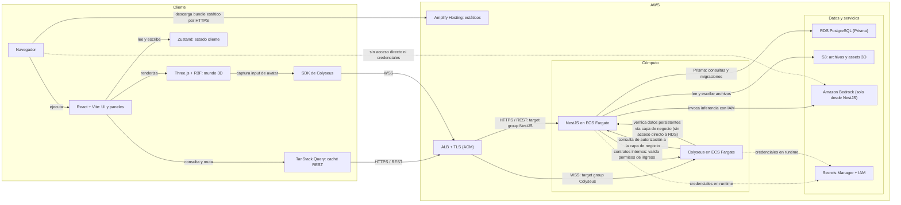
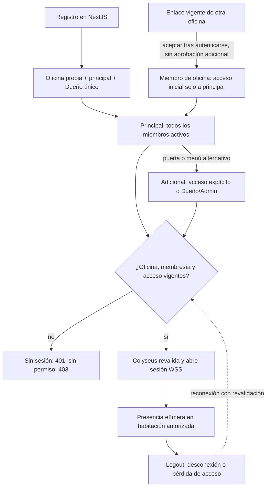
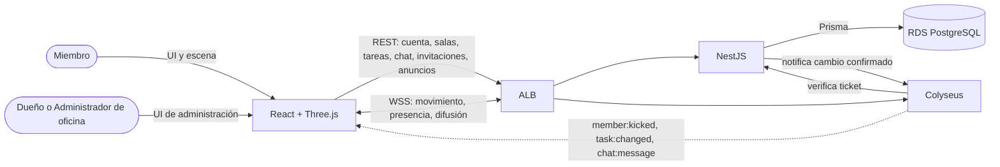

# Arquitectura y comunicación

> Cómo se conectan frontend, NestJS y Colyseus, y quién es la autoridad de cada dato. Parte del [índice de diagramas](../README.md).

**En este archivo**

- [1. Conexiones frontend y backend](#1-conexiones-frontend-y-backend)
  - [1.1 Arquitectura de despliegue y comunicación](#11-arquitectura-de-despliegue-y-comunicación)
  - [1.2 Matriz de canales](#12-matriz-de-canales)
  - [1.3 Flujo de usuarios y salas](#13-flujo-de-usuarios-y-salas)
  - [1.4 Comunicación por actor](#14-comunicación-por-actor)

← [Casos de uso](../01-functional/use-cases.md) · [Índice](../README.md) · [Modelo de datos](../03-structural/data-model.md) →

---

## 1. Conexiones frontend y backend

Esta sección muestra cómo se comunican el frontend React y los dos servicios backend del producto, qué transporte corresponde a cada operación y quién es la autoridad de cada dato. Todo lo descrito es **diseño objetivo (to-be)**: el repositorio solo contiene documentación y no hay código de aplicación implementado ([estado del repositorio](../../../README.md)), así que no existen todavía endpoints, DTOs ni eventos definitivos. Los nombres de eventos que aparecen son ilustrativos y los puntos marcados como **(propuesto)** dependen de documentación que aún no existe.

### 1.1 Arquitectura de despliegue y comunicación

**Autoridad de cada dato**

| Dato | Autoridad | Persistencia | Transporte |
|---|---|---|---|
| Credenciales y sesión | NestJS valida credenciales y gestiona la sesión con expiración | `Session` en RDS; hash con Argon2 o bcrypt | HTTPS / REST |
| Oficinas, membresías y habitaciones | NestJS | `Office`, `OfficeMember`, `Room`, accesos y liderazgo | HTTPS / REST |
| Tareas | NestJS | `Task` en RDS, asociada a la sala | HTTPS / REST; difusión WSS a la sala tras confirmar |
| Historial de mensajes | NestJS | `Message` en RDS | HTTPS / REST |
| Posición y presencia de avatares | Colyseus, como estado de la `Room` activa | Efímera; no se escriben posiciones por fotograma | WSS |
| Estado de objetos de sala | NestJS confirma la operación; Colyseus la difunde | `RoomItem` en RDS | HTTPS / REST + difusión WSS |
| Repaso diario | NestJS, con Bedrock solo del lado servidor | `DailyReviewDelivery` por usuario y fecha, zona `America/Argentina/Buenos_Aires` | HTTPS / REST en la primera conexión autenticada del día |

> **Lectura del diagrama.** El navegador solo tiene dos canales de aplicación hacia AWS: HTTPS/REST hacia el `target group` de NestJS y WSS hacia el de Colyseus, ambos a través del ALB con TLS ([documento maestro](../../../master-document.md)). Bedrock se invoca únicamente desde NestJS con permisos IAM ([documento maestro](../../../master-document.md)); la arista punteada hacia Bedrock marca justamente que el cliente no tiene acceso directo. RDS es la base relacional persistente: la escriben NestJS con Prisma y, para verificar datos, Colyseus a través de la capa de negocio ([documento maestro](../../../master-document.md)). Una sala del producto en PostgreSQL no equivale a una instancia `Room` de Colyseus ([documento maestro](../../../master-document.md)).

> **Huecos declarados.** El mecanismo de sesión (JWT, cookie, duración, refresh, revocación) no está especificado. Los permisos funcionales están definidos en la [ERS](../../functional-requirements.md#3-permisos); los detalles de sesión, contratos internos y duraciones concretas siguen propuestos. El acceso de habitación se deriva de membresía y acceso/liderazgo, no de un enum público/privado inventado.

### 1.2 Matriz de canales

| Operación | Origen | Destino | Transporte | Autorización | Persiste |
|---|---|---|---|---|---|
| Registro, login, roles | Usuario en el navegador | NestJS | HTTPS / REST | Credenciales validadas en el servidor; 401 si faltan o son inválidas | RDS PostgreSQL, entidad `Session` |
| CRUD de tareas, salas y reuniones | Panel React | NestJS | HTTPS / REST | Sesión válida y permiso sobre la sala; 403 sin permisos según matriz de la ERS | RDS PostgreSQL |
| Historial de mensajes | Cliente | NestJS | HTTPS / REST | Membresía activa de oficina; además acceso vigente para canal de habitación | RDS PostgreSQL, entidad `Message` |
| Posición de avatares y presencia | Cliente | Colyseus | WSS | Identidad verificable y autorización de la sala | Efímero, estado de `Room` |
| Entrada, salida y reconexión | Cliente | Colyseus | Solicitud previa HTTPS y sesión WSS | Colyseus valida identidad y autorización con NestJS antes de vincular la sesión | Efímero, con verificación de permisos |
| Estado persistente de objetos | Cliente | NestJS y luego Colyseus | HTTPS / REST + difusión WSS | Acceso de habitación verificado en NestJS; difusión solo a destinatarios autorizados | RDS PostgreSQL (`RoomItem`) + difusión efímera |
| Notificación de cambio en sala activa | Colyseus, tras confirmar la operación | Clientes conectados a la sala | WSS | Canal ya autorizado al ingresar a la sala | Efímero |
| Consultas y resúmenes del bot | Cliente | NestJS y Bedrock | HTTPS; notificación privada si corresponde | Solo lectura, con permisos del usuario (RN-18) | Entrega del repaso, no cambios de tareas/reuniones |
| Mensajería en vivo | Cliente → NestJS → Colyseus → destinatarios autorizados | REST para envío y WSS para difusión (propuesto) | Canal de oficina o habitación seleccionado; acceso vigente | Mensaje persistido antes de difusión |

> **Huecos declarados.** No hay catálogo de endpoints, verbos ni DTOs; los eventos (`avatar:input`, `avatar:state`, `presence:changed`, `room:joined`, `chat:message`, `task:changed`, `meeting:announced`, `bot:summary-ready`) son ilustrativos y no definitivos ([documento maestro](../../../master-document.md)). Tampoco están especificados el orden ni la deduplicación de mensajes, los payloads, los acknowledgements ni los namespaces.

### 1.3 Flujo de usuarios y salas

> **Notas del flujo.** RN-01 a RN-11: una oficina propia por registro, principal no eliminable, hasta 5 adicionales. Dueño/Admin crean habitaciones; Líder gestiona acceso solo a miembros ya existentes. La invitación tiene vencimiento y revocación, y límite opcional de usos (RF-OFI-005); aceptar un enlace no requiere aprobación posterior. Solicitud de ingreso es Evolución (RF-OFI-018), no camino obligatorio del MVP. No hay sala general global. Tickets y handshake son propuestas; en Colyseus se expresan principios de autenticación/autorización, no códigos HTTP obligatorios.

### 1.4 Comunicación por actor

La asimetría es intencional: **el cliente escribe por REST y escucha por WSS**. Los mensajes de movimiento y ciclo de conexión viajan por WSS; los mensajes de chat se envían por REST en esta propuesta y se difunden por WSS. El canal de oficina llega a sus miembros autorizados aunque estén en distintas habitaciones (RF-CHA-001/005); no se presupone un único socket de habitación para todos los canales. Suscripción, enrutamiento y reconexión de esos canales requieren contrato técnico. Un resumen personal del bot se envía solo a su usuario, nunca a toda la habitación.

---

← [Casos de uso](../01-functional/use-cases.md) · [Índice](../README.md) · [Modelo de datos](../03-structural/data-model.md) →
