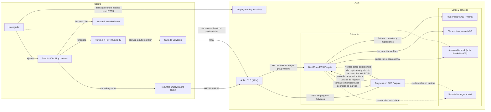
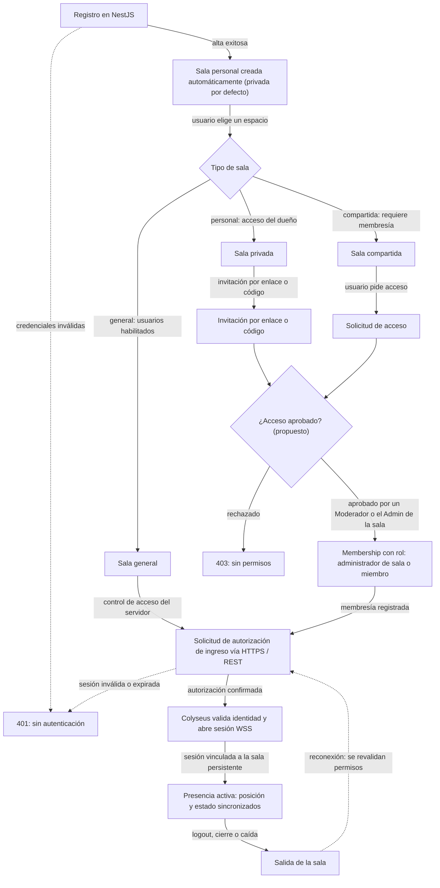
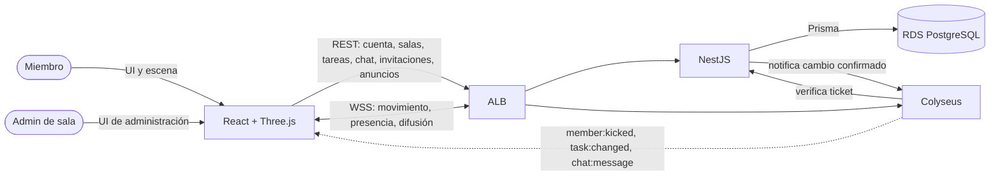

# Arquitectura y comunicación

> Cómo se conectan frontend, NestJS y Colyseus, y quién es la autoridad de cada dato. Parte del [índice de diagramas](../README.md).

**En este archivo**

- [1. Conexiones frontend y backend](#1-conexiones-frontend-y-backend)
  - [1.1 Arquitectura de despliegue y comunicación](#11-arquitectura-de-despliegue-y-comunicación)
  - [1.2 Matriz de canales](#12-matriz-de-canales)
  - [1.3 Flujo de usuarios y salas](#13-flujo-de-usuarios-y-salas)
  - [1.4 Comunicación por actor](#14-comunicación-por-actor)

← [Casos de uso](../01-functional/use-cases.md) · [Índice](../README.md) · [Modelo de datos](../03-structural/data-model.md) →

---

## 1. Conexiones frontend y backend

Esta sección muestra cómo se comunican el frontend React y los dos servicios backend del producto, qué transporte corresponde a cada operación y quién es la autoridad de cada dato. Todo lo descrito es **diseño objetivo (to-be)**: el repositorio solo contiene documentación y no hay código de aplicación implementado (`README.md:3`), así que no existen todavía endpoints, DTOs ni eventos definitivos. Los nombres de eventos que aparecen son ilustrativos y los puntos marcados como **(propuesto)** dependen de documentación que aún no existe.

### 1.1 Arquitectura de despliegue y comunicación

**Autoridad de cada dato**

| Dato | Autoridad | Persistencia | Transporte |
|---|---|---|---|
| Credenciales y sesión | NestJS valida credenciales y gestiona la sesión con expiración | `Session` en RDS; hash con Argon2 o bcrypt | HTTPS / REST |
| Salas y membresías | NestJS | `Room` y `Membership` en RDS | HTTPS / REST |
| Tareas | NestJS | `Task` en RDS, asociada a la sala | HTTPS / REST; difusión WSS a la sala tras confirmar |
| Historial de mensajes | NestJS | `Message` en RDS | HTTPS / REST |
| Posición y presencia de avatares | Colyseus, como estado de la `Room` activa | Efímera; no se escriben posiciones por fotograma | WSS |
| Estado de objetos de sala | NestJS confirma la operación; Colyseus la difunde | `RoomItem` en RDS | HTTPS / REST + difusión WSS |
| Repaso diario | NestJS, con Bedrock solo del lado servidor | `DailyReviewDelivery` por usuario y fecha, zona `America/Argentina/Buenos_Aires` | HTTPS / REST en la primera conexión autenticada del día |

> **Lectura del diagrama.** El navegador solo tiene dos canales de aplicación hacia AWS: HTTPS/REST hacia el `target group` de NestJS y WSS hacia el de Colyseus, ambos a través del ALB con TLS (`master-document.md:269,280-282`). Bedrock se invoca únicamente desde NestJS con permisos IAM (`master-document.md:273,293`); la arista punteada hacia Bedrock marca justamente que el cliente no tiene acceso directo. RDS es la base relacional persistente: la escriben NestJS con Prisma y, para verificar datos, Colyseus a través de la capa de negocio (`master-document.md:272,281`). Una sala del producto en PostgreSQL no equivale a una instancia `Room` de Colyseus (`master-document.md:35`).

> **Huecos declarados.** El mecanismo de sesión (JWT, cookie, duración, refresh, revocación) no está especificado. La matriz de permisos por rol se delega a `rules/rooms-and-permissions.md`, archivo que no existe. Los valores de visibilidad de una sala y el contrato exacto del repaso diario tampoco están definidos (`master-document.md:121`).

### 1.2 Matriz de canales

| Operación | Origen | Destino | Transporte | Autorización | Persiste |
|---|---|---|---|---|---|
| Registro, login, roles | Usuario en el navegador | NestJS | HTTPS / REST | Credenciales validadas en el servidor; 401 si faltan o son inválidas | RDS PostgreSQL, entidad `Session` |
| CRUD de tareas, salas y reuniones | Panel React | NestJS | HTTPS / REST | Sesión válida y permiso sobre la sala; 403 sin permisos (matriz por rol no definida) | RDS PostgreSQL |
| Historial de mensajes | Cliente | NestJS | HTTPS / REST | Membresía en la sala verificada en el servidor | RDS PostgreSQL, entidad `Message` |
| Posición de avatares y presencia | Cliente | Colyseus | WSS | Identidad verificable y autorización de la sala | Efímero, estado de `Room` |
| Entrada, salida y reconexión | Cliente | Colyseus | Solicitud previa HTTPS y sesión WSS | Colyseus valida identidad y autorización con NestJS antes de vincular la sesión | Efímero, con verificación de permisos |
| Estado persistente de objetos | Cliente | NestJS y luego Colyseus | HTTPS / REST + difusión WSS | Membresía verificada en NestJS; la difusión va solo a la sala | RDS PostgreSQL (`RoomItem`) + difusión efímera |
| Notificación de cambio en sala activa | Colyseus, tras confirmar la operación | Clientes conectados a la sala | WSS | Canal ya autorizado al ingresar a la sala | Efímero |
| Consultas y acciones del bot | Cliente | NestJS y Bedrock | HTTPS, con eventos si se requiere actualización en vivo | Sesión válida y permisos contextuales; el bot no elude las reglas de acceso | Acciones persistidas mediante herramientas del servidor |
| Mensajería en vivo | Cliente | Colyseus | WSS por defecto | Membresía en la sala activa | Efímero; el historial se recupera por REST |

> **Huecos declarados.** No hay catálogo de endpoints, verbos ni DTOs; los eventos (`avatar:input`, `avatar:state`, `presence:changed`, `room:joined`, `chat:message`, `task:changed`, `meeting:announced`, `bot:summary-ready`) son ilustrativos y no definitivos (`master-document.md:207`). Tampoco están especificados el orden ni la deduplicación de mensajes, los payloads, los acknowledgements ni los namespaces.

### 1.3 Flujo de usuarios y salas

> **Notas del flujo.** La sala personal se crea al registrar el usuario y es privada por defecto; persiste sin presencia (`master-document.md:30,31,26`). La invitación puede ser por enlace o código, pero su formato y expiración no están especificados (`master-document.md:33`). La solicitud de ingreso está contemplada y figura como funcionalidad complementaria, no de MVP (`master-document.md:87,331`); su aprobación, expulsión y el detalle de la verificación en sala general están marcados como **(propuesto)**. Los rechazos se expresan como 401 sin autenticación y 403 sin permisos; en Colyseus aplican los mismos principios sin códigos HTTP equivalentes (`master-document.md:219`).

### 1.4 Comunicación por actor

La asimetría es intencional: **el cliente escribe por REST y escucha por WSS**. El único mensaje cliente → Colyseus es `avatar:input`; el resto del flujo WSS es servidor → cliente.

---

← [Casos de uso](../01-functional/use-cases.md) · [Índice](../README.md) · [Modelo de datos](../03-structural/data-model.md) →
