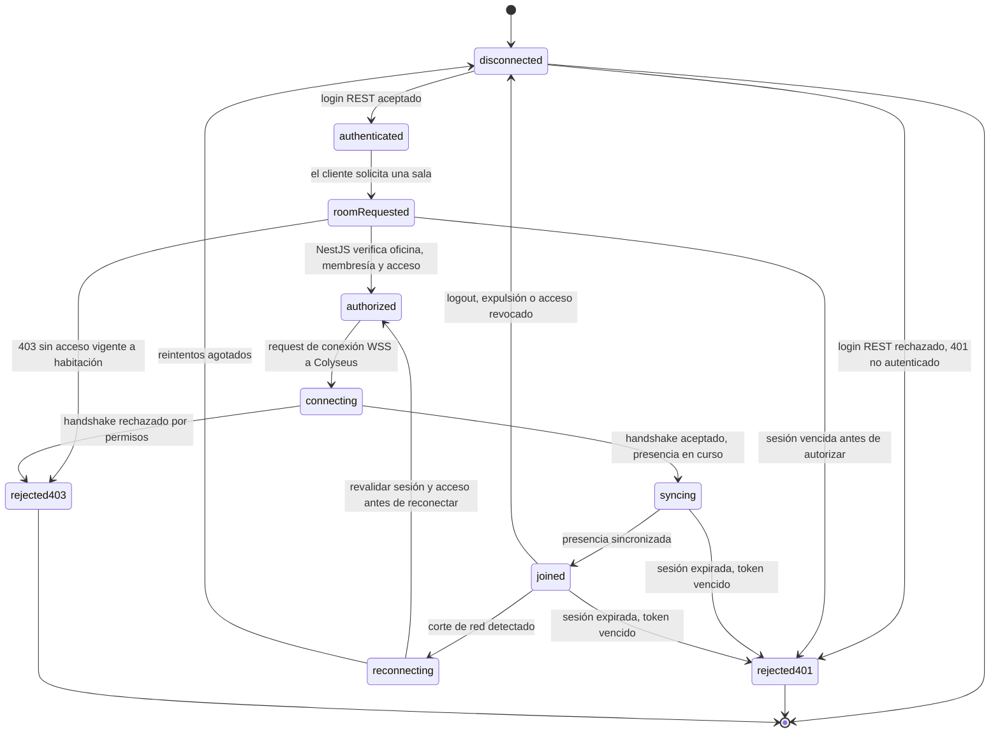
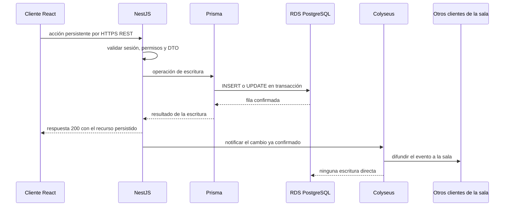

# Realtime: WebSockets y Colyseus

> Ciclo de conexión, eventos y la regla de consistencia entre REST y WSS. Parte del [índice de diagramas](../README.md).

**En este archivo**

- [1. WebSockets y Colyseus](#1-websockets-y-colyseus)
  - [1.1 Ciclo de conexión](#11-ciclo-de-conexión)
  - [1.2 Catálogo de eventos](#12-catálogo-de-eventos)
  - [1.3 Regla de consistencia y autoridad](#13-regla-de-consistencia-y-autoridad)
  - [1.4 Eventos adicionales de administración](#14-eventos-adicionales-de-administración)

← [Modelo de datos](../03-structural/data-model.md) · [Índice](../README.md) · [Clases por capa](../03-structural/class-design.md) →

---

## 1. WebSockets y Colyseus

El sistema tiene dos planos de comunicación con responsabilidades disjuntas. Todo lo que debe sobrevivir a la sesión —usuarios, sesiones, salas, membresías, tareas, mensajes, reuniones, configuración de avatar— viaja por REST/HTTPS hacia NestJS y termina en Amazon RDS for PostgreSQL ([documento maestro](../../../master-document.md)). Lo efímero —posición de avatares, presencia, entrada y salida, notificaciones a la sala activa, mensajería en vivo— viaja por WSS sobre Colyseus ([documento maestro](../../../master-document.md)). La regla que une ambos planos es una sola: toda acción persistente se envía a NestJS, se valida y se guarda en RDS, y **recién entonces** se notifica a los clientes conectados a la sala mediante Colyseus ([documento maestro](../../../master-document.md)). Colyseus nunca es la autoridad de un dato persistente y nunca escribe en la base ([documento maestro](../../../master-document.md)). Socket.IO existe como recurso puntual y no sustituye a Colyseus ([documento maestro](../../../master-document.md)); el MVP asume una única instancia de Colyseus, y escalarla exige estrategia de presencia, matchmaking, ruteo y reconexión ([documento maestro](../../../master-document.md)).

Conviene separar dos conceptos que el documento distingue explícitamente: una sala del producto almacenada en PostgreSQL no equivale necesariamente a una instancia `Room` de Colyseus ([documento maestro](../../../master-document.md)). El identificador persistente de la sala es el que manda; la instancia de Colyseus es un objeto en memoria, descartable, que se recrea al sincronizar.

### 1.1 Ciclo de conexión

El ciclo arranca con el login REST y termina en una de tres salidas: sesión activa, desconexión o rechazo. Los dos motivos de rechazo son los únicos códigos que el documento define: 401 sin autenticación y 403 sin permisos ([documento maestro](../../../master-document.md)).

Tres aclaraciones sobre el diagrama:

- Los dos motivos de 401 —credenciales ausentes al hacer login y token vencido durante una sesión activa— comparten el estado terminal `rejected401` para expresar una misma causa de rechazo; no hay límite funcional de estados. La diferencia queda en la transición que los origina.
- `authorized` no es un estado de Colyseus: es la verificación que hace el backend antes de habilitar el handshake ([documento maestro](../../../master-document.md)). Si esa verificación falla, no hay conexión WSS que abrir.
- El algoritmo de reconexión y el backoff no están especificados ([documento maestro](../../../master-document.md)). `reconnecting` existe como estado porque el ciclo lo contempla, pero su temporización es una propuesta, no un dato del documento.

### 1.2 Catálogo de eventos

Los nombres de la tabla son los ocho eventos que lista el documento fuente, más los que el ciclo de vida necesita. El documento los declara **ilustrativos y no definitivos** ([documento maestro](../../../master-document.md)), y no define payloads, direccionalidad, namespaces ni acknowledgements ([documento maestro](../../../master-document.md)). Por lo tanto, nombres, direcciones y payloads de esta tabla son **propuesta**.

| Evento | Dirección | Disparador | Payload mínimo | Persiste en PostgreSQL |
|---|---|---|---|---|
| `avatar:input` | cliente → servidor | intención de movimiento del jugador, WASD, clic a destino o táctil | `{ roomId, position, yaw }` | No |
| `avatar:state` | servidor → cliente | tick de simulación con la posición autoritativa del avatar | `{ userId, position, yaw, ts }` | No |
| `presence:changed` | servidor → cliente | un miembro entra, sale o cambia de estado dentro de la sala | `{ roomId, userId, status }` | No |
| `room:joined` | servidor → cliente | la sala aceptó al cliente y la presencia quedó sincronizada | `{ roomId, userId, sessionId }` | No |
| `chat:message` | servidor → cliente | NestJS confirmó el `INSERT` del mensaje (enviado por REST) y Colyseus lo difunde a suscriptores autorizados del canal | `{ channelScope, messageId, body, sentAt }` | Indirecto (vía NestJS) |
| `task:changed` | servidor → cliente | NestJS confirmó una escritura de `Task` y pide notificar la sala | `{ roomId, taskId, revision }` | Indirecto (vía NestJS) |
| `meeting:announced` | servidor → cliente | se publicó una reunión o anuncio en la sala | `{ roomId, meetingId, title, scheduledAt }` | Indirecto (vía NestJS) |
| `bot:summary-ready` | servidor → cliente | repaso generado con Bedrock o fallback, solo al usuario destinatario | `{ userId, deliveryId, summary }` | Indirecto (vía NestJS) |
| `room:left` | bidireccional | el cliente abandona la sala o el servidor lo saca por fin de sesión | `{ roomId, userId }` | No |
| `room:reconnecting` | bidireccional | se detectó un corte y comienza el intento de reconexión | `{ roomId, userId, attempt }` | No |
| `room:reconnected` | servidor → cliente | la reconexión se completó y la presencia volvió a sincronizarse | `{ roomId, userId }` | No |
| `room:error` | servidor → cliente | fallo de autorización, sesión vencida o error de sala | `{ roomId, code, reason }` | No |

> **Nota:** los payloads de la columna "Payload mínimo" son una **propuesta de trabajo**, no un dato del documento fuente: [documento maestro](../../../master-document.md) declara los eventos como ilustrativos y deja explícitamente sin definir payloads, direccionalidad, namespaces y acknowledgements. `channelScope` identifica oficina o habitación, sin permitir suscribir canales ajenos; no es una forma de payload aprobada. RN-03 y RF-CHA-007 exigen revalidar acceso, también al recuperar historial. RF-MUN-010 permite ver quién está en qué habitación de la oficina, sin conceder acceso a sus contenidos. Ningún evento de esta tabla escribe por sí mismo en PostgreSQL; lo que persiste —historial de mensajes, tareas, reuniones, el marcador del repaso diario— se guarda por REST en NestJS antes de emitir el evento, y por eso la columna dice "Indirecto (vía NestJS)". El tick rate exacto del movimiento tampoco está especificado.

### 1.3 Regla de consistencia y autoridad

Se ilustra el camino REST propuesto, seguido de difusión después del commit. La autoridad de persistencia es NestJS; el transporte de envío del chat sigue abierto entre REST y un mensaje realtime validado y procesado por NestJS, según [Communication](../../../rules/communication-and-meetings.md#chat). El ejemplo no descarta esa alternativa ni duplica la [regla de arquitectura](../../../rules/architecture.md#integration-between-nestjs-and-colyseus).

Dos hechos que el diagrama deja fijados, y que son la regla completa ([documento maestro](../../../master-document.md)):

- **Colyseus no escribe en RDS.** No tiene camino de escritura a la base; si el plano realtime se cae, la escritura ya ocurrió igual.
- **La difusión va después de la confirmación.** El cliente que originó la acción recibe su respuesta REST cuando RDS confirmó, no cuando Colyseus difundió. Los demás clientes de la sala reciben el evento solo después de esa confirmación, de modo que nunca observan un cambio que la base todavía no aceptó.

Reglas operativas:

1. **Autoridad única de escritura:** NestJS, con Prisma como único acceso a RDS. Colyseus no persiste nada y no puede promover un estado efímero a persistente por su cuenta ([documento maestro](../../../master-document.md)).
2. **Nunca se persiste lo efímero:** posición por fotograma, posiciones transitorias, conexiones activas, presencia y estados interpolados no son filas de la base ([documento maestro](../../../master-document.md)).
3. **Si Colyseus está caído, REST sigue siendo correcto:** la acción se valida y se guarda igual, solo se pierde la difusión. La fuente de verdad es RDS; el documento no define cómo se recuperan los eventos perdidos, así que la recuperación de notificaciones perdidas es obligatoria según [Architecture](../../../rules/architecture.md#integration-between-nestjs-and-colyseus); su protocolo concreto sigue abierto.
4. **Si la difusión falla después de escribir, la escritura no se revierte:** ya está confirmada en RDS y el fallo es del plano efímero. No hay garantía de entrega exacta ni de deduplicación definida; recuperar el cambio es obligatorio según [Architecture](../../../rules/architecture.md#integration-between-nestjs-and-colyseus), con mecanismo concreto por definir.
5. **La autorización se verifica siempre en el servidor:** Colyseus valida sesión, oficina activa, membresía y acceso vigente antes de unir o reconectar al cliente ([documento maestro](../../../master-document.md)), y ni el cliente ni Colyseus deciden permisos por su cuenta ([documento maestro](../../../master-document.md)).

### 1.4 Eventos adicionales de administración

Extienden el [catálogo de la 04-realtime §1.2](#12-catálogo-de-eventos). Todos son servidor → cliente y se emiten **después** de confirmar la escritura en NestJS.

| Evento | Destino de la difusión | Disparador | Payload mínimo | Persiste en PostgreSQL |
|---|---|---|---|---|
| `member:joined` | Oficina autorizada | UC-08 creó/reactivó `OfficeMember`; UC-23 es Evolución | `{ roomId, userId }` | Indirecto (vía NestJS) |
| `member:role-changed` | Oficina autorizada | UC-24 | `{ officeId, userId, role }` | Indirecto (vía NestJS) |
| `member:kicked` | Usuario expulsado, luego oficina autorizada | UC-25 | `{ roomId, userId, reason }` | Indirecto (vía NestJS) |
| `joinrequest:created` | Dueño/Admin de oficina; Evolución | UC-09 | `{ officeId, requestId, userId }` | Indirecto (vía NestJS) |
| `invitation:revoked` | Dueño/Admin de oficina | UC-22 | `{ officeId, invitationId }` | Indirecto (vía NestJS) |
| `room:settings-changed` | Sala | UC-21 o UC-27 | `{ roomId, revision }` | Indirecto (vía NestJS) |

Socket.IO está excluido del MVP según [Realtime and presence](../../../rules/realtime-and-presence.md#scaling-and-deployment); cualquier uso requiere justificación independiente y no sustituye a Colyseus. La entrega por oficina/habitación/usuario necesita contratos de suscripción y revocación explícitos, no difusión indiscriminada a toda Room.

---

← [Modelo de datos](../03-structural/data-model.md) · [Índice](../README.md) · [Clases por capa](../03-structural/class-design.md) →
