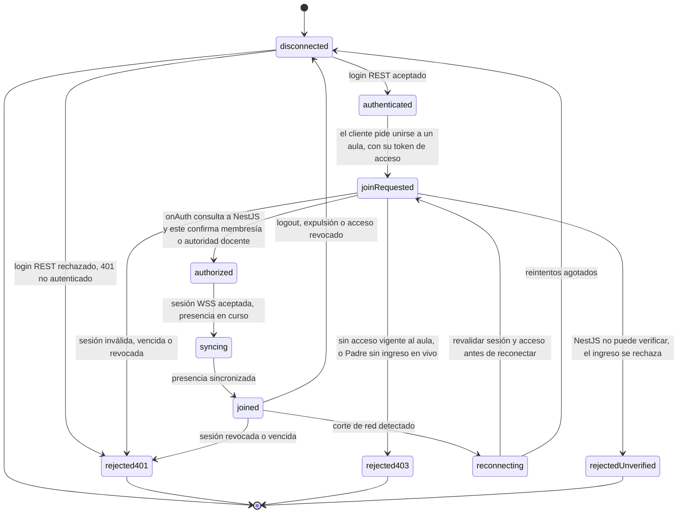
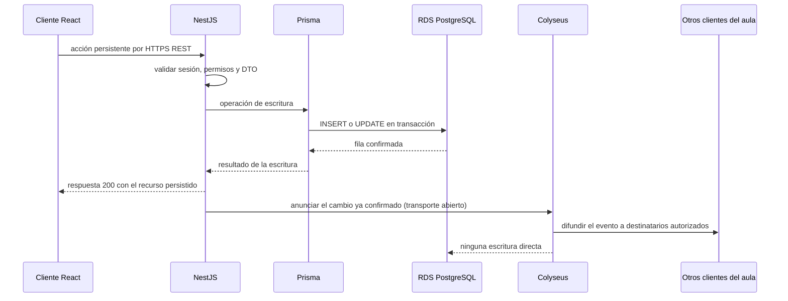

# Realtime: WebSockets y Colyseus

> Ciclo de conexión, eventos y la regla de consistencia entre REST y WSS. Parte del [índice de diagramas](../README.md).

**En este archivo**

- [1. WebSockets y Colyseus](#1-websockets-y-colyseus)
  - [1.1 Ciclo de conexión](#11-ciclo-de-conexión)
  - [1.2 Catálogo de eventos](#12-catálogo-de-eventos)
  - [1.3 Regla de consistencia y autoridad](#13-regla-de-consistencia-y-autoridad)
  - [1.4 Eventos de controles de aula](#14-eventos-de-controles-de-aula)
  - [1.5 Decisiones abiertas](#15-decisiones-abiertas)

← [Modelo de datos](../03-structural/data-model.md) · [Índice](../README.md) · [Clases por capa](../03-structural/class-design.md) →

---

## 1. WebSockets y Colyseus

Todo lo descrito es **diseño propuesto**, no implementado. El sistema tiene dos planos de comunicación con responsabilidades disjuntas. Todo lo que debe sobrevivir a la sesión —usuarios, sesiones, escuelas, aulas, membresías, actividades, calificaciones, mensajes, configuración de avatar— viaja por REST/HTTPS hacia NestJS y termina en Amazon RDS for PostgreSQL ([documento maestro](../../../master-document.md#62-canales-y-propiedad-de-los-datos)). Lo efímero —posición de avatares, presencia, congelamiento, entrada y salida, notificaciones al aula activa— viaja por WSS sobre Colyseus. La regla que une ambos planos es una sola: toda acción persistente se envía a NestJS, se valida y se guarda en RDS, y **recién entonces** se notifica a los clientes conectados al aula mediante Colyseus ([Architecture](../../../rules/architecture.md)). Colyseus nunca es la autoridad de un dato persistente y no accede a la base. Socket.IO está excluido del MVP y no sustituye a Colyseus; el MVP corre una única instancia de Colyseus, y escalarla exige estrategia de presencia, matchmaking, ruteo y reconexión ([Realtime and presence](../../../rules/realtime-and-presence.md#scaling-and-deployment)).

Conviene separar dos conceptos: un aula (`Classroom`) almacenada en PostgreSQL no es una `Room` de Colyseus. La `Room` es una sesión en memoria, descartable, que se puede crear, destruir y recrear sin perder datos del producto. El servidor controla la correspondencia: una `Room` pertenece a exactamente un aula persistente, y ningún identificador enviado por el cliente la establece. Usuarios de aulas o escuelas distintas nunca comparten una `Room`.

### 1.1 Ciclo de conexión

El ciclo arranca con el login REST y termina en una de tres salidas: sesión activa, desconexión o rechazo. Los motivos de rechazo siguen los principios de `401` (sin autenticación) y `403` (sin permiso); un aula ajena responde `404` sin revelar su existencia ([Realtime and presence](../../../rules/realtime-and-presence.md#join-authorization)). El Padre no tiene acceso en vivo al aula 3D y recibe rechazo de ingreso.

Tres aclaraciones sobre el diagrama:

- `authorized` no es un estado de Colyseus: es el resultado del `onAuth`, que llama a un endpoint interno de NestJS autenticado con un secreto de servicio guardado en AWS Secrets Manager. Si NestJS no puede verificar, Colyseus rechaza el ingreso (decisión D2, aprobada por Agustín el 2026-11-02, [justificación técnica](../../technical-justification.md#d2-nestjs-and-colyseus-integration)). La respuesta proviene del estado persistido vigente, nunca de afirmaciones del cliente. Desde la actualización del 2026-11-09 de D2, el cliente envía el token de acceso con el SDK (`client.auth.token`), que viaja como `Authorization: Bearer` en la petición de matchmaking y llega a `onAuth` como `token`; las opciones de ingreso solo llevan `classroomId`. `onAuth` llama a `POST /internal/realtime/join-verification` con el encabezado `x-internal-service-secret` y rechaza ante cualquier fallo (falla cerrada). Las credenciales de ingreso no se escriben en logs.
- El identificador de sesión viaja en el token de acceso y NestJS lo contrasta con la sesión guardada (D1); una sesión revocada produce `401`. `rejectedUnverified` agrupa el rechazo por imposibilidad de verificar y se trata como rechazo, no como admisión provisoria.
- La ventana de reconexión y el backoff son **abiertos**: `reconnecting` existe como estado porque el ciclo lo contempla, pero su temporización no está decidida y debe quedar acotada ([Realtime and presence](../../../rules/realtime-and-presence.md#reconnection-and-disconnection)). La reconexión repite la autorización y no restaura acceso perdido; el logout cierra las conexiones vivas.

### 1.2 Catálogo de eventos

Los nombres parten de los eventos ilustrativos del [documento maestro](../../../master-document.md#62-canales-y-propiedad-de-los-datos) y de [Realtime and presence](../../../rules/realtime-and-presence.md), más los que el ciclo de vida necesita. Se declaran **ilustrativos y no definitivos**; nombres, direcciones y payloads de esta tabla son **propuesta** hasta especificarse en [API contracts](../../../rules/api-contracts.md).

| Evento | Dirección | Disparador | Payload mínimo | Persiste en PostgreSQL |
|---|---|---|---|---|
| `avatar:input` | cliente → servidor | intención de movimiento, WASD, clic a destino o táctil | `{ position, yaw }` | No |
| `avatar:state` | servidor → cliente | simulación con la posición autoritativa del avatar | `{ userId, position, yaw, ts }` | No |
| `presence:changed` | servidor → cliente | un miembro entra, sale o cambia de estado dentro del aula | `{ classroomId, userId, status }` | No |
| `classroom:joined` | servidor → cliente | el aula aceptó al cliente y la presencia quedó sincronizada | `{ classroomId, userId }` | No |
| `chat:message` | servidor → cliente | NestJS confirmó el `INSERT` del mensaje y Colyseus lo difunde a destinatarios autorizados | `{ classroomId, messageId, body, sentAt }` | Indirecto (vía NestJS) |
| `chat:muted` | servidor → cliente | el profesor silenció o reactivó el chat; NestJS persistió el estado | `{ classroomId, muted }` | Indirecto (vía NestJS) |
| `activity:published` | servidor → cliente | NestJS confirmó la publicación de una actividad | `{ classroomId, activityId }` | Indirecto (vía NestJS) |
| `grade:published` | servidor → cliente | NestJS confirmó una calificación; solo al alumno afectado | `{ userId, submissionId }` | Indirecto (vía NestJS) |
| `notification:created` | servidor → cliente | NestJS creó una notificación para un usuario | `{ userId, notificationId }` | Indirecto (vía NestJS) |
| `bot:summary-ready` | servidor → cliente | repaso diario generado con Bedrock o con alternativa estructurada, solo al usuario destinatario | `{ userId, deliveryId }` | Indirecto (vía NestJS) |
| `classroom:left` | bidireccional | el cliente abandona el aula o el servidor lo saca por fin de sesión | `{ classroomId, userId }` | No |
| `classroom:error` | servidor → cliente | fallo de autorización, sesión vencida o error del aula | `{ classroomId, code, reason }` | No |

> **Nota:** la columna "Payload mínimo" es una **propuesta de trabajo**. Los mensajes del cliente se validan en forma, tipo, tamaño y frecuencia; el rol, los permisos y la identidad provienen de la sesión autenticada, nunca del payload. Los tipos desconocidos se ignoran o rechazan sin efectos. El servidor valida la plausibilidad del movimiento (límites, colisiones, velocidad) y rechaza todo movimiento de un avatar congelado. Ningún evento de esta tabla escribe por sí mismo en PostgreSQL; lo que persiste —mensajes, calificaciones, avisos, el marcador del repaso diario— se guarda por REST en NestJS antes de emitir el evento, y por eso la columna dice "Indirecto (vía NestJS)". La lista de presencia solo muestra usuarios de la misma aula. Tick rate, reconciliación y límites por conexión están **abiertos**. No se registran en logs posiciones por fotograma ni contenido de mensajes ([Observability and privacy](../../../rules/observability-and-privacy.md)).

### 1.3 Regla de consistencia y autoridad

Se ilustra el camino REST propuesto, seguido de difusión después del commit. La autoridad de persistencia es NestJS; el transporte de envío del chat sigue **abierto** entre REST y un mensaje realtime validado y procesado por NestJS, según [Communication](../../../rules/communication-and-notifications.md#classroom-chat). El ejemplo no descarta esa alternativa ni duplica la [regla de arquitectura](../../../rules/architecture.md#integration-between-nestjs-and-colyseus).

Dos hechos que el diagrama deja fijados, y que son la regla completa:

- **Colyseus no accede a RDS.** No tiene camino de lectura ni de escritura a la base; obtiene autorización y datos persistentes a través de NestJS. Si el plano realtime se cae, la escritura ya ocurrió igual.
- **La difusión va después de la confirmación.** El cliente que originó la acción recibe su respuesta REST cuando RDS confirmó, no cuando Colyseus difundió. Los demás clientes reciben el evento solo después de esa confirmación.

Reglas operativas:

1. **Autoridad única de escritura:** NestJS, con Prisma como único acceso a RDS. Colyseus no persiste nada y no puede promover un estado efímero a persistente por su cuenta.
2. **Nunca se persiste lo efímero:** posición, orientación, estado de presencia, asignación de pupitre, bloqueo de congelamiento y conexiones no son filas de la base. El tiempo conectado se informa a NestJS como agregado, no por tick ([Activities and grading](../../../rules/activities-and-grading.md)).
3. **Si Colyseus está caído, REST sigue siendo correcto:** la acción se valida y se guarda igual, solo se pierde la difusión. La recuperación de notificaciones perdidas es obligatoria según [Architecture](../../../rules/architecture.md#integration-between-nestjs-and-colyseus): REST es la fuente de verdad y los clientes se reconcilian por ahí; el protocolo concreto sigue **abierto**.
4. **Si la difusión falla después de escribir, la escritura no se revierte:** ya está confirmada y el fallo es del plano efímero. No hay garantía de entrega exacta ni de deduplicación definida.
5. **La autorización se verifica siempre en el servidor:** NestJS confirma sesión y acceso vigente antes de unir o reconectar al cliente; ni el cliente ni Colyseus deciden permisos por su cuenta. Cuando el acceso cambia con el cliente conectado, el servidor lo retira de la `Room` y rechaza la reconexión; el mecanismo de propagación es **abierto**.
6. **Estado persistente que afecta al aula viva:** silencio de chat, bloqueo de colaboración y juegos deshabilitados los guarda NestJS, y Colyseus los recarga desde NestJS al crear la `Room` y en cada ingreso.

### 1.4 Eventos de controles de aula

Extienden el [catálogo de §1.2](#12-catálogo-de-eventos). Los mensajes de control (congelar, silenciar a todos, bloquear colaboración, deshabilitar juegos) solo se aceptan de quien NestJS confirmó con autoridad docente vigente sobre el aula (Profesor, o Dueño o Admin de la escuela); cualquier otro emisor se ignora sin efectos ([Live classroom tools](../../../rules/live-classroom-tools.md)). Los nombres siguen siendo ilustrativos.

| Evento | Destino de la difusión | Disparador | Estado | Persiste en PostgreSQL |
|---|---|---|---|---|
| `classroom:frozen` | Aula viva | el docente congela o descongela; cada alumno recibe un pupitre y queda bloqueado (el docente no) | Efímero; se aplica a ingresos y reconexiones posteriores | No |
| `classroom:collaboration-locked` | Aula viva | el docente bloquea o libera la colaboración | Estado de aula recargado desde NestJS | Indirecto (vía NestJS) |
| `classroom:games-changed` | Aula viva | el docente habilita o deshabilita minijuegos | Persistido por NestJS | Indirecto (vía NestJS) |
| `whiteboard:update` | Participantes permitidos por el bloqueo | edición del pizarrón, gráficos o LaTeX; tamaño y frecuencia acotados | Sin persistir por operación; mecanismo de sincronización abierto | No |
| `member:removed` | Usuario afectado, luego aula | baja lógica de un miembro (RN-18); el servidor lo retira de la `Room` | Indirecto (vía NestJS) | Indirecto (vía NestJS) |

El silenciar a todos se aplica además en los permisos del servicio de medios, no solo con el anuncio a los clientes. La entrega por aula o por usuario necesita contratos de suscripción y revocación explícitos, no difusión indiscriminada. Socket.IO está excluido del MVP según [Realtime and presence](../../../rules/realtime-and-presence.md#scaling-and-deployment); cualquier uso requiere justificación independiente y no sustituye a Colyseus.

### 1.5 Decisiones abiertas

Según [Realtime and presence](../../../rules/realtime-and-presence.md#open-decisions) y [Architecture](../../../rules/architecture.md#open-decisions):

| Tema | Estado |
|---|---|
| Tick rate, reconciliación de movimiento y valores de límite por conexión | abierto |
| Política de conexiones duplicadas y propagación de cambios de acceso a las `Room` vivas | abierto |
| Ventana de reconexión y backoff | abierto |
| Envío del chat por REST o por mensaje realtime | abierto |
| Mecanismo de sincronización colaborativa (estado de Colyseus o Yjs) | abierto |
| Transporte de anuncios de NestJS a Colyseus | abierto |
| Distribución de tipos de mensajes y estado realtime | resuelto en D8 (generados con `@colyseus/schema` codegen y `packages/contracts`, commiteados); rutas exactas por fijar en el bootstrap |
| Escalado de Colyseus más allá de una instancia | abierto |

---

← [Modelo de datos](../03-structural/data-model.md) · [Índice](../README.md) · [Clases por capa](../03-structural/class-design.md) →
