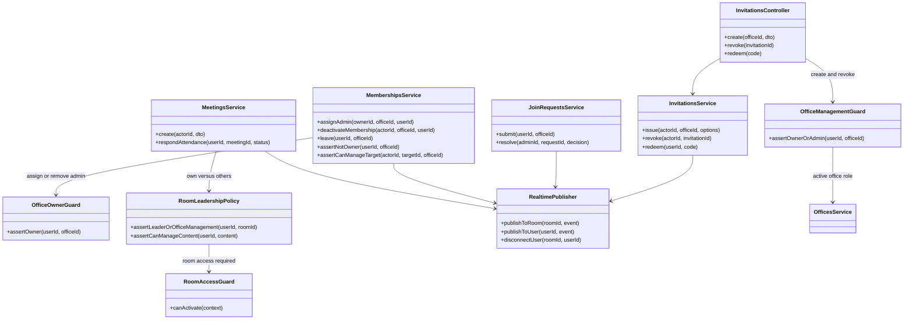

# Clases por capa

> Quién ejecuta cada responsabilidad en frontend, backend y realtime. Parte del [índice de diagramas](../README.md).

**En este archivo**

- [1. Clases del sistema](#1-clases-del-sistema)
  - [1.1 Clases por capa](#11-clases-por-capa)
  - [1.2 Clases adicionales](#12-clases-adicionales)

← [Realtime: WebSockets y Colyseus](../02-system-architecture/realtime-colyseus.md) · [Índice](../README.md) · [Secuencias del núcleo (S1 a S7)](../04-behavioral/core-flows.md) →

---

## 1. Clases del sistema

### 1.1 Clases por capa

Esta vista propone responsabilidades, no clases implementadas. Nombres, métodos, DTOs y guards son propuestas técnicas sujetas a la [ERS](../../functional-requirements.md). Se separan frontend previsto en Amplify, NestJS y Colyseus en ECS/Fargate, sin memoria compartida. La propiedad y distribución de contratos entre repositorios sigue pendiente.

```mermaid
classDiagram
  namespace Frontend {
    class ApiClient {
      +get(path)
      +post(path, body)
      +patch(path, body)
      +delete(path)
    }
    class AuthStore {
      +login(credentials)
      +logout()
      +isAuthenticated()
    }
    class RoomStore {
      +setActiveRoom(roomId)
      +setActiveOffice(officeId)
    }
    class ColyseusClient {
      +connect(roomId, token)
      +send(type, payload)
      +onStateChange(callback)
      +disconnect()
    }
    class SceneController {
      +mount(canvas)
      +tick(delta)
      +dispose()
    }
    class InteractionController {
      +pick(pointer)
      +requestMove(target)
      +interact(itemId)
    }
    class TaskPanel {
      +open(taskId)
      +submit(task)
      +move(taskId, columnId)
    }
    class ChatPanel {
      +loadHistory(channelScope)
      +send(channelScope, body)
      +onMessage(event)
    }
    class BotPanel {
      +ask(prompt)
      +renderSummary(delivery)
    }
  }

  namespace Backend {
    class AuthController {
      +login(dto)
      +logout(sessionId)
      +me()
    }
    class AuthService {
      +validateCredentials(dto)
      +issueSession(user)
      +validateSession(token)
      +revokeSession(sessionId)
    }
    class RoomsController {
      +list()
      +get(roomId)
      +create(dto)
      +join(roomId)
    }
    class OfficesService {
      +createOwnOfficeWithMainRoom(userId)
      +assertActiveMembership(userId, officeId)
      +listForUser(userId)
      +deactivate(ownerId, officeId)
      +restore(ownerId, officeId)
    }
    class RoomAccessService {
      +assertAccess(userId, roomId)
      +grantToExistingMember(actorId, memberId, roomId)
      +revokeAndMarkOrphans(actorId, memberId, roomId)
    }
    class RoomsService {
      +createAdditionalRoom(actorId, officeId, dto)
      +listForUser(userId)
      +snapshot(roomId)
    }
    class TasksController {
      +list(roomId)
      +create(dto)
      +update(taskId, dto)
      +remove(taskId)
    }
    class TasksService {
      +create(userId, dto)
      +update(userId, taskId, dto)
      +move(taskId, columnId)
    }
    class MessagesController {
      +history(channelScope, cursor)
      +send(dto)
    }
    class MessagesService {
      +listAuthorized(userId, channelScope, cursor)
      +create(authorId, dto)
    }
    class BotController {
      +ask(dto)
      +dailyReview()
    }
    class BotService {
      +respond(userId, prompt)
      +buildDailyReview(userId)
      +buildFallbackSummary(userId)
    }
    class SessionAuthGuard {
      +canActivate(context)
      +resolveSession(request)
    }
    class RoomAccessGuard {
      +canActivate(context)
      +resolveRoom(request)
    }
    class PrismaService {
      +onModuleInit()
      +transaction(fn)
      +client()
    }
    class RealtimePublisher {
      +publishToRoom(roomId, event)
      +publishToUser(userId, event)
    }
    class BedrockClient {
      +converse(messages)
      +invoke(prompt)
    }
    class ReadOnlyToolRegistry {
      +registerQuery(query)
      +executeQuery(name, args, context)
    }
  }

  namespace Realtime {
    class RoomState {
      +addMember(userId)
      +removeMember(userId)
      +snapshot()
    }
    class AvatarState {
      +applyInput(input)
      +step(delta)
      +toSnapshot()
    }
    class RoomLifecycle {
      +onCreate(options)
      +onJoin(client, options)
      +onLeave(client, consented)
    }
    class AuthVerifier {
      +verify(token, roomId)
      +assertOfficeAndRoomAccess(userId, roomId)
    }
    class MovementValidator {
      +validate(from, to, delta)
      +clamp(position)
    }
    class ChatRelay {
      +broadcastConfirmed(channelScope, event)
      +broadcast(roomId, event)
    }
    class PersistenceBridge {
      +loadSnapshot(roomId)
    }
  }

  namespace Contratos {
    class SessionToken {
      +accessToken string
      +sessionId uuid
      +userId uuid
      +expiresAt datetime
    }
    class RoomSnapshot {
      +roomId uuid
      +revision int
      +members string
      +items string
    }
    class TaskEvent {
      +roomId uuid
      +taskId uuid
      +columnId uuid
      +revision int
    }
    class ChatEvent {
      +channelScope string
      +messageId uuid
      +authorId uuid
      +sentAt datetime
    }
    class AvatarInput {
      +roomId uuid
      +x decimal
      +y decimal
      +yaw decimal
      +seq int
    }
  }

  ApiClient --> SessionToken
  AuthStore --> ApiClient
  RoomStore --> ApiClient
  RoomStore --> RoomSnapshot
  SceneController --> RoomStore : items
  TaskPanel --> ApiClient
  TaskPanel --> RoomStore : active context only
  ChatPanel --> ApiClient
  ChatPanel --> ColyseusClient
  BotPanel --> ApiClient
  ColyseusClient --> SessionToken
  ColyseusClient --> RoomSnapshot
  ColyseusClient --> AvatarInput
  ColyseusClient --> ChatEvent
  ColyseusClient --> TaskEvent
  InteractionController --> SceneController
  InteractionController --> ColyseusClient : input

  AuthController --> AuthService
  AuthController --> SessionAuthGuard : logout and me
  RoomsController --> RoomsService
  RoomsController --> SessionAuthGuard
  RoomsController --> RoomAccessGuard : existing room routes
  RoomsController --> OfficeManagementGuard : create additional room
  TasksController --> TasksService
  TasksController --> SessionAuthGuard
  TasksController --> RoomAccessGuard
  MessagesController --> MessagesService
  MessagesController --> SessionAuthGuard
  MessagesController --> RoomAccessGuard : room channel only
  MessagesController --> OfficesService : active office membership for office channel
  BotController --> BotService
  BotController --> SessionAuthGuard
  AuthService --> PrismaService
  AuthService --> OfficesService : registration
  OfficesService --> PrismaService
  RoomAccessService --> OfficesService
  RoomAccessService --> PrismaService
  RoomAccessService --> RealtimePublisher : access revoked
  AuthService --> SessionToken
  RoomsService --> PrismaService
  RoomsService --> RealtimePublisher
  TasksService --> PrismaService
  TasksService --> RealtimePublisher
  TasksService --> TaskEvent
  MessagesService --> PrismaService
  MessagesService --> RealtimePublisher
  MessagesService --> ChatEvent
  BotService --> PrismaService
  BotService --> BedrockClient
  BotService --> ReadOnlyToolRegistry
  SessionAuthGuard --> AuthService : validateSession
  RoomAccessGuard --> RoomAccessService : assertAccess
  ReadOnlyToolRegistry --> TasksService : authorized queries only
  ReadOnlyToolRegistry --> RoomsService : authorized queries only
  RealtimePublisher --> TaskEvent
  RealtimePublisher --> ChatEvent

  RoomLifecycle *-- RoomState : room state
  RoomState *-- AvatarState : members
  RoomLifecycle --> AuthVerifier : onJoin
  RoomLifecycle --> MovementValidator : onUpdate
  RoomLifecycle --> ChatRelay : confirmed notifications
  RoomLifecycle --> PersistenceBridge : rehydrate
  AuthVerifier --> AuthService : verify token
  AuthVerifier --> SessionToken
  MovementValidator --> AvatarInput
  AvatarState --> AvatarInput
  RoomState --> RoomSnapshot
  ChatRelay --> ChatEvent
  PersistenceBridge --> RoomsService : snapshot
  PersistenceBridge --> MessagesService : history
```

Cuatro decisiones que el diagrama deja explícitas y conviene no perder de vista:

1. **Las escrituras publican después de persistir.** `RealtimePublisher` cuelga de `RoomsService`, `TasksService` y `MessagesService`, nunca de los controllers. Así el evento de sala solo puede emitirse después de que Prisma confirmó la escritura, que es la regla de consistencia del documento (`master-document.md:284`). El controller no tiene forma de publicar por su cuenta.
2. **`PersistenceBridge` cruza a NestJS, no a Prisma.** Sus dos dependencias son `RoomsService` y `MessagesService`; el proceso de Colyseus no tiene cliente de base de datos ni credenciales de RDS (`master-document.md:282-284`). El precio es una llamada de red más por reconexión (rehidratación del snapshot). El chat ya no pasa por este puente: se envía por REST (S5).
3. **Autenticación y autorización son distintas.** `SessionAuthGuard` no decide entre JWT y cookies. `RoomAccessGuard` verifica oficina activa, membresía activa y acceso a la habitación, no solo pertenencia a la oficina. Chat de oficina requiere membresía; chat de habitación requiere también acceso vigente.
4. **No se duplican autoridades.** `RoomStore` conserva contexto de oficina/habitación, mientras tareas y columnas se consultan e invalidan mediante TanStack Query. El bot invoca solo consultas autorizadas en el MVP, nunca métodos de escritura.

> **Frontera entre `RealtimePublisher` y Colyseus.** El publisher no referencia ninguna clase de la capa Realtime porque cruza un límite de proceso: habla con la API del servidor de Colyseus, no con `RoomState` en memoria. Dibujar una flecha hacia `RoomState` sugeriría memoria compartida, que es justamente lo que la arquitectura evita.

**Fronteras entre capas**

| Capa | Puede | No puede | Cómo se verifica |
|---|---|---|---|
| Frontend React | Renderizar UI y escena 3D, mantener estado efímero, llamar REST y WSS, aplicar actualización optimista | Invocar Bedrock, escribir en RDS, decidir permisos, entrar a una sala sin autorización | Toda mutación se confirma por REST y el servidor revalida; el cliente nunca es autoridad (`master-document.md:86,88`) |
| NestJS | Autenticar, autorizar, persistir con Prisma, invocar Bedrock y publicar eventos ya confirmados | Sostener presencia o posición como fuente de verdad; tocar la memoria de Colyseus sin pasar por su API | Es el único camino de escritura a RDS (`master-document.md:281,284`) |
| Colyseus | Sincronizar presencia, validar movimiento, retransmitir chat vivo y eventos de sala | Escribir en RDS, invocar Bedrock, emitir tokens, decidir permisos por su cuenta | Valida identidad y membresía con NestJS antes del handshake (`master-document.md:282`) |
| Contratos de integración | Describir tipos y payloads | Imponer un paquete compartido no aprobado o decidir permisos | Propiedad/distribución pendientes; seguir [API contracts](../../../rules/api-contracts.md) |
| Prisma y RDS | Guardar filas, transacciones, constraints e índices | Ser invocados desde Colyseus o desde el navegador | Único cliente: `PrismaService` dentro de NestJS (`master-document.md:150,272`) |

### 1.2 Clases adicionales

No se modela una herencia lineal de roles. `OfficeManagementGuard` comprueba Dueño/Admin; `OfficeOwnerGuard` protege nombramientos y baja/recuperación; `RoomLeadershipPolicy` limita al Líder a su habitación y contenido propio. Cualquier miembro con acceso gestiona tareas, también ajenas. Admin no expulsa Dueño ni otro Admin. La expulsión es baja lógica que conserva contenido y revoca acceso en toda la oficina; el Dueño no abandona ni transfiere.

`JoinRequestsService` es Evolución (RF-OFI-018). Columnas, liderazgo múltiple, notificaciones y asistencia se detallarán en sus módulos, sin omitir sus RF porque no se enumeren todas las clases aquí. Se aplica el [orden de verificación](../05-reference/conventions.md#12-orden-obligatorio-de-verificación), con difusión solo a destinatarios autorizados. `RealtimePublisher.disconnectUser` y la revalidación cortan acceso aunque se conserve un ticket anterior.

---

← [Realtime: WebSockets y Colyseus](../02-system-architecture/realtime-colyseus.md) · [Índice](../README.md) · [Secuencias del núcleo (S1 a S7)](../04-behavioral/core-flows.md) →
