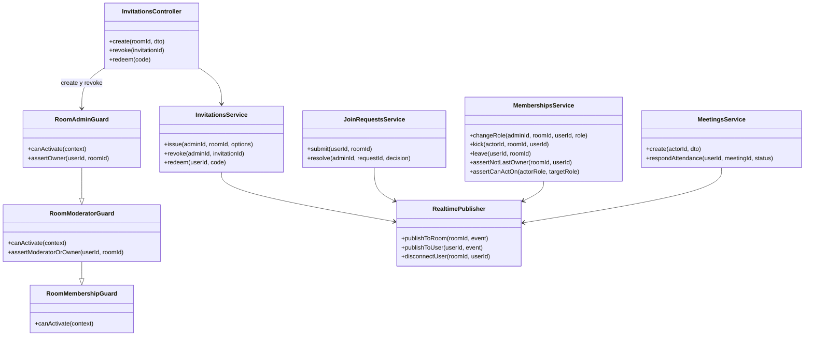

# Clases por capa

> Quién ejecuta cada responsabilidad en frontend, backend y realtime. Parte del [índice de diagramas](../README.md).

**En este archivo**

- [1. Clases del sistema](#1-clases-del-sistema)
  - [1.1 Clases por capa](#11-clases-por-capa)
  - [1.2 Clases adicionales](#12-clases-adicionales)

← [Realtime: WebSockets y Colyseus](../02-system-architecture/realtime-colyseus.md) · [Índice](../README.md) · [Secuencias del núcleo (S1 a S7)](../04-behavioral/core-flows.md) →

---

## 1. Clases del sistema

### 1.1 Clases por capa

El diagrama técnico no repite el modelo de datos: muestra quién ejecuta cada responsabilidad y qué dependencias reales existen en el código. Las cuatro capas se corresponden con los tres despliegues del sistema —frontend en Amplify, NestJS y Colyseus en ECS Fargate— más los contratos que comparten (`master-document.md:268-270`). Los contratos son DTOs: tienen campos, no comportamiento.

```mermaid
classDiagram
  namespace Frontend {
    class ApiClient {
      +get(path)
      +post(path, body)
      +patch(path, body)
      +delete(path)
    }
    class AuthStore {
      +login(credentials)
      +logout()
      +isAuthenticated()
    }
    class RoomStore {
      +setActiveRoom(roomId)
      +upsertTask(task)
      +removeTask(taskId)
    }
    class ColyseusClient {
      +connect(roomId, token)
      +send(type, payload)
      +onStateChange(callback)
      +disconnect()
    }
    class SceneController {
      +mount(canvas)
      +tick(delta)
      +dispose()
    }
    class InteractionController {
      +pick(pointer)
      +requestMove(target)
      +interact(itemId)
    }
    class TaskPanel {
      +open(taskId)
      +submit(task)
      +move(taskId, status)
    }
    class ChatPanel {
      +loadHistory(roomId)
      +send(body)
      +onMessage(event)
    }
    class BotPanel {
      +ask(prompt)
      +renderSummary(delivery)
    }
  }

  namespace Backend {
    class AuthController {
      +login(dto)
      +logout(sessionId)
      +me()
    }
    class AuthService {
      +validateCredentials(dto)
      +issueSession(user)
      +validateSession(token)
      +revokeSession(sessionId)
    }
    class RoomsController {
      +list()
      +get(roomId)
      +create(dto)
      +join(roomId)
    }
    class RoomsService {
      +createPersonalRoom(userId)
      +assertMembership(userId, roomId)
      +listForUser(userId)
      +snapshot(roomId)
    }
    class TasksController {
      +list(roomId)
      +create(dto)
      +update(taskId, dto)
      +remove(taskId)
    }
    class TasksService {
      +create(userId, dto)
      +update(userId, taskId, dto)
      +move(taskId, status)
    }
    class MessagesController {
      +history(roomId, cursor)
      +send(dto)
    }
    class MessagesService {
      +list(roomId, cursor)
      +create(authorId, dto)
    }
    class BotController {
      +ask(dto)
      +dailyReview()
    }
    class BotService {
      +respond(userId, prompt)
      +buildDailyReview(userId)
      +buildFallbackSummary(userId)
    }
    class JwtAuthGuard {
      +canActivate(context)
      +resolveSession(request)
    }
    class RoomMembershipGuard {
      +canActivate(context)
      +resolveRoom(request)
    }
    class PrismaService {
      +onModuleInit()
      +transaction(fn)
      +client()
    }
    class RealtimePublisher {
      +publishToRoom(roomId, event)
      +publishToUser(userId, event)
    }
    class BedrockClient {
      +converse(messages)
      +invoke(prompt)
    }
    class ToolRegistry {
      +register(tool)
      +execute(name, args, context)
    }
  }

  namespace Realtime {
    class RoomState {
      +addMember(userId)
      +removeMember(userId)
      +snapshot()
    }
    class AvatarState {
      +applyInput(input)
      +step(delta)
      +toSnapshot()
    }
    class RoomLifecycle {
      +onCreate(options)
      +onJoin(client, options)
      +onLeave(client, consented)
    }
    class AuthVerifier {
      +verify(token, roomId)
      +loadMembership(userId, roomId)
    }
    class MovementValidator {
      +validate(from, to, delta)
      +clamp(position)
    }
    class ChatRelay {
      +onChat(client, payload)
      +broadcast(roomId, event)
    }
    class PersistenceBridge {
      +loadSnapshot(roomId)
      +persistChat(message)
    }
  }

  namespace Contratos {
    class SessionToken {
      +accessToken string
      +sessionId uuid
      +userId uuid
      +expiresAt datetime
    }
    class RoomSnapshot {
      +roomId uuid
      +revision int
      +members string
      +items string
    }
    class TaskEvent {
      +roomId uuid
      +taskId uuid
      +status TaskStatus
      +revision int
    }
    class ChatEvent {
      +roomId uuid
      +messageId uuid
      +authorId uuid
      +sentAt datetime
    }
    class AvatarInput {
      +roomId uuid
      +x decimal
      +y decimal
      +yaw decimal
      +seq int
    }
  }

  ApiClient --> SessionToken
  AuthStore --> ApiClient
  RoomStore --> ApiClient
  RoomStore --> RoomSnapshot
  SceneController --> RoomStore : items
  TaskPanel --> ApiClient
  TaskPanel --> RoomStore
  ChatPanel --> ApiClient
  ChatPanel --> ColyseusClient
  BotPanel --> ApiClient
  ColyseusClient --> SessionToken
  ColyseusClient --> RoomSnapshot
  ColyseusClient --> AvatarInput
  ColyseusClient --> ChatEvent
  ColyseusClient --> TaskEvent
  InteractionController --> SceneController
  InteractionController --> ColyseusClient : input

  AuthController --> AuthService
  AuthController --> JwtAuthGuard : logout and me
  RoomsController --> RoomsService
  RoomsController --> JwtAuthGuard
  RoomsController --> RoomMembershipGuard : room routes
  TasksController --> TasksService
  TasksController --> JwtAuthGuard
  TasksController --> RoomMembershipGuard
  MessagesController --> MessagesService
  MessagesController --> JwtAuthGuard
  MessagesController --> RoomMembershipGuard
  BotController --> BotService
  BotController --> JwtAuthGuard
  AuthService --> PrismaService
  AuthService --> SessionToken
  RoomsService --> PrismaService
  RoomsService --> RealtimePublisher
  TasksService --> PrismaService
  TasksService --> RealtimePublisher
  TasksService --> TaskEvent
  MessagesService --> PrismaService
  MessagesService --> RealtimePublisher
  MessagesService --> ChatEvent
  BotService --> PrismaService
  BotService --> BedrockClient
  BotService --> ToolRegistry
  JwtAuthGuard --> AuthService : validateSession
  RoomMembershipGuard --> RoomsService : assertMembership
  ToolRegistry --> TasksService
  ToolRegistry --> RoomsService
  RealtimePublisher --> TaskEvent
  RealtimePublisher --> ChatEvent

  RoomLifecycle *-- RoomState : room state
  RoomState *-- AvatarState : members
  RoomLifecycle --> AuthVerifier : onJoin
  RoomLifecycle --> MovementValidator : onUpdate
  RoomLifecycle --> ChatRelay : onChat
  RoomLifecycle --> PersistenceBridge : rehydrate
  AuthVerifier --> AuthService : verify token
  AuthVerifier --> SessionToken
  MovementValidator --> AvatarInput
  AvatarState --> AvatarInput
  RoomState --> RoomSnapshot
  ChatRelay --> ChatEvent
  PersistenceBridge --> RoomsService : snapshot
  PersistenceBridge --> MessagesService : history
```

Tres decisiones que el diagrama deja explícitas y conviene no perder de vista:

1. **Las escrituras publican después de persistir.** `RealtimePublisher` cuelga de `RoomsService`, `TasksService` y `MessagesService`, nunca de los controllers. Así el evento de sala solo puede emitirse después de que Prisma confirmó la escritura, que es la regla de consistencia del documento (`master-document.md:284`). El controller no tiene forma de publicar por su cuenta.
2. **`PersistenceBridge` cruza a NestJS, no a Prisma.** Sus dos dependencias son `RoomsService` y `MessagesService`; el proceso de Colyseus no tiene cliente de base de datos ni credenciales de RDS (`master-document.md:282-284`). El precio es una llamada de red más por reconexión (rehidratación del snapshot). El chat ya no pasa por este puente: se envía por REST (S5).
3. **Los guards son dependencias de los controllers que protegen.** `JwtAuthGuard` aparece en los cinco controllers y `RoomMembershipGuard` en los tres que operan sobre una sala. Son decoradores en el código real, pero la dependencia existe: sin ellos el controller no puede resolver identidad ni membresía (`master-document.md:86,88,217`).

> **Frontera entre `RealtimePublisher` y Colyseus.** El publisher no referencia ninguna clase de la capa Realtime porque cruza un límite de proceso: habla con la API del servidor de Colyseus, no con `RoomState` en memoria. Dibujar una flecha hacia `RoomState` sugeriría memoria compartida, que es justamente lo que la arquitectura evita.

**Fronteras entre capas**

| Capa | Puede | No puede | Cómo se verifica |
|---|---|---|---|
| Frontend React | Renderizar UI y escena 3D, mantener estado efímero, llamar REST y WSS, aplicar actualización optimista | Invocar Bedrock, escribir en RDS, decidir permisos, entrar a una sala sin autorización | Toda mutación se confirma por REST y el servidor revalida; el cliente nunca es autoridad (`master-document.md:86,88`) |
| NestJS | Autenticar, autorizar, persistir con Prisma, invocar Bedrock y publicar eventos ya confirmados | Sostener presencia o posición como fuente de verdad; tocar la memoria de Colyseus sin pasar por su API | Es el único camino de escritura a RDS (`master-document.md:281,284`) |
| Colyseus | Sincronizar presencia, validar movimiento, retransmitir chat vivo y eventos de sala | Escribir en RDS, invocar Bedrock, emitir tokens, decidir permisos por su cuenta | Valida identidad y membresía con NestJS antes del handshake (`master-document.md:282`) |
| Contratos compartidos | Definir tipos y payloads entre capas | Contener reglas de negocio, validaciones de autorización o acceso a datos | Se versionan con el código; el servidor no confía en lo que declara el cliente (`rules/security.md:16,18`) |
| Prisma y RDS | Guardar filas, transacciones, constraints e índices | Ser invocados desde Colyseus o desde el navegador | Único cliente: `PrismaService` dentro de NestJS (`master-document.md:150,272`) |

### 1.2 Clases adicionales

La jerarquía de guards replica la de roles: `RoomModeratorGuard` exige `moderator` u `owner` (UC-23, UC-25, UC-26) y `RoomAdminGuard` exige `owner` (UC-21, UC-22, UC-24, UC-27, UC-28). Ambos se ejecutan en el mismo orden obligatorio de la [05-reference/conventions.md](../05-reference/conventions.md#12-orden-obligatorio-de-verificación): autenticación, autorización, validación y escritura. `MembershipsService.assertCanActOn` impide que un rol actúe sobre otro de igual o mayor jerarquía, salvo el Admin. `RealtimePublisher.disconnectUser` es el único punto por donde NestJS pide a Colyseus cerrar una sesión (UC-25).

---

← [Realtime: WebSockets y Colyseus](../02-system-architecture/realtime-colyseus.md) · [Índice](../README.md) · [Secuencias del núcleo (S1 a S7)](../04-behavioral/core-flows.md) →
