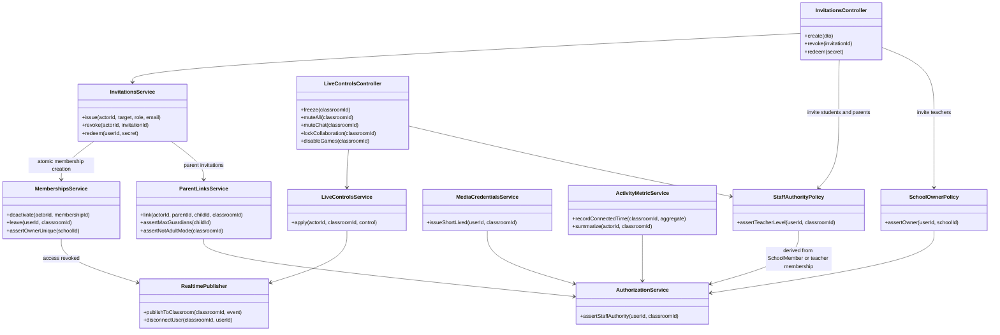

# Clases por capa

> Quién ejecuta cada responsabilidad en frontend, backend y realtime. Parte del [índice de diagramas](../README.md).

**En este archivo**

- [1. Clases del sistema](#1-clases-del-sistema)
  - [1.1 Clases por capa](#11-clases-por-capa)
  - [1.2 Clases adicionales](#12-clases-adicionales)

← [Realtime: WebSockets y Colyseus](../02-system-architecture/realtime-colyseus.md) · [Índice](../README.md) · [Secuencias del núcleo (S1 a S7)](../04-behavioral/core-flows.md) →

---

## 1. Clases del sistema

### 1.1 Clases por capa

Esta vista propone responsabilidades, no clases implementadas. Nombres, métodos, DTOs y guards son propuestas técnicas sujetas a la [ERS](../../functional-requirements.md) y no sustituyen las reglas de [Architecture](../../../rules/architecture.md#module-boundaries-inside-nestjs), [Authentication and session](../../../rules/authentication-and-session.md) y [Classrooms, roles, and permissions](../../../rules/classrooms-and-roles.md). Se separan el frontend previsto en Amplify, NestJS y Colyseus como servicios independientes, sin memoria compartida. El repositorio propone un monorepo pnpm con `apps/api` (NestJS), `apps/realtime` (Colyseus) y `packages/contracts` (decisión D3, aprobada por Agustín el 2026-11-02; ver [Technical justification, D3](../../technical-justification.md#d3-repository-layout)). Los contratos REST salen de un documento OpenAPI generado por NestJS (D4); los tipos realtime se generan y exportan desde `packages/contracts` y se commitean (D8).

El modelo de datos que estas clases operan está en [Modelo de datos](./data-model.md#11-modelo-de-dominio). Los módulos de NestJS se organizan por capacidad de dominio (autenticación, escuelas y aulas, actividades y calificaciones, puntos y tienda, comunicación y notificaciones, herramientas en vivo, bot) y un módulo no consulta las tablas de otro: llama a su servicio.

```mermaid
classDiagram
  namespace Frontend {
    class ApiClient {
      +get(path)
      +post(path, body)
      +patch(path, body)
      +delete(path)
    }
    class AuthStore {
      +login(credentials)
      +logout()
      +isAuthenticated()
    }
    class ClassroomStore {
      +setActiveClassroom(classroomId)
      +setViewMode(mode)
    }
    class ColyseusClient {
      +connect(classroomId, credential)
      +send(type, payload)
      +onStateChange(callback)
      +disconnect()
    }
    class SceneController {
      +mount(canvas)
      +tick(delta)
      +dispose()
    }
    class InteractionController {
      +pick(pointer)
      +requestMove(target)
      +interact(objectId)
    }
    class ActivityPanel {
      +list(classroomId)
      +submit(activityId, answer)
      +viewGrade(submissionId)
    }
    class ChatPanel {
      +loadHistory(channelScope)
      +send(channelScope, body)
      +onMessage(event)
    }
    class ShopPanel {
      +listItems(classroomId)
      +purchase(itemId)
    }
    class BotPanel {
      +ask(prompt)
      +renderSummary(delivery)
    }
  }

  namespace Backend {
    class AuthController {
      +register(dto)
      +login(dto)
      +refresh(dto)
      +logout(sessionId)
      +me()
    }
    class AuthService {
      +validateCredentials(dto)
      +issueTokens(user)
      +rotateRefreshToken(refreshToken)
      +validateAccessToken(claims)
      +revokeSession(sessionId)
    }
    class InternalAuthController {
      +verifyJoin(serviceCredential, accessToken, classroomId)
    }
    class SchoolsService {
      +createSchoolWithOwner(userId, dto)
      +assertSchoolRole(userId, schoolId, role)
    }
    class ClassroomsController {
      +list()
      +get(classroomId)
      +create(dto)
      +update(classroomId, dto)
    }
    class ClassroomsService {
      +create(actorId, dto)
      +setAdultMode(actorId, classroomId, enabled)
      +listForUser(userId)
      +snapshot(classroomId)
    }
    class AuthorizationService {
      +assertStaffAuthority(userId, classroomId)
      +assertEnrolledOrStaff(userId, classroomId)
      +assertParentLink(userId, childId)
      +resolveScope(userId, resource)
    }
    class ActivitiesController {
      +list(classroomId)
      +create(dto)
      +update(activityId, dto)
      +remove(activityId)
    }
    class ActivitiesService {
      +publish(actorId, dto)
      +listForStudent(userId, classroomId)
      +assertDeletable(activityId)
    }
    class SubmissionsService {
      +submit(studentId, activityId, dto)
      +deriveState(submission)
    }
    class GradingService {
      +grade(graderId, submissionId, dto)
      +autoGrade(submissionId)
    }
    class PointsLedgerService {
      +creditForGrade(grade)
      +debit(studentId, amount, source)
      +compensate(actorId, entryId, reason)
      +balance(studentId)
    }
    class ShopService {
      +listItems(classroomId)
      +purchase(studentId, itemId)
    }
    class StreakService {
      +recordQualifyingAction(studentId, localDate)
    }
    class MessagesController {
      +history(channelScope, cursor)
      +send(dto)
    }
    class MessagesService {
      +listAuthorized(userId, channelScope, cursor)
      +create(authorId, dto)
      +moderate(actorId, messageId)
    }
    class NotificationsService {
      +notify(userId, kind, ref)
      +markRead(userId, notificationId)
      +enqueueEmail(notificationId)
    }
    class BotController {
      +ask(dto)
      +dailyReview()
    }
    class BotService {
      +respond(userId, classroomId, prompt)
      +assertNotInExam(userId)
    }
    class DailyReviewService {
      +deliverIfFirstOfDay(userId)
      +buildFallbackSummary(userId)
    }
    class SessionAuthGuard {
      +canActivate(context)
      +resolveSession(request)
    }
    class ClassroomAccessGuard {
      +canActivate(context)
      +resolveClassroom(request)
    }
    class PrismaService {
      +onModuleInit()
      +transaction(fn)
      +client()
    }
    class StorageService {
      +signedUploadUrl(key)
      +signedDownloadUrl(key)
    }
    class RealtimePublisher {
      +publishToClassroom(classroomId, event)
      +publishToUser(userId, event)
      +disconnectUser(classroomId, userId)
    }
    class BedrockClient {
      +converse(messages)
      +invoke(prompt)
    }
    class ReadOnlyToolRegistry {
      +registerQuery(query)
      +executeQuery(name, args, context)
    }
  }

  namespace Realtime {
    class ClassroomRoom {
      +onAuth(client, options)
      +onJoin(client, options)
      +onLeave(client, consented)
    }
    class ClassroomState {
      +addMember(userId)
      +removeMember(userId)
      +snapshot()
    }
    class AvatarState {
      +applyInput(input)
      +step(delta)
      +toSnapshot()
    }
    class NestApiClient {
      +verifyJoin(accessToken, classroomId)
      +reportConnectedTime(classroomId, aggregate)
    }
    class MovementValidator {
      +validate(from, to, delta)
      +isFrozen(userId)
    }
    class LiveControlState {
      +applyControl(control)
      +assertTeacherLevel(userId)
    }
    class ChatRelay {
      +broadcastConfirmed(channelScope, event)
    }
  }

  namespace Contratos {
    class TokenPair {
      +accessToken string
      +refreshToken string
      +expiresAt datetime
    }
    class AccessClaims {
      +userId uuid
      +sessionId uuid
      +expiresAt datetime
    }
    class ClassroomSnapshot {
      +classroomId uuid
      +revision int
      +members string
      +controls string
    }
    class GradeEvent {
      +classroomId uuid
      +submissionId uuid
      +revision int
    }
    class ChatEvent {
      +channelScope string
      +messageId uuid
      +authorId uuid
      +sentAt datetime
    }
    class ClassroomControlEvent {
      +classroomId uuid
      +control string
      +enabled boolean
    }
    class AvatarInput {
      +classroomId uuid
      +x decimal
      +y decimal
      +yaw decimal
      +seq int
    }
  }

  ApiClient --> TokenPair
  AuthStore --> ApiClient
  ClassroomStore --> ApiClient
  ClassroomStore --> ClassroomSnapshot
  SceneController --> ClassroomStore : items
  ActivityPanel --> ApiClient
  ChatPanel --> ApiClient
  ChatPanel --> ColyseusClient
  ShopPanel --> ApiClient
  BotPanel --> ApiClient
  ColyseusClient --> AccessClaims
  ColyseusClient --> ClassroomSnapshot
  ColyseusClient --> AvatarInput
  ColyseusClient --> ChatEvent
  ColyseusClient --> ClassroomControlEvent
  InteractionController --> SceneController
  InteractionController --> ColyseusClient : input

  AuthController --> AuthService
  AuthController --> SchoolsService : registration
  AuthController --> SessionAuthGuard : logout and me
  InternalAuthController --> AuthService : validateAccessToken
  InternalAuthController --> AuthorizationService : assertEnrolledOrStaff
  ClassroomsController --> ClassroomsService
  ClassroomsController --> SessionAuthGuard
  ClassroomsController --> ClassroomAccessGuard : existing classroom routes
  ActivitiesController --> ActivitiesService
  ActivitiesController --> SessionAuthGuard
  ActivitiesController --> ClassroomAccessGuard
  MessagesController --> MessagesService
  MessagesController --> SessionAuthGuard
  MessagesController --> ClassroomAccessGuard
  BotController --> BotService
  BotController --> DailyReviewService
  BotController --> SessionAuthGuard
  AuthService --> PrismaService
  AuthService --> TokenPair
  AuthService --> AccessClaims
  SchoolsService --> PrismaService
  ClassroomsService --> PrismaService
  ClassroomsService --> AuthorizationService
  ClassroomsService --> RealtimePublisher
  AuthorizationService --> PrismaService
  ActivitiesService --> PrismaService
  ActivitiesService --> AuthorizationService
  ActivitiesService --> StorageService
  SubmissionsService --> PrismaService
  SubmissionsService --> StorageService
  GradingService --> SubmissionsService
  GradingService --> PointsLedgerService : same transaction
  GradingService --> RealtimePublisher
  GradingService --> GradeEvent
  PointsLedgerService --> PrismaService
  ShopService --> PointsLedgerService
  ShopService --> PrismaService
  StreakService --> PrismaService
  MessagesService --> PrismaService
  MessagesService --> AuthorizationService
  MessagesService --> NotificationsService : mentions
  MessagesService --> RealtimePublisher
  MessagesService --> ChatEvent
  NotificationsService --> PrismaService
  BotService --> PrismaService
  BotService --> BedrockClient
  BotService --> ReadOnlyToolRegistry
  DailyReviewService --> BedrockClient
  DailyReviewService --> PrismaService
  SessionAuthGuard --> AuthService : validateAccessToken
  ClassroomAccessGuard --> AuthorizationService : resolveScope
  ReadOnlyToolRegistry --> ActivitiesService : authorized queries only
  ReadOnlyToolRegistry --> ClassroomsService : authorized queries only
  RealtimePublisher --> GradeEvent
  RealtimePublisher --> ChatEvent
  RealtimePublisher --> ClassroomControlEvent

  ClassroomRoom *-- ClassroomState : room state
  ClassroomState *-- AvatarState : members
  ClassroomRoom --> NestApiClient : onAuth
  ClassroomRoom --> MovementValidator : onUpdate
  ClassroomRoom --> LiveControlState : controls
  ClassroomRoom --> ChatRelay : confirmed notifications
  NestApiClient --> AccessClaims
  MovementValidator --> AvatarInput
  MovementValidator --> LiveControlState : freeze lock
  AvatarState --> AvatarInput
  ClassroomState --> ClassroomSnapshot
  ChatRelay --> ChatEvent
  LiveControlState --> ClassroomControlEvent
```

Cuatro decisiones que el diagrama deja explícitas y conviene no perder de vista:

1. **Las escrituras publican después de persistir.** `RealtimePublisher` cuelga de los servicios (`ClassroomsService`, `GradingService`, `MessagesService`), nunca de los controllers. El evento solo puede emitirse después de que Prisma confirmó la escritura (persistencia antes de difusión, [Architecture](../../../rules/architecture.md#services-and-ownership)); si el aviso se pierde, el cliente reconcilia por REST. El transporte NestJS hacia Colyseus sigue **abierto**.
2. **Colyseus cruza a NestJS, no a Prisma.** `NestApiClient` es la única vía de Colyseus hacia datos persistentes: en `onAuth` llama al endpoint interno de `InternalAuthController`, autenticado con un secreto de servicio guardado en Secrets Manager (decisión D2, aprobada por Agustín el 2026-11-02). Colyseus rechaza el ingreso si NestJS no puede verificar. El proceso realtime no tiene cliente de base de datos ni credenciales de RDS.
3. **Autenticación y autorización son distintas, y la autorización es una sola.** `SessionAuthGuard` valida el JWT de acceso y contrasta su `sessionId` con la sesión almacenada en cada request (D1), de modo que una sesión revocada responde `401`. `AuthorizationService` es la única implementación de acceso a escuela, aula y vínculo parental que usan REST, las verificaciones de Colyseus y las herramientas del bot (RN-03, RN-04). Rol y membresía se leen del estado persistido en cada request. Un recurso fuera de alcance responde `404` y `403` queda para rol insuficiente sobre un recurso visible.
4. **El bot es de solo lectura.** `ReadOnlyToolRegistry` invoca únicamente consultas de servicios existentes bajo la autorización del usuario que consulta, nunca métodos de escritura (RN-14). `BotService` bloquea la consulta mientras el alumno tiene un examen en curso (RN-13).

> **Frontera entre `RealtimePublisher` y Colyseus.** El publisher no referencia ninguna clase de la capa Realtime porque cruza un límite de proceso: habla con Colyseus por un canal interno aún no definido, no con `ClassroomState` en memoria. Dibujar una flecha hacia el estado sugeriría memoria compartida, que es justamente lo que la arquitectura evita.

**Fronteras entre capas**

| Capa | Puede | No puede | Cómo se verifica |
|---|---|---|---|
| Frontend React | Renderizar el aula 3D y el Modo 2D Clásico, mantener estado efímero, llamar REST y WSS, aplicar actualización optimista | Invocar Bedrock, escribir en RDS, decidir permisos, entrar a un aula sin autorización | Toda mutación se confirma por REST y el servidor revalida; el cliente nunca es autoridad (RN-17, [documento maestro](../../../master-document.md)) |
| NestJS | Autenticar, autorizar, persistir con Prisma, invocar Bedrock y S3, enviar correo y publicar eventos ya confirmados | Sostener presencia o posición como fuente de verdad; tocar la memoria de Colyseus | Es el único camino de escritura a RDS ([Architecture](../../../rules/architecture.md#services-and-ownership)) |
| Colyseus | Sincronizar presencia, validar movimiento, aplicar el bloqueo de congelamiento, retransmitir chat y eventos confirmados | Escribir en RDS, invocar Bedrock, emitir tokens, decidir permisos por su cuenta | Verifica identidad y acceso con NestJS antes de admitir (D2); debe existir una prueba de que una acción de Colyseus no evita la autorización de NestJS |
| Contratos de integración | Describir tipos y payloads REST desde OpenAPI (D4) | Decidir permisos | Seguir [API contracts](../../../rules/api-contracts.md); tipos realtime según D8 |
| Prisma y RDS | Guardar filas, transacciones, constraints e índices | Ser invocados desde Colyseus o desde el navegador | Único cliente: `PrismaService` dentro de NestJS |

### 1.2 Clases adicionales

Clases de las capacidades que el diagrama anterior no detalla: ingreso por invitación, membresías, vínculos parentales y controles de clase en vivo. Todas son propuestas.

No se modela una herencia lineal de roles. `StaffAuthorityPolicy` aplica la regla de que el Dueño y el Admin de la escuela tienen autoridad docente sobre todas sus aulas, derivada de `SchoolMember` sin membresía por aula, y de que un Profesor solo actúa en las aulas que dicta (RN-03). `SchoolOwnerPolicy` protege las operaciones exclusivas del Dueño; qué parte de ellas delega al Admin está **abierto** ([Classrooms](../../../rules/classrooms-and-roles.md#open-decisions)). El Alumno y el Padre / Tutor no pasan por estas políticas: acceden solo a lo propio o a lo vinculado por `ParentLink`.

`InvitationsService` valida el secreto, su vencimiento y revocación y crea la membresía en una sola transacción atómica e idempotente, de modo que aceptaciones concurrentes no duplican membresías (RN-02, RF-AUL-002). `ParentLinksService` rechaza un tercer tutor y todo vínculo en aulas con `adultMode` (RN-16). `LiveControlsService` acepta controles solo de personal con autoridad docente en ese momento, persiste los estados de aula que corresponden (`chatMuted`, `collaborationLocked`, `gamesDisabled`) y publica después de confirmar (RN-10). `MediaCredentialsService` emite credenciales de corta duración para audio y video; el proveedor (LiveKit o Amazon Chime SDK) es un candidato sin decisión ([Architecture](../../../rules/architecture.md#external-services-candidates)). `ActivityMetricService` recibe de Colyseus el tiempo conectado ya agregado (RN-19).

Los módulos de tienda, mascota, medallas, anuncios y notificaciones se detallarán en sus propios módulos, sin omitir sus RF (RF-GAM, RF-COM) porque no se enumeren todas las clases aquí. Se aplica el [orden de verificación](../05-reference/conventions.md#12-orden-obligatorio-de-verificación), con difusión solo a destinatarios autorizados. `RealtimePublisher.disconnectUser` y la revalidación cortan acceso en vivo cuando se expulsa a un miembro o se revoca la sesión, aunque se conserve una credencial anterior.

---

← [Realtime: WebSockets y Colyseus](../02-system-architecture/realtime-colyseus.md) · [Índice](../README.md) · [Secuencias del núcleo (S1 a S7)](../04-behavioral/core-flows.md) →
