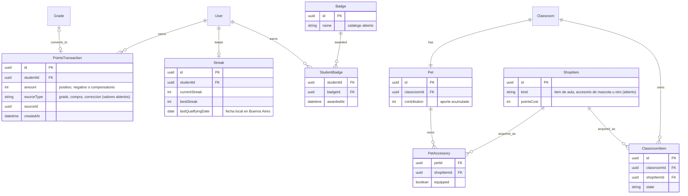
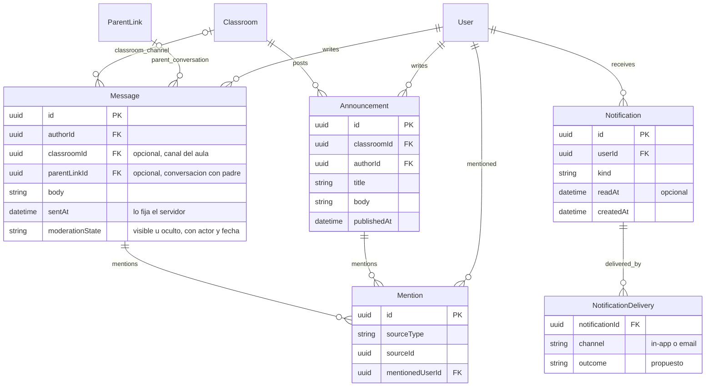
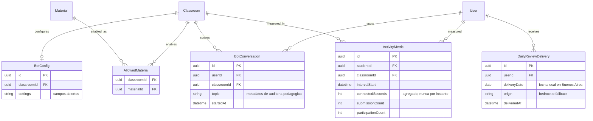

# Modelo de datos

> Entidades persistentes, relaciones e invariantes del dominio escolar. Parte del [índice de diagramas](../README.md).

**En este archivo**

- [1. Modelo de datos](#1-modelo-de-datos)
  - [1.1 Modelo de dominio](#11-modelo-de-dominio)
  - [1.2 Entidades adicionales](#12-entidades-adicionales)

← [Arquitectura y comunicación](../02-system-architecture/deployment-and-network.md) · [Índice](../README.md) · [Realtime: WebSockets y Colyseus](../02-system-architecture/realtime-colyseus.md) →

---

## 1. Modelo de datos

Esta sección fija el **modelo de dominio propuesto**: qué entidades existen y cómo se relacionan. La estructura de clases por capa está en [Clases por capa](./class-design.md#11-clases-por-capa). Ninguna de las dos es una especificación ejecutable ni está implementada.

La [ERS, sección 7](../../functional-requirements.md#7-entidades-conceptuales), define las entidades conceptuales, la [sección 3](../../functional-requirements.md#3-permisos) los permisos y la [sección 4](../../functional-requirements.md) las reglas `RN-01` a `RN-20`. Las restricciones obligatorias de persistencia están en [Data](../../../rules/data.md); las de roles, en [Classrooms, roles, and permissions](../../../rules/classrooms-and-roles.md). Esta vista traduce esas fuentes a nombres técnicos **propuestos**, no a un esquema Prisma aprobado ni a DDL. Por eso solo se dibujan atributos conceptuales que las fuentes mencionan; nombres finales de tablas y columnas, valores de enums y límites de campos siguen **abiertos** ([Data, decisiones abiertas](../../../rules/data.md#open-decisions)). Se aplican las [reglas de datos y tiempo](../../../rules/data-and-time.md).

### 1.1 Modelo de dominio

Una `School` es la unidad de aislamiento del camino institucional y tiene un único Dueño (RN-01, RN-03). Un `Classroom` pertenece a **exactamente una** `School` o a **exactamente un** profesor independiente, y esa exclusión se aplica en la base de datos. El Dueño y el Admin de la escuela tienen autoridad docente sobre todas sus aulas por su `SchoolMember`, sin membresía por aula. Un Padre / Tutor accede solo mediante `ParentLink`. Las actividades, entregas y calificaciones forman la cadena académica que luego alimenta los puntos.

```mermaid
erDiagram
  User ||--o| AvatarConfiguration : configures
  User ||--o{ Session : opens
  User ||--o{ SchoolMember : holds
  School ||--|{ SchoolMember : has
  School |o--o{ Classroom : groups
  User |o--o{ Classroom : independent_teacher
  Classroom ||--o{ ClassroomMembership : enrolls
  User ||--o{ ClassroomMembership : joins
  Classroom ||--o{ Desk : seats
  ClassroomMembership |o--o| Desk : assigned
  User ||--o{ ParentLink : parent_of
  User ||--o{ ParentLink : child_in
  Classroom ||--o{ ParentLink : context
  School |o--o{ Invitation : target_school
  Classroom |o--o{ Invitation : target_classroom
  User ||--o{ Invitation : creates
  Classroom ||--o{ Material : stores
  User ||--o{ Material : uploads
  Classroom ||--o{ Activity : publishes
  Activity ||--o{ Question : contains
  Question ||--|{ Option : offers
  Activity ||--o{ Submission : receives
  User ||--o{ Submission : submits
  Submission ||--o| Grade : receives
  User ||--o{ Grade : evaluates

  User {
    uuid id PK
    string email UK
    string passwordHash
    string displayName
    datetime createdAt
    datetime updatedAt
  }

  Session {
    uuid id PK
    uuid userId FK
    string refreshTokenHash "D1, aprobada por Agustin el 2026-11-02"
    datetime expiresAt
    datetime revokedAt "opcional"
    datetime createdAt
  }

  AvatarConfiguration {
    uuid id PK
    uuid userId FK
    string appearance "apariencia persistente, campos abiertos"
  }

  School {
    uuid id PK
    string name
    datetime deletedAt "opcional, baja logica"
  }

  SchoolMember {
    uuid id PK
    uuid userId FK
    uuid schoolId FK
    enum_SchoolRole role "owner, admin, teacher"
    string state "activo o inactivo"
  }

  Classroom {
    uuid id PK
    uuid schoolId FK "opcional, excluyente con el profesor independiente"
    uuid independentTeacherId FK "opcional, excluyente con la escuela"
    string name
    boolean adultMode
    boolean chatMuted
    boolean collaborationLocked
    boolean gamesDisabled
    datetime deletedAt "opcional, baja logica"
  }

  ClassroomMembership {
    uuid id PK
    uuid classroomId FK
    uuid userId FK
    enum_ClassroomRole role "teacher, student (propuesto)"
    datetime deletedAt "opcional, baja logica"
  }

  Desk {
    uuid id PK
    uuid classroomId FK
    uuid membershipId FK "opcional"
  }

  ParentLink {
    uuid id PK
    uuid parentId FK
    uuid childId FK
    uuid classroomId FK
    string state "activo o inactivo"
  }

  Invitation {
    uuid id PK
    string secretHash UK
    string targetEmail "solo invitación por correo; el código de unión (D7) no tiene correo"
    uuid schoolId FK "opcional, excluyente con el aula"
    uuid classroomId FK "opcional, excluyente con la escuela"
    enum_InvitationRole role
    datetime expiresAt
    enum_InvitationState state "vigente, usada, revocada"
    uuid createdById FK
  }

  Material {
    uuid id PK
    uuid classroomId FK
    uuid authorId FK
    string storageKey "objeto privado en S3"
  }

  Activity {
    uuid id PK
    uuid classroomId FK
    enum_ActivityType type "tp, exam"
    enum_ActivityFormat format "file, multiple_choice"
    string title
    string description
    datetime dueAt "fecha limite o ventana de examen"
    int maxScore "escala 0 a 100"
    boolean allowLate
    decimal weightMultiplier
    datetime publishedAt "opcional"
  }

  Question {
    uuid id PK
    uuid activityId FK
    string prompt
  }

  Option {
    uuid id PK
    uuid questionId FK
    string text
    boolean isCorrect "nunca se expone al alumno antes de corregir"
  }

  Submission {
    uuid id PK
    uuid activityId FK
    uuid studentId FK
    datetime submittedAt "hora del servidor"
    boolean isLate
    string content "archivos o respuestas, representacion abierta"
  }

  Grade {
    uuid id PK
    uuid submissionId FK
    uuid graderId FK "opcional si es automatica"
    int score "escala 0 a 100"
    string feedback
    datetime gradedAt
  }
```

Lecturas del modelo y alcance:

- **Aula persistente y Room de Colyseus son distintos.** Un `Classroom` existe haya o no usuarios conectados; la sesión en vivo es efímera y no guarda posiciones por fotograma ni conexiones (RN-19, [Realtime and presence](../../../rules/realtime-and-presence.md)).
- **Un Dueño por escuela.** Hay exactamente una membresía `owner` por `School`, creada con la escuela en una sola transacción; no se reasigna salvo mediante la operación de traspaso ([Data](../../../rules/data.md#constraints-and-uniqueness)).
- **Autoridad derivada, no duplicada.** Dueño y Admin obtienen autoridad docente de `SchoolMember` y del `schoolId` del aula; el modelo no crea una `ClassroomMembership` por aula para ellos (RN-03). Un Profesor solo actúa sobre las aulas en las que consta como docente.
- **El estado del trabajo del alumno se deriva.** `Pendiente`, `Entregada`, `Corregida` y `Vencida` se calculan desde `Submission`, `Grade` y la hora del servidor; no hay un campo de estado que pueda contradecirlos (RN-05).
- **Opción múltiple se corrige en el servidor.** `Option.isCorrect` no se selecciona hacia el cliente antes del cierre de la evaluación (RN-06).
- **`Session` es soporte técnico.** Se mantiene según la decisión D1 ([Technical justification, D1](../../technical-justification.md#d1-session-mechanism), aprobada por Agustín el 2026-11-02): el refresh token se guarda hasheado y rotado; el JWT de acceso lleva el identificador de sesión y el servidor lo contrasta con esta fila en cada request. El logout marca `revokedAt` y no borra la fila (RF-AUT-002, RN-04).
- **`Desk` y los campos exactos de `AvatarConfiguration` son propuestos.** `Desk` figura en la ERS (RF-ESP-002, RN-10) pero no en la lista de [Data](../../../rules/data.md#entities); su forma queda abierta.

**Enums propuestos.** Por una limitación de la sintaxis `erDiagram`, cada enum se escribe como un único token de tipo `enum_Nombre`. Los conjuntos de valores son propuestos y se confirman en el diseño final.

| Enum | Valores | Se usa en | Fuente |
|---|---|---|---|
| `SchoolRole` | owner, admin, teacher | `SchoolMember.role` | [Data](../../../rules/data.md#entities); alcance de delegación del Admin **abierto** ([Classrooms](../../../rules/classrooms-and-roles.md)) |
| `ClassroomRole` | teacher, student | `ClassroomMembership.role` | ERS §7; cómo consta el profesor del aula está **abierto** en [Data](../../../rules/data.md#entities) |
| `ActivityType` | tp, exam | `Activity.type` | RN-05; conjunto cerrado según [Activities](../../../rules/activities-and-grading.md#activities) |
| `ActivityFormat` | file, multiple_choice | `Activity.format` | RN-05; tipo y formato son independientes |
| `InvitationRole` | admin, teacher, student, parent | `Invitation.role` | [Classrooms](../../../rules/classrooms-and-roles.md#invitations-and-membership); la invitación fija el rol |
| `InvitationState` | vigente, usada, revocada (el vencimiento se deriva de `expiresAt`) | `Invitation.state` | ERS §7 |

**Invariantes del modelo**

| Dato | Regla | Fuente |
|---|---|---|
| `User.email` | Único tras normalizar; es el identificador de login | RF-AUT-001, [Data](../../../rules/data.md#constraints-and-uniqueness) |
| `Session` | Expira, se verifica en cada request protegido y el logout o el reinicio de contraseña la invalidan en el servidor | RF-AUT-002, RN-04, D1 |
| `School` / `SchoolMember` | Único (`schoolId`, `userId`); exactamente un `owner` por escuela | [Data](../../../rules/data.md#constraints-and-uniqueness), RN-03 |
| `Classroom` | Exactamente una de `schoolId` o `independentTeacherId`; restricción en la base de datos | RN-01, [Data](../../../rules/data.md#entities) |
| `ClassroomMembership` | Único (`classroomId`, `userId`); baja lógica al expulsar o salir, sin borrar contenido | RN-18, RF-AUL-003 |
| `ParentLink` | Máximo 2 vínculos activos por alumno; único (padre, hijo, aula); se rechaza en aula con `adultMode` | RN-16, RF-AUT-004 |
| `Invitation` | Solo el hash del secreto, único; vigente, no revocada; validación y alta de membresía atómicas e idempotentes. D7 (propuesto): además existe el código de unión por aula, solo rol `student`, con vencimiento, máximo de usos opcional, contador de usos y registro de cada ingreso; su forma (discriminador en `Invitation` o entidad aparte) queda para el esquema base | RN-02, RF-AUL-002, D7 |
| `Activity` / `Question` / `Option` | Pertenecen a un aula; no se borra una actividad con entregas o calificaciones | RN-05, [Data](../../../rules/data.md#deletion-and-lifecycle) |
| `Submission` | Único (`activityId`, `studentId`) salvo que la actividad permita reentrega (historial abierto); el alumno debe estar matriculado en el aula de la actividad (regla de servicio en transacción) | RN-05, [Data](../../../rules/data.md#constraints-and-uniqueness) |
| `Grade` | Único por entrega; solo personal con autoridad docente califica o recalifica | RN-06 |
| Archivos (`Material`, adjuntos) | Bucket privado, acceso por URL firmada de corta duración tras autorizar | RN-20 |

### 1.2 Entidades adicionales

Las entidades de gamificación, comunicación, bot y métricas se agrupan en tres diagramas. Las claves foráneas hacia `User`, `Classroom`, `Activity` y `Submission` son las de la sección 1.1.

**Puntos, racha, medallas, tienda y mascota** (RF-GAM-001 a RF-GAM-005; RN-07, RN-08, RN-09):

- El asiento `PointsTransaction` es **inmutable**; una corrección es un asiento compensatorio nuevo, nunca una edición (RN-07). Es único por (`sourceType`, `sourceId`) para las acreditaciones, de modo que reintentar una calificación no duplica puntos.
- La compra de un ítem o el aporte a la mascota registran un asiento negativo y el ítem resultante en una transacción que valida saldo no negativo (RN-09). La ERS nombra `StudentPurchase` para ese registro; [Data](../../../rules/data.md#entities) lo cubre con `ClassroomItem` y el asiento. Si hace falta una entidad separada para el inventario por alumno, es una decisión **abierta**.
- Cada aula tiene exactamente una `Pet`, creada junto con el aula, independiente del bot: ninguna entidad une `Pet` o `PetAccessory` con la configuración o las conversaciones del bot. La propiedad de accesorios es única por (`petId`, `shopItemId`).
- La racha registra a lo sumo un hito por alumno y día local (RN-08); la representación del registro de día calificante (único por alumno y día) y el catálogo de `Badge` están **abiertos** ([Data](../../../rules/data.md#open-decisions), [Points and shop](../../../rules/points-and-shop.md)).

**Comunicación y notificaciones** (RF-COM-001 a RF-COM-004; RN-16, RN-18):

- **Un mensaje pertenece a exactamente un contexto:** el canal del aula o una conversación ligada a un `ParentLink`; la restricción se aplica en la base de datos ([Data](../../../rules/data.md#entities)). El autor y la hora los fija el servidor. La moderación es un cambio de estado con actor y marca temporal que conserva el historial para el docente (RN-18).
- **El Padre / Tutor no accede al chat del aula**; solo ve conversaciones de sus propios vínculos (RN-16, [Communication](../../../rules/communication-and-notifications.md#parent-messages)). Si el Dueño o Admin pueden leer esas conversaciones está **abierto**; por defecto no.
- **`Mention` se resuelve contra el roster del aula** y es única por (origen, usuario mencionado); solo notifica a quien conserva acceso.
- **`Notification` es el registro durable** con estado de lectura; el correo es un canal. La unicidad (`notificationId`, `channel`) hace idempotente el envío. `NotificationDelivery` es una entidad **propuesta** para sostener esa unicidad y registrar el resultado; [Data](../../../rules/data.md#entities) solo exige el estado de entrega por correo. El mecanismo de reintentos y rebotes está **abierto**.
- **El foro de consultas por actividad** (RF-COM-003) no tiene entidad propia en [Data](../../../rules/data.md#entities): si se modela como mensajes asociados a una actividad es una decisión **abierta** que debe respetar la restricción de contexto único.

**Bot, repaso diario y métricas** (RF-BOT-001 a RF-BOT-004, RF-ACT-005; RN-12 a RN-15, RN-19):

- **El bot solo usa material habilitado.** `AllowedMaterial` es único por (`classroomId`, `materialId`); el filtro por aula y material habilitado se aplica en el servidor antes de invocar a Bedrock (RN-12). La ERS expresa lo mismo como `is_bot_enabled` sobre el material.
- **`BotConversation` es un registro de auditoría pedagógica** (RN-14). Que se persista, su retención y si se guarda el texto generado están **abiertos** ([AI bot and daily briefing](../../../rules/ai-bot-and-daily-briefing.md)); el diagrama solo conserva metadatos.
- **`DailyReviewDelivery` es único por** (`userId`, `deliveryDate`) con fecha local en `America/Argentina/Buenos_Aires`, para que el repaso se entregue una vez por día (RN-15). No aplica al Padre / Tutor. Persistir el texto completo del repaso está **abierto**.
- **`ActivityMetric` acumula tiempo conectado de forma gruesa** por intervalo, entregas y participación; Colyseus reporta el agregado a NestJS y el cliente nunca informa su propio tiempo (RN-19). La fórmula del nivel mostrado está **abierta** ([Activities](../../../rules/activities-and-grading.md#activity-level-metric)).
- **No se persisten** posiciones por fotograma, estados interpolados, conexiones activas, presencia, el bloqueo de congelamiento ni los flujos de edición colaborativa del pizarrón; solo los estados de aula nombrados en `Classroom` (`chatMuted`, `collaborationLocked`, `gamesDisabled`). Si se persiste el contenido del pizarrón es decisión **abierta** ([Live classroom tools](../../../rules/live-classroom-tools.md)).

**Abiertos y propuestos resumidos**

| Tema | Estado | Referencia |
|---|---|---|
| Nombres finales de tablas y columnas, valores de enums, límites de campos | Abierto | [Data](../../../rules/data.md#open-decisions) |
| `Session` y almacenamiento del refresh token (D1) | Decidido (D1, aprobada por Agustín el 2026-11-02); entidad propuesta | [Authentication](../../../rules/authentication-and-session.md#session-lifecycle) |
| Registro del profesor en el aula (`ClassroomMembership.role`) y `Desk` | Propuesto | ERS §7 |
| Catálogo de `Badge`, historial de reentregas y de calificaciones | Abierto | [Data](../../../rules/data.md#open-decisions) |
| Persistencia y retención de `BotConversation` y del texto del repaso | Abierto | [AI bot](../../../rules/ai-bot-and-daily-briefing.md) |
| `NotificationDelivery`, foro por actividad, retención de mensajes | Propuesto / abierto | [Communication](../../../rules/communication-and-notifications.md) |
| Efectos de eliminar escuela, aula o cuenta; representación de instantes | Abierto | [Data](../../../rules/data.md#open-decisions) |
| Un mismo usuario con camino escuela y camino profesor independiente | Admitido por [Classrooms](../../../rules/classrooms-and-roles.md#account-paths); [Data](../../../rules/data.md#open-decisions) lo mantiene abierto | RF-AUT-001 |

---

← [Arquitectura y comunicación](../02-system-architecture/deployment-and-network.md) · [Índice](../README.md) · [Realtime: WebSockets y Colyseus](../02-system-architecture/realtime-colyseus.md) →
