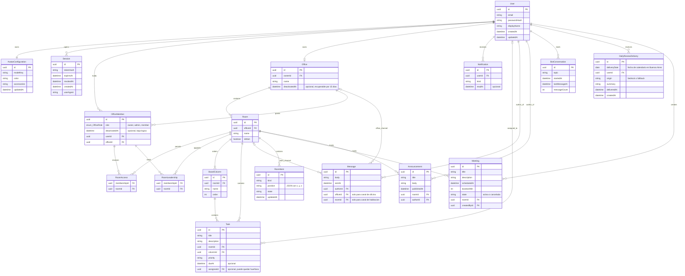
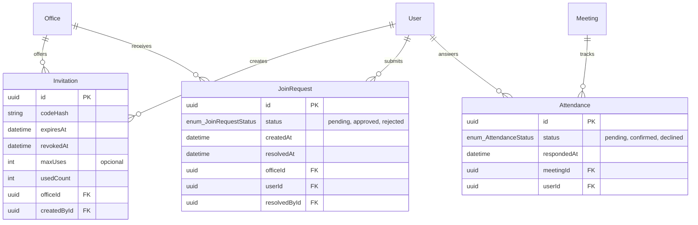

# Modelo de datos

> Entidades persistentes, relaciones e invariantes. Parte del [índice de diagramas](../README.md).

**En este archivo**

- [1. Modelo de datos](#1-modelo-de-datos)
  - [1.1 Modelo de dominio](#11-modelo-de-dominio)
  - [1.2 Entidades adicionales](#12-entidades-adicionales)

← [Arquitectura y comunicación](../02-system-architecture/deployment-and-network.md) · [Índice](../README.md) · [Realtime: WebSockets y Colyseus](../02-system-architecture/realtime-colyseus.md) →

---

## 1. Modelo de datos

Esta sección fija el **modelo de dominio**: qué entidades existen y cómo se relacionan. La estructura de clases por capa está en [Clases por capa](./class-design.md#11-clases-por-capa). Ninguna de las dos es una especificación ejecutable.

La [ERS, sección 7](../../functional-requirements.md#7-entidades-conceptuales), define entidades conceptuales y la [sección 3](../../functional-requirements.md#3-permisos) define permisos. Esta vista los traduce a nombres técnicos propuestos, no a un esquema Prisma aprobado ni a DDL. Los atributos, tipos genéricos, claves y mecanismos concretos deben validarse antes de implementar migraciones; no existe un límite de doce entidades. Las restricciones funcionales citadas por RN/RF sí deben preservarse. Se aplican las [reglas de datos y tiempo](../../../rules/data-and-time.md).

### 1.1 Modelo de dominio

`Office` contiene habitaciones persistentes. `OfficeMember` expresa pertenencia y rol de oficina; `RoomAccess` y `RoomLeadership` expresan acceso y liderazgo específicos. El registro crea la oficina propia, una membresía de Dueño y la habitación principal. No hay sala personal independiente ni sala general global. Columnas configurables organizan tareas; mensajes pertenecen a un canal de oficina o de habitación.

Lecturas del modelo y alcance:

- **Habitación persistente y Room de Colyseus son distintas.** La sesión realtime es efímera; no representa otra oficina ni guarda posiciones por frame.
- **Un Dueño por oficina, no transferible.** La relación de creación es uno a uno en el alta (RN-01/RN-02); el cero permitido en el dibujo contempla el ciclo de baja, no crear varias oficinas. La reposición tras eliminación definitiva sigue pendiente (P-05).
- **Reuniones y anuncios tienen habitación obligatoria.** No hay contenidos globales entre oficinas; un anuncio de oficina es evolución (RF-CAR-011).
- **Canales separados.** Cada mensaje tiene exactamente un destino: oficina o habitación, nunca ambos ni ninguno. Membresía activa habilita el canal de oficina; el de habitación requiere acceso vigente (RF-CHA-001 a RF-CHA-007). Mensajería privada y editar/eliminar mensajes son evolución.
- **Datos técnicos propuestos.** `Session` y `BotConversation` ilustran soporte técnico, no nuevas capacidades funcionales ni un compromiso de retención del historial del bot.

**Enums del dominio.** Por una limitación de la sintaxis `erDiagram`, cada enum se escribe como un único token de tipo `enum_Nombre`; el nombre del enum es lo que sigue al guion bajo. Los valores son los que se listan acá y no se repiten como entidades.

| Enum | Valores | Se usa en |
|---|---|---|
| `OfficeRole` | owner, admin, member | `OfficeMember.role`; liderazgo separado por habitación |
| `AttendanceStatus` | pending, confirmed, declined (nombres técnicos propuestos) | `Attendance.status`; confirmar asistencia es Must · MVP |

Las columnas iniciales son **Pendiente, En curso, Hecho**, en ese orden (RF-TAR-006). No son un enum cerrado de estados: Líder, Admin y Dueño pueden crear, renombrar, reordenar y eliminar columnas, sin dejar el tablero vacío ni tareas sin columna (RF-TAR-007).

**Invariantes del modelo**

| Dato | Regla | Motivo |
|---|---|---|
| `User.email` | Único, normalizado en minúsculas; es la identidad de login | Evita dos cuentas con la misma credencial; la fuente no define otro identificador natural ([documento maestro](../../../master-document.md)) |
| `Session.expiresAt` | Obligatorio y verificado en cada request protegido; el logout marca `revokedAt` y no borra la fila | Las sesiones vencen y el logout invalida el acceso sin perder datos ([documento maestro](../../../master-document.md)) |
| `Office` / `Room` | Una habitación principal por oficina, no eliminable y accesible para todos sus miembros; hasta 5 adicionales | RN-01, RN-04, RN-05 |
| `OfficeMember` | Pertenencia única por usuario/oficina; un solo Dueño, que no transfiere ni abandona; baja lógica al expulsar | RN-02, RN-13, RN-15 |
| Acceso y liderazgo | Solo miembros activos de la misma oficina; puede haber varios Líderes, todos con acceso. Dueño/Admin acceden a todas | RN-07, RN-10, RN-11 |
| `DailyReviewDelivery` | Clave única compuesta (`userId`, `deliveryDate`), con fecha local en `America/Argentina/Buenos_Aires` e inserción atómica | El repaso no se repite por recarga, cambio de sala ni reconexión, y se evitan ejecuciones concurrentes ([documento maestro](../../../master-document.md)) |
| `BoardColumn` / `Task` | Columna y tarea pertenecen a la misma habitación; nombres de columna únicos por tablero | RF-TAR-004, RF-TAR-007 |
| `Task.assigneeId` | Opcional; se asigna solo con acceso vigente; si lo pierde, la tarea permanece marcada huérfana hasta reasignación | RN-12, RF-TAR-008/009 |
| `Meeting` / `Announcement` | Habitación obligatoria; Líder gestiona los propios, Dueño/Admin también los ajenos | RF-CAR-002 a RF-CAR-006 |
| Ciclo de oficina | Baja lógica recuperable 15 días, sin acceso durante la baja; después eliminación definitiva | RN-14, RF-OFI-014 a RF-OFI-016 |

### 1.2 Entidades adicionales

`Invitation` y `Attendance` corresponden al MVP; `JoinRequest` es **Evolución** (RF-OFI-018), no una alternativa obligatoria a la invitación. Una invitación pertenece a la oficina y solo la emite/revoca Dueño o Admin; su aceptación incorpora como Miembro con acceso inicial a la principal, sin aprobación posterior de un Líder (RN-06/RN-11). Debe estar vigente y no revocada; el límite de usos es opcional (RF-OFI-005), por lo que `usedCount < maxUses` aplica solo si hay límite. Guardar hash del token y consumirlo de forma atómica son propuestas técnicas, no un contrato de código ya aprobado.

`Attendance` es única por usuario/reunión. Las respuestas, el acceso a la reunión y la cancelación respetan RF-CAR-006/007. El código de invitación, las claves de unión y los campos de estado requieren diseño de datos backend; no se genera ninguna migración con esta actualización.

---

← [Arquitectura y comunicación](../02-system-architecture/deployment-and-network.md) · [Índice](../README.md) · [Realtime: WebSockets y Colyseus](../02-system-architecture/realtime-colyseus.md) →
