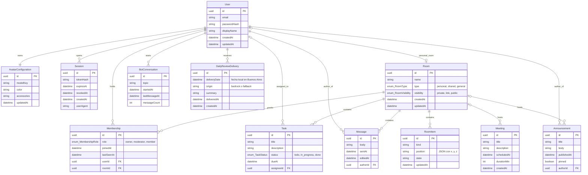
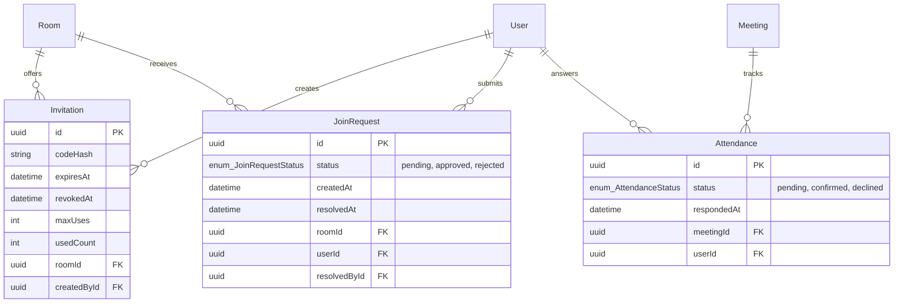

# Modelo de datos

> Entidades persistentes, relaciones e invariantes. Parte del [índice de diagramas](../README.md).

**En este archivo**

- [1. Modelo de datos](#1-modelo-de-datos)
  - [1.1 Modelo de dominio](#11-modelo-de-dominio)
  - [1.2 Entidades adicionales](#12-entidades-adicionales)

← [Arquitectura y comunicación](../02-system-architecture/deployment-and-network.md) · [Índice](../README.md) · [Realtime: WebSockets y Colyseus](../02-system-architecture/realtime-colyseus.md) →

---

## 1. Modelo de datos

Esta sección fija el **modelo de dominio**: qué entidades existen y cómo se relacionan. La estructura de clases por capa está en [Clases por capa](./class-design.md#11-clases-por-capa). Ninguna de las dos es una especificación ejecutable.

El esquema definitivo se definirá en `rules/data.md`, que todavía no existe. Los atributos de este diagrama son una propuesta del equipo y deben validarse antes de generar la migración de Prisma. La hoja de hechos deja constancia de que ningún campo de entidad está definido en el documento fuente (`master-document.md:223`); solo se conocen los nombres de las entidades, algunas relaciones y un puñado de comportamientos. Por eso lo que sigue es un **modelo lógico, no DDL**: no fija nombres de tablas, tipos SQL nativos, índices, collations ni políticas de retención. Los tipos `uuid`, `string`, `datetime`, `enum`, `boolean`, `int` y `decimal` son genéricos y se traducirán a tipos de PostgreSQL recién en la migración. La matriz de permisos por rol también está pendiente: se delega a `rules/rooms-and-permissions.md`, archivo que no existe (`master-document.md:85`).

La fuente lista once entidades porque escribe `Meeting`/`Announcement` como un solo ítem; acá se separan en dos, porque el documento las describe como dos conceptos con ciclos de vida distintos (`master-document.md:71,223`). El diagrama resultante tiene doce entidades.

### 1.1 Modelo de dominio

El diagrama cubre las doce entidades del producto. `User` es el centro de identidad: tiene una configuración de avatar, varias sesiones, varias conversaciones con el bot y una entrega de repaso diario por día. `Room` es el espacio persistente y se relaciona con `User` de dos maneras distintas: por membresía explícita (`Membership`, N:M) y por la sala personal (1:1 opcional, `personal_room`). Las tareas, mensajes, objetos, reuniones y anuncios cuelgan de la sala; la tarea además puede apuntar a un responsable opcional.

Cuatro lecturas que el diagrama necesita:

- **La sala persistente no es la sala de Colyseus.** `Room` es la fila en PostgreSQL; la instancia de Colyseus es un objeto en memoria que se recrea y no se dibuja como entidad (`master-document.md:35`).
- **`personal_room` es un vínculo aparte de `Membership`.** Expresa que un usuario tiene a lo sumo una sala personal y que esa sala pertenece a un solo usuario. La sala personal se crea al registrar el usuario y persiste sin presencia (`master-document.md:30,31`); las salas compartidas y generales se resuelven por `Membership`.
- **`Meeting` y `Announcement` tienen sala opcional.** Un aviso o reunión con `roomId` nulo es de alcance global; con `roomId` presente, la autorización se deriva de la sala. La fuente no define esa cardinalidad, así que la opcionalidad es una decisión de este modelo.
- **La mensajería privada no está modelada.** El documento la menciona mediante la interfaz del teléfono (`master-document.md:70`), pero no define su modelo. `Message` queda ligado a la sala; un canal privado exigiría una entidad o un campo de destinatario que hoy no se puede justificar.

**Enums del dominio.** Por una limitación de la sintaxis `erDiagram`, cada enum se escribe como un único token de tipo `enum_Nombre`; el nombre del enum es lo que sigue al guion bajo. Los valores son los que se listan acá y no se repiten como entidades.

| Enum | Valores | Se usa en |
|---|---|---|
| `RoomType` | personal, shared, general | `Room.type` |
| `RoomVisibility` | private, link, public | `Room.visibility` |
| `MembershipRole` | owner, moderator (propuesto), member | `Membership.role` |
| `TaskStatus` | todo, in_progress, done | `Task.status` |
| `AttendanceStatus` | pending, confirmed, declined | Sin campo en este diagrama; ver nota |

> **Nota sobre `AttendanceStatus`.** La fuente menciona la confirmación de asistencia a reuniones (`master-document.md:71`), pero la asistencia es un dato por usuario y por reunión, no un atributo de `Meeting`. Modelarla bien requiere una entidad de unión `Attendance` (N:M entre `User` y `Meeting` con el enum). La fuente no lista esa entidad y agregarla excedería el límite de doce; por eso el enum queda declarado pero sin uso, y la tabla de invariantes no lo exige. Es el primer candidato a incorporar cuando se escriba `rules/data.md`.

**Invariantes del modelo**

| Dato | Regla | Motivo |
|---|---|---|
| `User.email` | Único, normalizado en minúsculas; es la identidad de login | Evita dos cuentas con la misma credencial; la fuente no define otro identificador natural (`master-document.md:215`) |
| `Session.expiresAt` | Obligatorio y verificado en cada request protegido; el logout marca `revokedAt` y no borra la fila | Las sesiones vencen y el logout invalida el acceso sin perder datos (`master-document.md:302,389`) |
| `Room` personal | Exactamente una `Room` con `type = personal` por usuario, creada en el registro y privada por defecto | La sala personal se crea al registrar y persiste sin presencia (`master-document.md:26,30,31`) |
| `Membership` | Par (`userId`, `roomId`) único; toda sala compartida conserva al menos un `owner`; el último `owner` no puede salir ni degradarse | El documento exige administrador de sala y miembro (`master-document.md:85`); sin dueño no hay quién administre visibilidad ni invitaciones (`:34,87`) |
| `DailyReviewDelivery` | Clave única compuesta (`userId`, `deliveryDate`), con fecha local en `America/Argentina/Buenos_Aires` e inserción atómica | El repaso no se repite por recarga, cambio de sala ni reconexión, y se evitan ejecuciones concurrentes (`master-document.md:130`) |
| `Task.status` | Cualquier transición entre `todo`, `in_progress` y `done` (arrastre libre en el Kanban); la auditoría de cambios es (propuesto) y sus campos no están modelados | Kanban y estados de tarea (`master-document.md:77-78`); una regla lineal estricta contradice el arrastre entre columnas |
| `Task.assigneeId` | Nulo o un usuario con `Membership` en la sala de la tarea | El responsable debe ser un usuario autorizado sobre la sala (`master-document.md:76,88`) |
| `Meeting` / `Announcement` | `roomId` opcional; si está presente, la sala debe ser `shared` o `general` y el autor debe ser miembro | Reuniones y avisos salen de la sala general y de espacios habilitados (`master-document.md:71`) |

### 1.2 Entidades adicionales

Con estas tres entidades el modelo pasa de doce a quince. Invariantes: el código de invitación se guarda con hash, como la contraseña, y se compara en servidor; `Invitation` vigente exige `expiresAt` futuro, `revokedAt` nulo y `usedCount < maxUses`; `JoinRequest` es única por (`userId`, `roomId`) mientras esté `pending`; `Attendance` es única por (`meetingId`, `userId`). El valor `owner` de `MembershipRole` es el "Admin de sala" del glosario y `moderator` es el tercer rol (propuesto): una sala tiene al menos un `owner` y cero o más `moderator`; la sala personal no admite `moderator`.

---

← [Arquitectura y comunicación](../02-system-architecture/deployment-and-network.md) · [Índice](../README.md) · [Realtime: WebSockets y Colyseus](../02-system-architecture/realtime-colyseus.md) →
