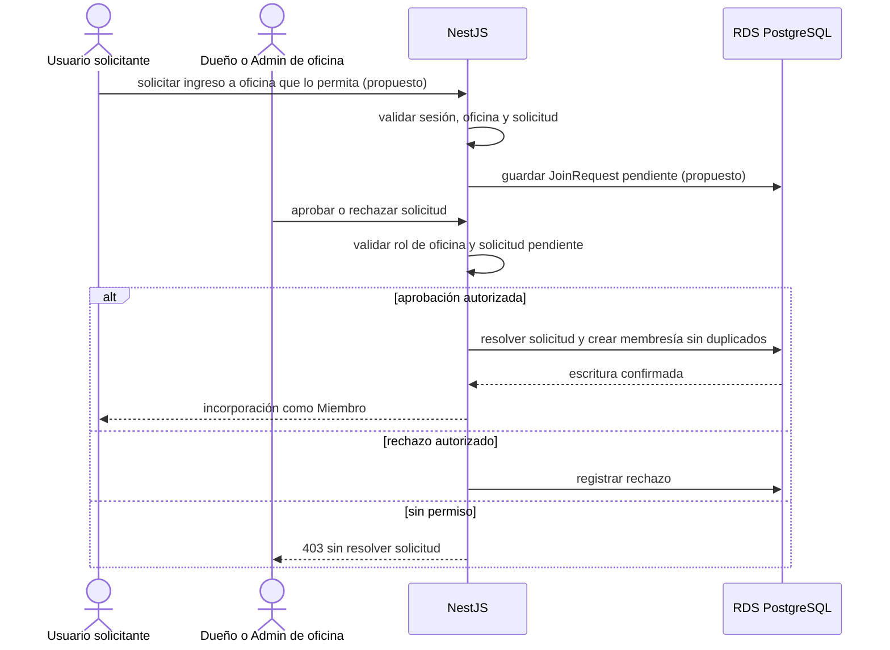
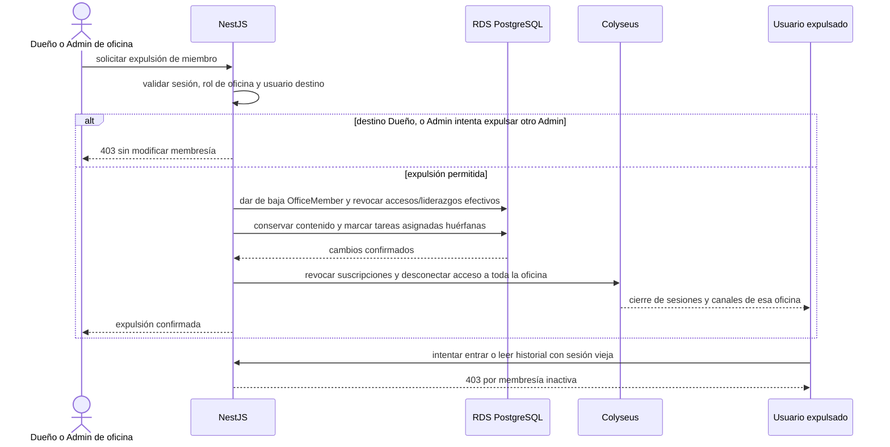
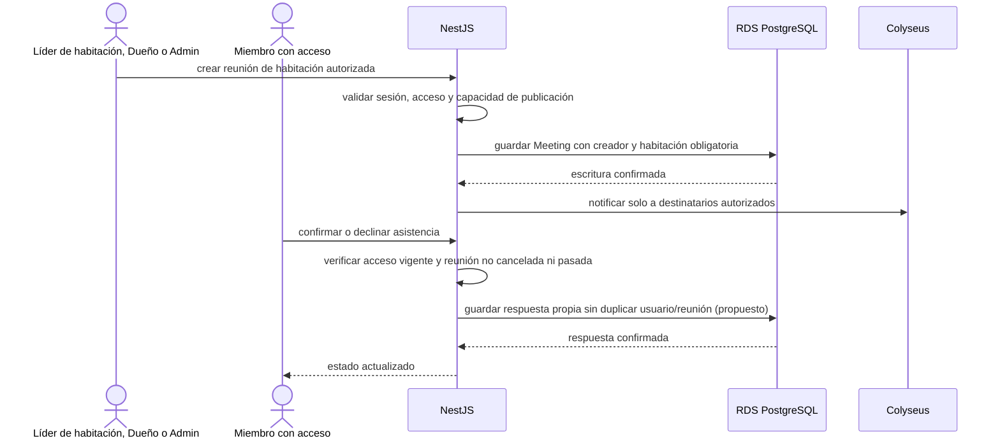
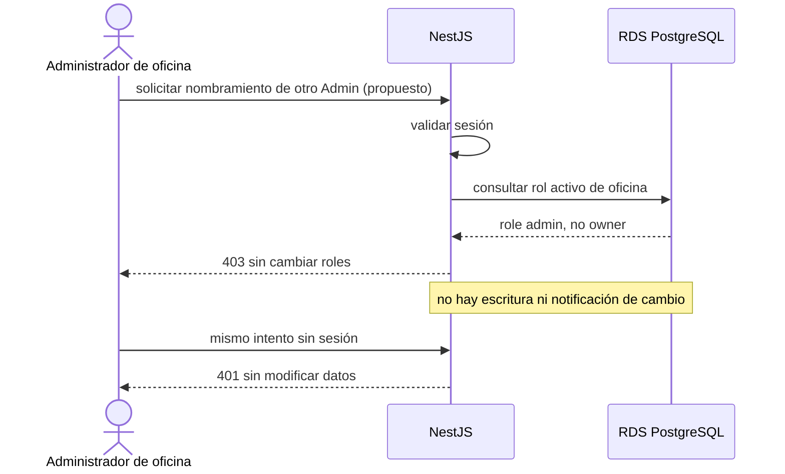

# Secuencias de administración (S8 a S13)

> Gestión de oficina, accesos y contenido según la [ERS](../../functional-requirements.md). Nombres de guards, operaciones y respuestas no exigidas por RF son propuestas, no implementación.

**En este archivo**

- [1. Escenarios de administración](#1-escenarios-de-administración)
  - [1.1 S8 — Invitación a oficina](#11-s8--invitación-a-oficina)
  - [1.2 S9 — Solicitud de ingreso y aprobación](#12-s9--solicitud-de-ingreso-y-aprobación)
  - [1.3 S10 — Expulsión de un miembro](#13-s10--expulsión-de-un-miembro)
  - [1.4 S11 — Reunión y asistencia](#14-s11--reunión-y-asistencia)
  - [1.5 S12 — Admin intenta nombrar otro Admin](#15-s12--admin-intenta-nombrar-otro-admin)
  - [1.6 S13 — Baja y recuperación de oficina](#16-s13--baja-y-recuperación-de-oficina)

← [Secuencias del núcleo](./core-flows.md) · [Índice](../README.md) · [Convenciones](../05-reference/conventions.md) →

## 1. Escenarios de administración

Las escrituras pasan por NestJS, con autenticación, autorización contextual y validación. Se difunde solo después de confirmar y solo a destinatarios autorizados. Roles de oficina y liderazgo de habitación son ámbitos distintos, no una jerarquía Moderador/Admin.

### 1.1 S8 — Invitación a oficina

RF-OFI-005 a RF-OFI-009: Dueño o Admin invitan; el Líder no incorpora usuarios nuevos. Enlace único significa identificable, no necesariamente de un solo uso: el límite de usos es opcional.

```mermaid
sequenceDiagram
    actor manager as Dueño o Admin de oficina
    actor guest as Invitado
    participant api as NestJS
    participant db as RDS PostgreSQL

    manager->>api: generar enlace de invitación (contrato propuesto)
    api->>api: validar sesión, oficina activa y rol Dueño/Admin
    alt sin permiso
        api-->>manager: 403 sin crear invitación
    else autorizado
        api->>db: guardar invitación con vencimiento y límite opcional de usos
        db-->>api: escritura confirmada
        api-->>manager: enlace único copiable
    end
    manager-->>guest: compartir enlace
    guest->>api: abrir enlace; autenticarse o registrarse si hace falta
    api->>api: validar invitación y oficina activas
    alt vencida, revocada, agotada u oficina dada de baja
        api-->>guest: rechazo con motivo; sin nueva membresía
    else usuario ya es miembro activo
        api-->>guest: ingresar sin duplicar membresía ni consumo de alta
    else incorporación permitida
        api->>db: crear o reactivar OfficeMember member y consumir uso atómicamente
        db-->>api: membresía confirmada; acceso inicial solo a principal
        api-->>guest: oficina disponible sin aprobación posterior
    end
```

La reinvitación de una persona expulsada no restaura sus accesos anteriores (RF-OFI-008). Guardar solo hash y validar/consumir la invitación atómicamente son obligatorios en [Rooms and permissions](../../../rules/rooms-and-permissions.md#invitations-and-membership-changes); el formato de token y las respuestas concretas requieren diseño técnico; el flujo no impone consumo único ni aprobación manual después de aceptar el enlace.

### 1.2 S9 — Solicitud de ingreso y aprobación

**Could · Evolución**, RF-OFI-018. No es un camino obligatorio del MVP ni corresponde a un Líder de habitación por ser Líder.



### 1.3 S10 — Expulsión de un miembro

**Must · MVP**, RF-OFI-012 y RN-13: baja lógica de membresía; se conservan mensajes, tareas y anuncios del usuario. No se elimina físicamente la membresía como mecanismo de expulsión.



La revalidación de membresía/accesos impide reingreso aunque falle una notificación de desconexión. Quitar solo acceso a una habitación aplica RN-12 y RF-HAB-010: se conserva pertenencia a la oficina, pero se pierde contenido e historial de esa habitación; el avatar se redirige a la principal según la ERS.

### 1.4 S11 — Reunión y asistencia

RF-CAR-005 a RF-CAR-008: Líder de esa habitación, Dueño o Admin crean; el Líder gestiona solo sus propias reuniones. **Confirmar asistencia es Must · MVP**, no funcionalidad complementaria.



La respuesta de asistencia puede cambiarse antes de la reunión, nunca si está cancelada o pasada (RF-CAR-007). Gestionar anuncios ajenos o editar/cancelar reuniones ajenas corresponde únicamente a Dueño/Admin (RF-CAR-004/006). La misma regla aplica aunque el cliente manipule un ID. La programación sigue [Communication and meetings](../../../rules/communication-and-meetings.md#meetings-and-attendance) y [Data and time](../../../rules/data-and-time.md), sin generalizar la política del repaso.

### 1.5 S12 — Admin intenta nombrar otro Admin

RF-OFI-011, RN-09: solo el Dueño nombra o quita Administradores. El rechazo no depende de ocultar el botón ni de una jerarquía de guard heredada.



### 1.6 S13 — Baja y recuperación de oficina

RF-OFI-014 a RF-OFI-016 y RN-14/RN-15: solo Dueño; no hay transferencia de propiedad ni abandono del Dueño. La baja es lógica y recuperable durante **15 días**; después se elimina definitivamente. No se decide aquí la reposición de oficina tras eliminación (P-05).

```mermaid
sequenceDiagram
    actor owner as Dueño de oficina
    participant api as NestJS
    participant db as RDS PostgreSQL
    participant col as Colyseus

    owner->>api: confirmar baja explícita de su oficina
    api->>api: validar sesión, propiedad y confirmación
    api->>db: registrar baja lógica y fecha
    db-->>api: escritura confirmada
    api->>col: cerrar acceso y canales de oficina para todos
    Note over api,db: nadie puede entrar; solo Dueño ve la opción de recuperar
    alt Dueño solicita recuperación dentro de 15 días
        owner->>api: recuperar oficina
        api->>api: verificar propiedad y plazo con reloj servidor
        api->>db: restaurar oficina con miembros, accesos y datos anteriores
        db-->>api: restauración confirmada
    else plazo de recuperación vencido
        api->>db: eliminación definitiva por sistema (mecanismo por diseñar)
    end
```

Eliminar una habitación adicional es un flujo diferente: requiere Dueño/Admin, advertencia del contenido perdido y confirmación; la principal nunca se elimina (RF-HAB-005). Los mecanismos técnicos de eliminación y recuperación deben diseñarse y probarse antes de implementarlos; estos diagramas no ejecutan borrados.

← [Secuencias del núcleo](./core-flows.md) · [Índice](../README.md) · [Convenciones](../05-reference/conventions.md) →
