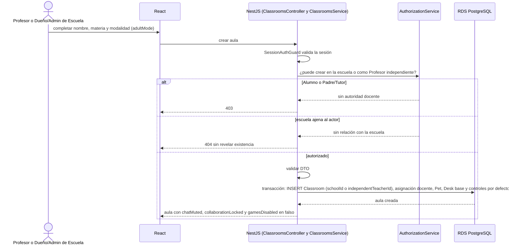
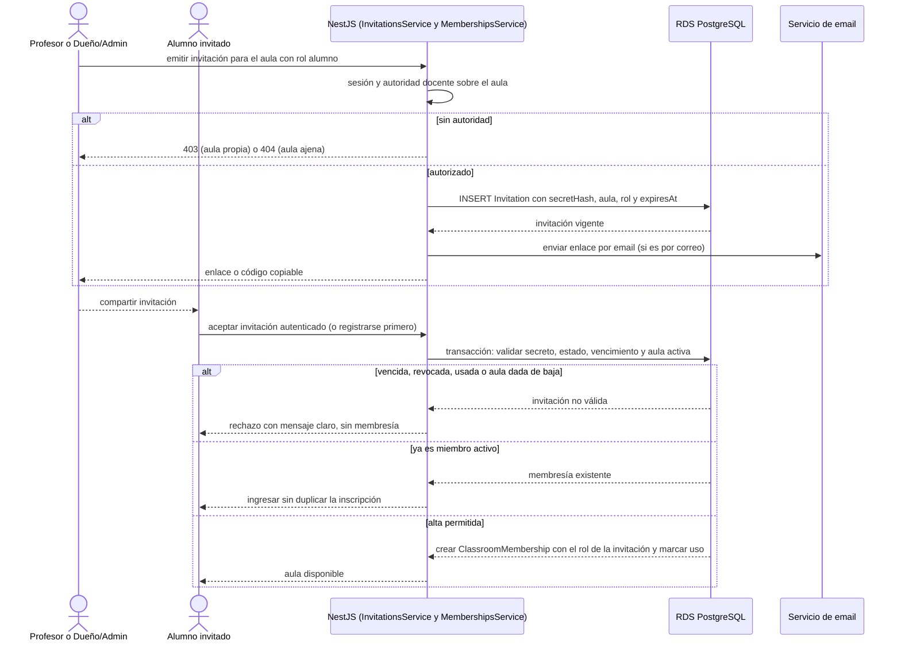
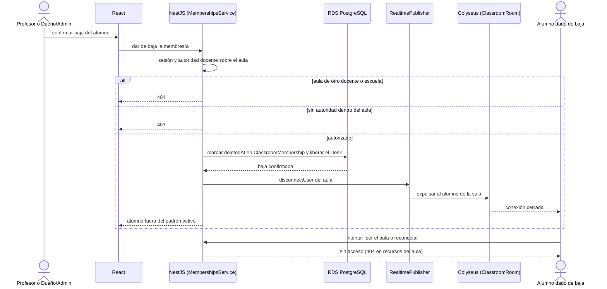
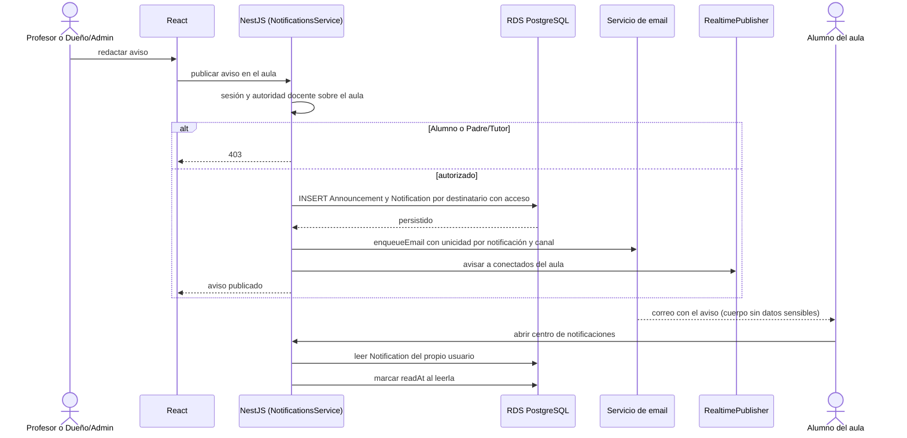
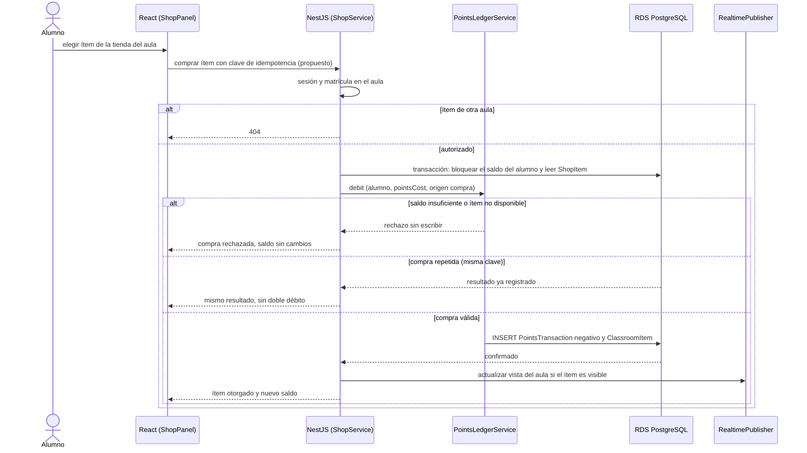
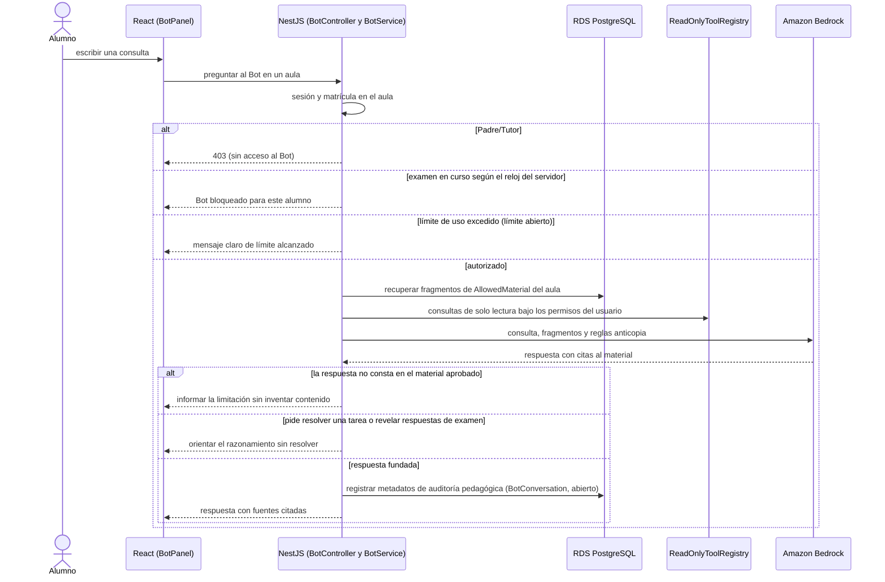

# Secuencias de administración y servicios del aula (S8 a S13)

> Gestión de escuela y aula, accesos, comunicación, tienda y consulta al Bot según la [ERS](../../functional-requirements.md). Nombres de guards, operaciones y respuestas no exigidas por RF son propuestas, no implementación.

**En este archivo**

- [1. Escenarios de administración y servicios](#1-escenarios-de-administración-y-servicios)
  - [1.1 S8 — Creación de aula](#11-s8--creación-de-aula)
  - [1.2 S9 — Invitación y alta en el aula](#12-s9--invitación-y-alta-en-el-aula)
  - [1.3 S10 — Baja lógica de un miembro](#13-s10--baja-lógica-de-un-miembro)
  - [1.4 S11 — Aviso con notificación](#14-s11--aviso-con-notificación)
  - [1.5 S12 — Compra en la tienda](#15-s12--compra-en-la-tienda)
  - [1.6 S13 — Consulta al Bot Guía de Estudio](#16-s13--consulta-al-bot-guía-de-estudio)

← [Secuencias del núcleo](./core-flows.md) · [Índice](../README.md) · [Convenciones](../05-reference/conventions.md) →

## 1. Escenarios de administración y servicios

Las escrituras pasan por NestJS, con autenticación, autorización contextual y validación, en ese orden ([Convenciones](../05-reference/conventions.md#12-orden-obligatorio-de-verificación)). Se difunde solo después de confirmar y solo a destinatarios autorizados. La autoridad docente es de quien dicta el aula o, por derivación de `SchoolMember`, del Dueño y del Admin de la escuela (RN-03). Todo es **diseño propuesto**, no implementado. Quedan fuera de esta serie, por ser MVP Extendido, la vinculación Padre-Alumno (RF-AUT-004), los controles de clase en vivo (RF-VIV) y la mascota del aula (RF-GAM-004); sus reglas están en la ERS.

### 1.1 S8 — Creación de aula

RF-AUL-001 (Must · MVP Core, HU-AUL-001; RN-01, RN-04). Un Profesor independiente o el Dueño/Admin de una escuela crean un aula. El `Classroom` pertenece a exactamente una `School` o a un Profesor independiente, y esa exclusión la garantiza la base de datos. Se inicializan en la misma transacción la `Pet`, los `Desk` base y los controles por defecto.

Dueño y Admin obtienen autoridad por su `SchoolMember`, sin una `ClassroomMembership` por aula. Cómo consta el profesor titular en el aula (`ClassroomMembership.role`) es **propuesto** y está **abierto** en [Data](../../../rules/data.md#entities). El alcance de lo que puede hacer un Admin frente al Dueño está **abierto** en [Classrooms and roles](../../../rules/classrooms-and-roles.md). La creación de la escuela y del espacio del Profesor independiente ocurre en el registro (S1).

### 1.2 S9 — Invitación y alta en el aula

RF-AUL-002 (Must · MVP Core, HU-AUL-002; RN-02). El Profesor del aula o el Dueño/Admin emiten una invitación por email o un código/enlace con vencimiento y revocación. Solo se guarda el hash del secreto. El rol lo fija la invitación y el invitado no puede cambiarlo. La validación y el alta de la membresía son una única operación atómica e idempotente.

La invitación es de un solo uso, vence y es revocable ([Classrooms and roles](../../../rules/classrooms-and-roles.md#invitations-and-membership)). Que un código o enlace compartido con varios alumnos admita varios usos no queda resuelto por esa regla y se considera **abierto**. Una invitación de Padre/Tutor sigue este mismo patrón pero pertenece a RF-AUT-004 (MVP Extendido) y se rechaza en aulas con `adultMode` (RN-16). El mecanismo de reintentos y rebotes del email está **abierto** en [Communication and notifications](../../../rules/communication-and-notifications.md). La invitación a la escuela (Dueño/Admin invitan Profesores, RF-AUL-004, MVP Extendido) es análoga con destino `schoolId`.

### 1.3 S10 — Baja lógica de un miembro

RF-AUL-003 (Must · MVP Core, HU-AUL-003; RN-03, RN-18). Dar de baja a un alumno corta de inmediato su acceso HTTP y su presencia en tiempo real, pero conserva entregas, calificaciones y mensajes atribuidos. No hay borrado físico.

Los contenidos generados (entregas, notas, mensajes, asientos de puntos) se conservan íntegros para trazabilidad académica (RN-18). La propagación a la sala en vivo es un requisito ([Realtime and presence](../../../rules/realtime-and-presence.md)) cuyo mecanismo concreto está **abierto**; el diagrama usa `RealtimePublisher` como propuesta. Los efectos de eliminar una cuenta, un aula o una escuela sobre los registros retenidos siguen **abiertos** en [Data](../../../rules/data.md#open-decisions).

### 1.4 S11 — Aviso con notificación

RF-COM-001 y RF-COM-004 (Must · MVP Core, HU-COM-001 y HU-COM-004). El aviso pertenece a la cartelera del aula. El aviso y su notificación son durables en PostgreSQL y el correo es un canal con envío idempotente. La difusión en vivo ocurre solo después de persistir.

Los destinatarios son los alumnos matriculados y, en el MVP Extendido, los Padres/Tutores de los hijos vinculados **si la decisión de producto lo permite**: queda **abierto** en [Communication and notifications](../../../rules/communication-and-notifications.md). Un alumno nunca ve notificaciones ajenas, y la baja de acceso al aula quita la lectura. También **abiertos**: frecuencia, resumen versus envío inmediato para padres, opción de baja de correos no esenciales, y registro y supresión de rebotes. Los correos y los registros nunca incluyen contraseñas, tokens ni datos sensibles de menores (RN-20).

### 1.5 S12 — Compra en la tienda

RF-GAM-003 (Must · MVP Core, HU-GAM-003; RN-09, RN-07). La compra debita puntos y otorga el ítem en una única transacción con bloqueo, de modo que el saldo no queda negativo ni siquiera ante dos peticiones concurrentes.

El libro mayor es inmutable: no se edita ni se borra un asiento (RN-07). Un ítem solo es comprable si su efecto está implementado (RN-09). Siguen **abiertos** en [Points and shop](../../../rules/points-and-shop.md): reembolsos (si existen son asientos compensatorios), ítems consumibles o permanentes, apilado y límites por aula, quién puede comprar y equipar accesorios, y el saldo visible entre compañeros (por defecto no se muestra). El aporte a la mascota (RF-GAM-004) es MVP Extendido y sigue la misma mecánica con `pet_contribution`.

### 1.6 S13 — Consulta al Bot Guía de Estudio

RF-BOT-001 y RF-BOT-002 (Must · MVP Core, HU-BOT-001 y HU-BOT-002; RN-12, RN-13, RN-14). El Bot responde por RAG solo sobre el material que el Profesor habilitó para el aula, es solo de lectura y se bloquea para el alumno mientras tiene un examen en curso. Bedrock se invoca únicamente desde NestJS.

El filtro por aula y material habilitado se aplica en el servidor antes de invocar a Bedrock, y el Bot no crea, edita ni borra datos en el MVP, ni siquiera ante un pedido explícito (RN-14, RF-BOT-004). Siguen **abiertos** en [AI bot and daily briefing](../../../rules/ai-bot-and-daily-briefing.md): modelo concreto, límites numéricos por usuario, aula y global, si se persiste `BotConversation` y su retención, la detección de uso indebido y la extensión de las pruebas adversarias. Verificar la disponibilidad de modelos de Bedrock en `us-east-2` es una condición pendiente de la decisión D5.

---

← [Secuencias del núcleo](./core-flows.md) · [Índice](../README.md) · [Convenciones](../05-reference/conventions.md) →
