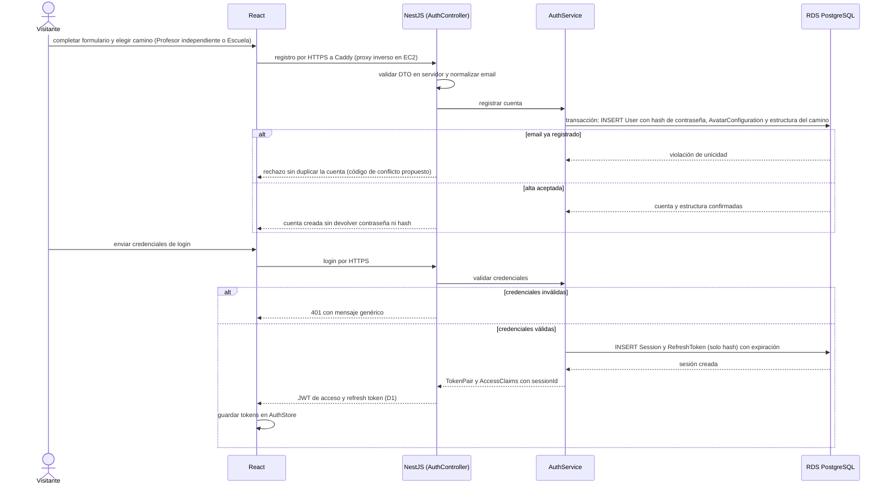
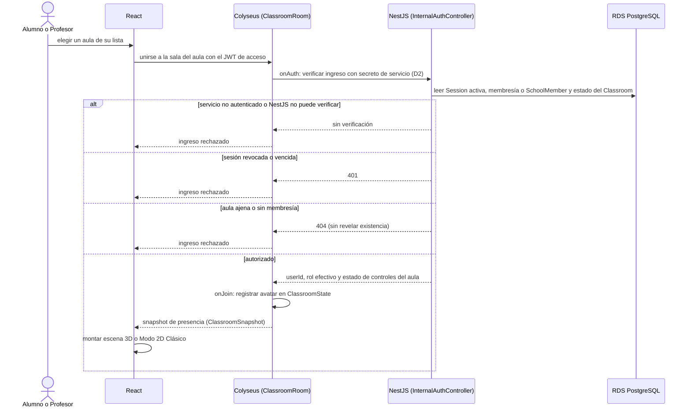
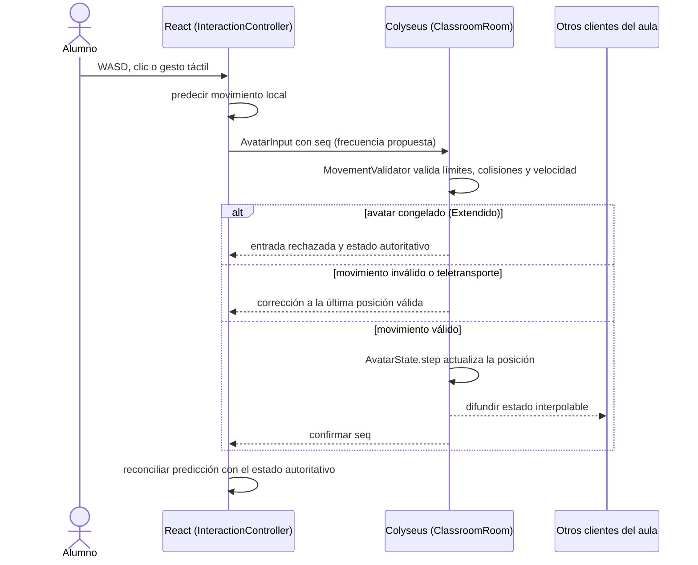
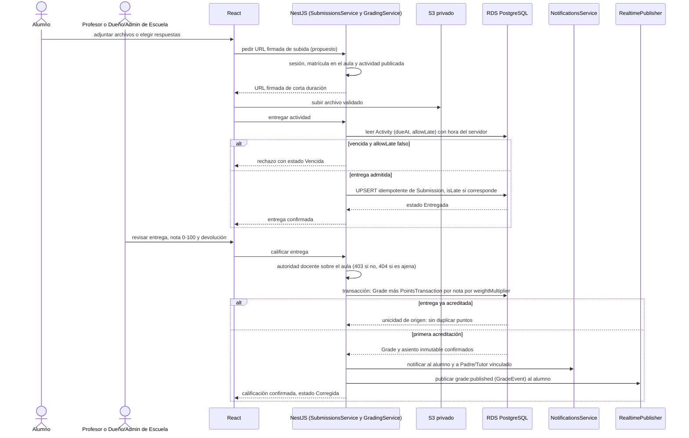
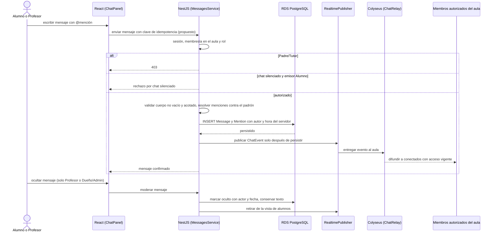
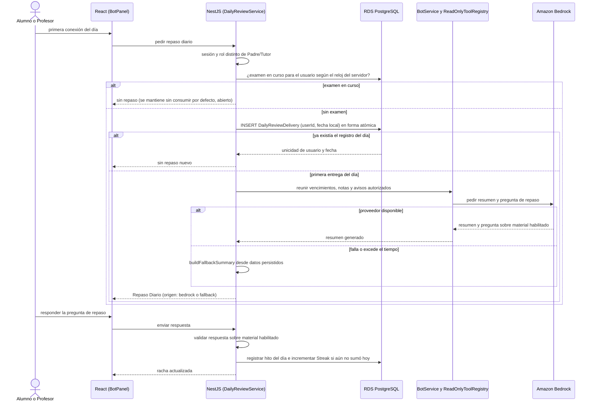
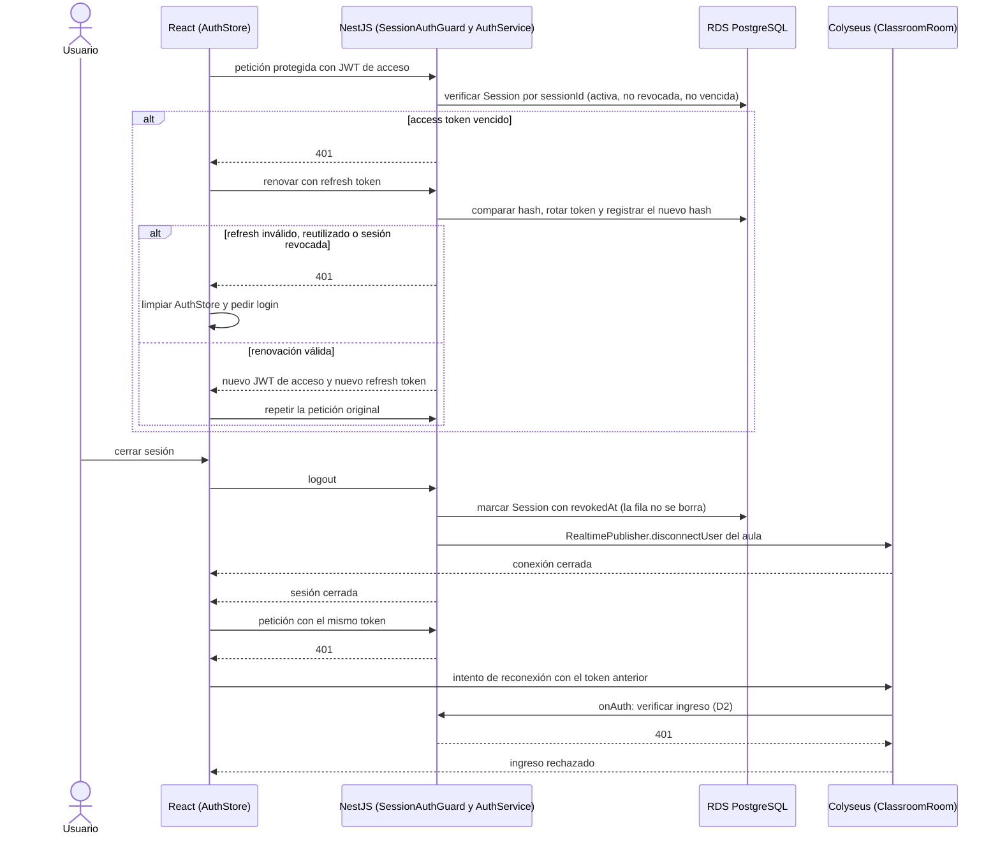

# Secuencias del núcleo (S1 a S7)

> Cuenta y sesión, ingreso al aula, movimiento, entrega y calificación, chat, repaso diario y renovación/logout. Parte del [índice de diagramas](../README.md).

**En este archivo**

- [1. Diagramas de secuencia](#1-diagramas-de-secuencia)
  - [1.1 S1 — Registro y login](#11-s1--registro-y-login)
  - [1.2 S2 — Ingreso al aula](#12-s2--ingreso-al-aula)
  - [1.3 S3 — Movimiento de avatar](#13-s3--movimiento-de-avatar)
  - [1.4 S4 — Entrega y calificación con puntos](#14-s4--entrega-y-calificación-con-puntos)
  - [1.5 S5 — Mensaje de chat](#15-s5--mensaje-de-chat)
  - [1.6 S6 — Repaso diario del bot](#16-s6--repaso-diario-del-bot)
  - [1.7 S7 — Renovación, reconexión y logout](#17-s7--renovación-reconexión-y-logout)

← [Clases por capa](../03-structural/class-design.md) · [Índice](../README.md) · [Secuencias de administración (S8 a S13)](./admin-flows.md) →

---

## 1. Diagramas de secuencia

Los siete escenarios recorren el ciclo central del MVP Core: alta de cuenta y sesión, ingreso a un aula 3D, movimiento, entrega y calificación con acreditación de puntos, chat, repaso diario del bot y las salidas del sistema (renovación, reconexión y logout). Cada diagrama aísla un camino y deja ver quién decide qué: NestJS es la autoridad de todo lo persistente, Colyseus la de lo efímero, y PostgreSQL nunca recibe una escritura del plano realtime ([documento maestro](../../../master-document.md), RN-19).

Todo lo que sigue es **diseño propuesto (to-be)**, no relevamiento de implementación: el repositorio solo contiene documentación y no hay código de aplicación ([estado del repositorio](../../../README.md)). Por eso no existen endpoints, verbos, DTOs ni payloads definitivos, y los eventos son ilustrativos. Los nombres de componentes (`AuthService`, `InternalAuthController`, `MovementValidator`, etc.) coinciden con el [diseño de clases](../03-structural/class-design.md) y las entidades con el [modelo de datos](../03-structural/data-model.md), ambos también propuestos. Se rotulan con **(propuesto)** o **(abierto)** los contratos y parámetros que la fuente deja sin definir. Los códigos de error siguen [Authentication and session](../../../rules/authentication-and-session.md#authorization-responses): `401` sin credencial válida, `403` con rol insuficiente sobre un recurso visible y `404` uniforme ante recursos de otra escuela o aula.

Las decisiones de sesión (D1) e integración NestJS-Colyseus (D2) provienen de [Technical justification, sección 7](../../technical-justification.md#7-architecture-decisions-recorded-on-2026-11-02) y fueron aprobadas por Agustín el 2026-11-02 (no se afirma aprobación de todo el equipo); los flujos las asumen como diseño propuesto.

### 1.1 S1 — Registro y login

RF-AUT-001 y RF-AUT-002 (Must · MVP Core, HU-AUT-001 y HU-AUT-002). El registro elige el camino organizacional y crea cuenta y estructura inicial en una sola transacción: para el Profesor independiente, su espacio docente, y para una Escuela, la `School` con el usuario como `SchoolMember(owner)`. Registrarse sin invitación no otorga rol en estructuras existentes. El login emite, según D1, un JWT de acceso de corta vida con el identificador de sesión y un refresh token opaco guardado hasheado.

Cliente y servidor validan entradas, pero el servidor es la autoridad (RN-02, RN-20). Que las respuestas de login no revelen si falló el correo o la contraseña es obligatorio. El cliente guarda ambos tokens en `sessionStorage` y envía el de acceso como `Authorization: Bearer` ([D1](../../technical-justification.md#d1-session-mechanism)). Que un mismo usuario cumpla el camino Escuela y el de Profesor independiente está **abierto** en [Data](../../../rules/data.md#open-decisions).

### 1.2 S2 — Ingreso al aula

RF-AUL-005 y RF-ESP-001 (Must · MVP Core, HU-AUL-005 y HU-ESP-001; RN-01, RN-04). Ingresar no es abrir un socket: el cliente se une a la `Room` de Colyseus y esta, en `onAuth`, consulta a NestJS con un endpoint interno autenticado con un secreto de servicio guardado en AWS Secrets Manager (D2). Si NestJS no puede verificar, Colyseus rechaza el ingreso. NestJS sigue siendo el único servicio de autorización y responde desde el estado persistido actual. El token viaja como `Authorization: Bearer` en la petición de matchmaking (`client.auth.token`), no en las opciones de ingreso, y el endpoint interno es `POST /internal/realtime/join-verification` con el encabezado `x-internal-service-secret` (D2, actualización del 2026-11-09). Un `Classroom` persistente no equivale a la instancia `Room` de Colyseus.

El rol se lee del estado persistido en cada verificación y no del contenido de la sesión, de modo que los cambios aplican de inmediato ([Authentication and session](../../../rules/authentication-and-session.md#authorization-responses)). El Modo 2D Clásico no pasa por esta sala y obtiene el mismo contenido por REST (RN-17, RF-ESP-003). La política de conexiones duplicadas del mismo usuario está **abierta** ([Realtime and presence](../../../rules/realtime-and-presence.md)). Un Padre / Tutor no ingresa al aula 3D (RN-16). El formato de la credencial presentada a Colyseus no figura en las reglas y se rotula **(propuesto)**: nunca debe viajar en una URL que se registre en logs.

### 1.3 S3 — Movimiento de avatar

RF-ESP-001 (Must · MVP Core, HU-ESP-001; RN-19). El cliente predice localmente y el servidor realtime valida plausibilidad: límites, colisiones y velocidad. Una posición no se persiste: vive en la memoria de Colyseus y no hay fila por fotograma en PostgreSQL. El rechazo de un avatar congelado corresponde a RF-VIV-001 (Must · **MVP Extendido**, RN-10) y se muestra para fijar el límite de autoridad.

Frecuencia de envío, tick rate y estrategia exacta de reconciliación están **abiertos** ([Realtime and presence](../../../rules/realtime-and-presence.md)). Qué puede hacer un alumno congelado además de moverse (chat, pupitre, bot) también está **abierto** ([Live classroom tools](../../../rules/live-classroom-tools.md)); el profesor no queda congelado. Colyseus informa a NestJS solo el tiempo conectado agregado, que alimenta `ActivityMetric`, y el cliente nunca informa el suyo.

### 1.4 S4 — Entrega y calificación con puntos

RF-ACT-003, RF-ACT-004 y RF-GAM-001 (Must · MVP Core; HU-ACT-003, HU-ACT-004, HU-GAM-001; RN-05, RN-06, RN-07, RN-18, RN-20). Es el recorrido académico central. La hora de entrega, la tardanza y la nota se deciden en el servidor. La calificación y el asiento de puntos ocurren en la misma transacción, y el asiento es inmutable.

En actividades de opción múltiple el servidor corrige de forma automática con las respuestas persistidas y las opciones correctas nunca se envían al cliente antes de cerrar la evaluación (RN-06). Una **recalificación** conserva trazabilidad y agrega un asiento compensatorio por la diferencia, sin editar el original (RN-07). El correo al Padre / Tutor es parte del MVP Extendido (RF-ACT-006). Siguen **abiertos** en [Activities and grading](../../../rules/activities-and-grading.md): límites de archivos y malware, entrega después del cierre de un examen, intentos múltiples, anulación manual de una nota automática y el mecanismo de control de concurrencia (nunca last-write-wins silencioso). El nombre del evento `grade:published` es ilustrativo.

### 1.5 S5 — Mensaje de chat

RF-COM-002 (Must · MVP Core, HU-COM-002; RN-01, RN-16, RN-18). El mensaje se persiste antes de difundirse y quien perdió mensajes los recupera del historial. La ruta de envío (REST seguido de difusión de Colyseus, o mensaje de Colyseus validado por NestJS) está **abierta** en [Communication and notifications](../../../rules/communication-and-notifications.md); el diagrama muestra la primera opción como propuesta.

El texto se almacena y devuelve como texto, nunca como HTML. El límite de longitud, el tope de menciones por mensaje, el filtrado automático y el silenciado individual están **abiertos**. La moderación es un cambio de estado y el cuerpo docente conserva el historial completo (RN-18). Un usuario que pierde acceso al aula deja de recibir difusión y de leer historial.

### 1.6 S6 — Repaso diario del bot

RF-BOT-003 (Must · MVP Core, HU-BOT-003; RN-08, RN-13, RN-15). En la primera conexión autenticada del día en `America/Argentina/Buenos_Aires` se entrega exactamente un repaso por usuario, aun con varias pestañas concurrentes. Se omite para el Padre / Tutor y mientras hay un examen en curso. El bot consulta solo datos autorizados y no modifica nada en el MVP (RN-14).

La racha se actualiza solo con una acción académica real y a lo sumo una vez por alumno y día local (RN-08); iniciar sesión no la extiende. Siguen **abiertos** en [AI bot and daily briefing](../../../rules/ai-bot-and-daily-briefing.md): recuperación si falla la entrega tras crear el registro, persistencia del texto completo del repaso (con atención a menores), modelo concreto, límites numéricos de uso y si un repaso omitido por examen se consume. Ver también [Convenciones](../05-reference/conventions.md#13-idempotencia-y-duplicados).

### 1.7 S7 — Renovación, reconexión y logout

RF-AUT-002 (Must · MVP Core, HU-AUT-002; RN-04). Con D1, el access token vence pronto y se renueva con un refresh token opaco que rota en cada uso. El servidor contrasta el `sessionId` del token con la fila de `Session` en cada petición protegida, de modo que una sesión revocada por logout o por reinicio de contraseña responde `401` aunque el token siga sin vencer.

Una reconexión legítima (corte de red con sesión vigente) repite el ingreso de S2: Colyseus vuelve a verificar con NestJS y restaura la presencia y el asiento, sin filas por fotograma (RN-19). La **ventana de reconexión**, el backoff y los reintentos acotados están **abiertos** ([Realtime and presence](../../../rules/realtime-and-presence.md)), igual que las duraciones de los tokens (parámetros de configuración, D1) y la propagación de la pérdida de acceso a la sala en vivo. Reiniciar la contraseña invalida las sesiones previas por el mismo mecanismo (RF-AUT-002, criterio 4).

---

← [Clases por capa](../03-structural/class-design.md) · [Índice](../README.md) · [Secuencias de administración (S8 a S13)](./admin-flows.md) →
