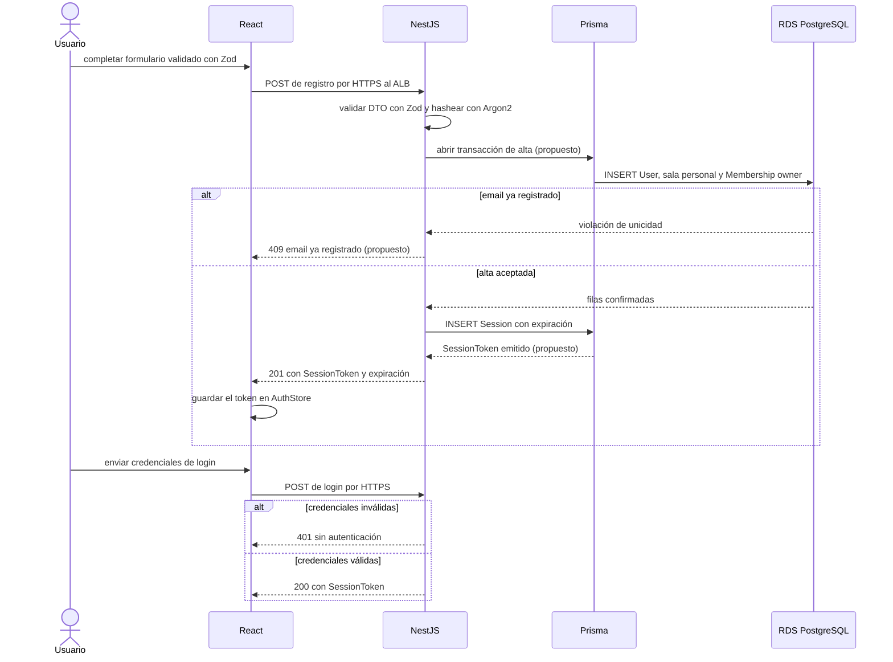
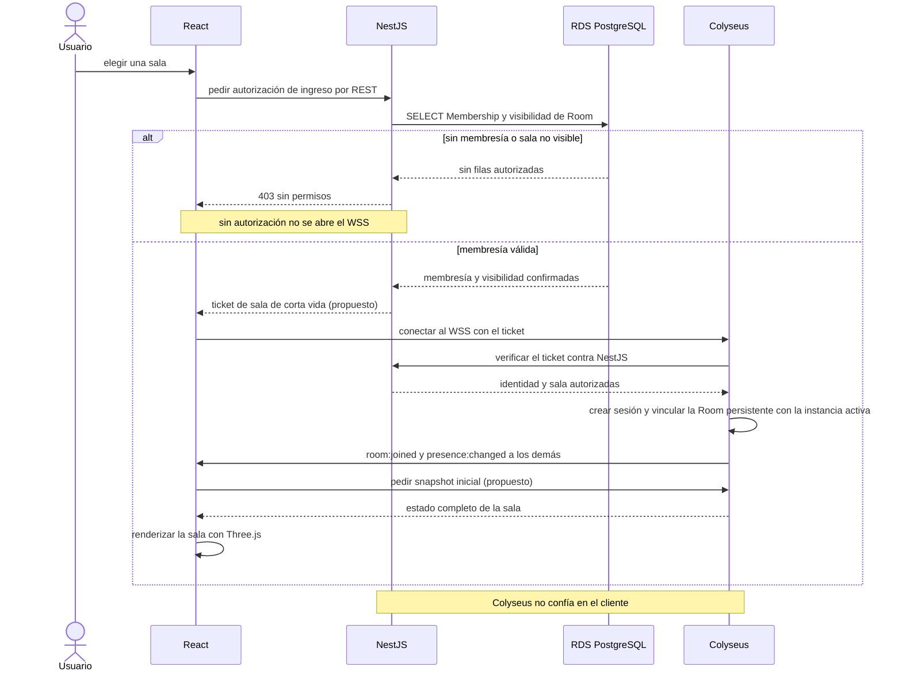
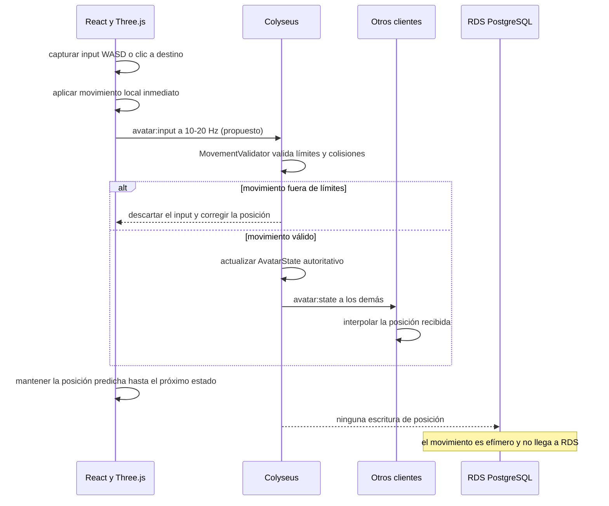
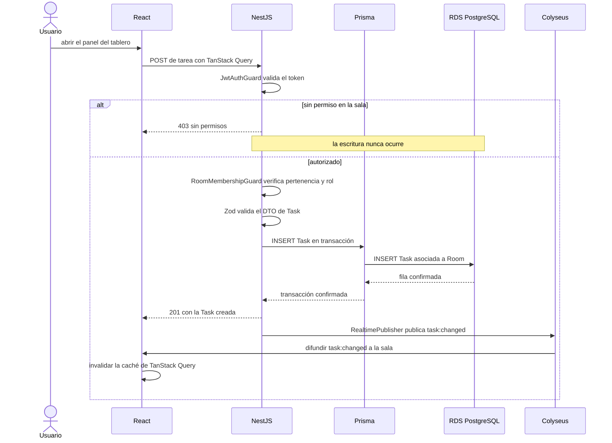
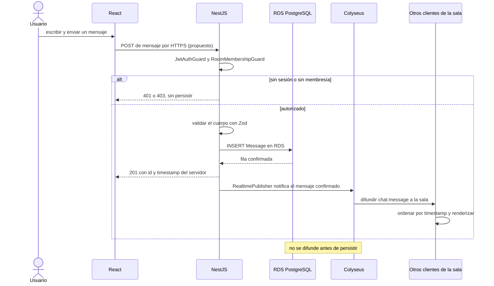
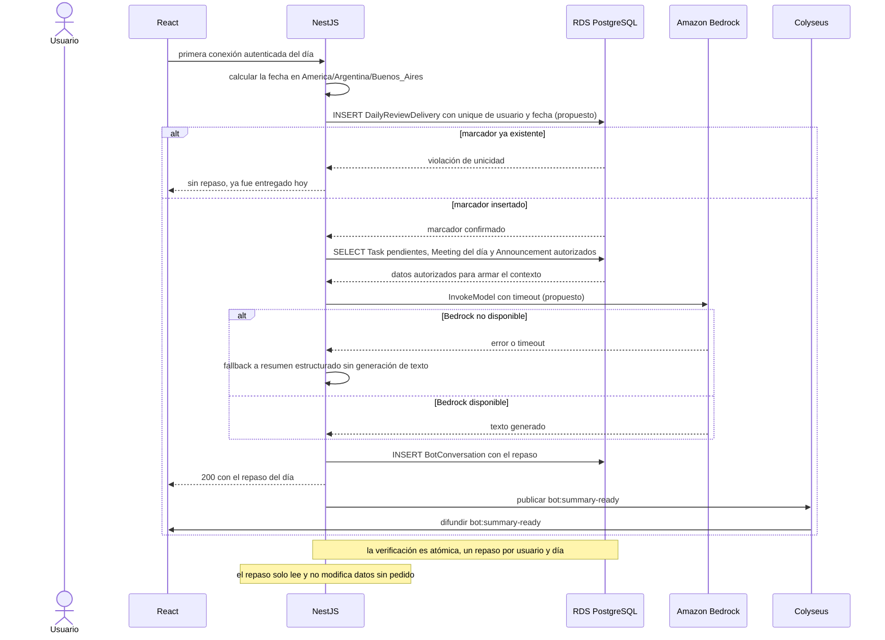
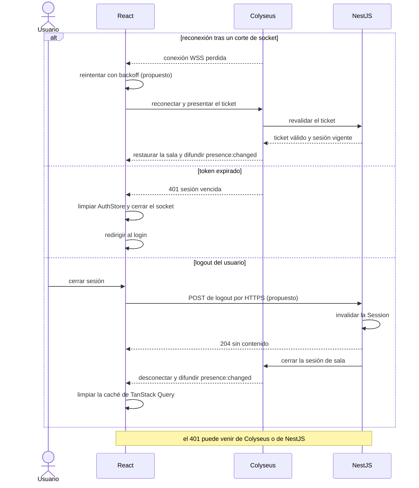

# Secuencias del núcleo (S1 a S7)

> Cuenta, ingreso a sala, movimiento, tareas, chat, repaso diario y reconexión. Parte del [índice de diagramas](../README.md).

**En este archivo**

- [1. Diagramas de secuencia](#1-diagramas-de-secuencia)
  - [1.1 S1 — Registro, login y sala personal](#11-s1--registro-login-y-sala-personal)
  - [1.2 S2 — Ingreso a una sala](#12-s2--ingreso-a-una-sala)
  - [1.3 S3 — Movimiento de avatar](#13-s3--movimiento-de-avatar)
  - [1.4 S4 — Crear una tarea](#14-s4--crear-una-tarea)
  - [1.5 S5 — Mensaje de chat](#15-s5--mensaje-de-chat)
  - [1.6 S6 — Repaso diario del bot](#16-s6--repaso-diario-del-bot)
  - [1.7 S7 — Reconexión, token expirado y logout](#17-s7--reconexión-token-expirado-y-logout)

← [Clases por capa](../03-structural/class-design.md) · [Índice](../README.md) · [Secuencias de administración (S8 a S12)](./admin-flows.md) →

---

## 1. Diagramas de secuencia

Los siete escenarios de esta sección recorren el ciclo completo del producto: alta de cuenta y sesión, ingreso a una sala, movimiento de avatar, creación de una tarea, mensaje de chat, repaso diario del bot y las tres salidas del sistema —reconexión, token vencido y logout—. Cada diagrama aísla un camino y deja ver quién decide qué: NestJS es la autoridad de todo lo persistente, Colyseus la de lo efímero, y RDS nunca recibe una escritura del plano realtime (`master-document.md:283-284`).

Todo lo que sigue es **diseño objetivo (to-be)**, no relevamiento de implementación: el repositorio solo contiene documentación y no hay código de aplicación (`README.md:3`). Por eso no existen endpoints, verbos, DTOs ni payloads definitivos, y los eventos son ilustrativos y no definitivos (`master-document.md:207`). Se rotulan con **(propuesto)** los contratos y parámetros que la fuente deja sin definir —tickets, tokens, formatos de error no documentados, frecuencia de envío, timeouts y backoff—; los nombres de componentes internos como guards, validadores y publicadores son nombres de diseño. Los únicos códigos de error documentados son 401 sin autenticación y 403 sin permisos (`master-document.md:219`).

### 1.1 S1 — Registro, login y sala personal

El alta crea tres cosas que deben quedar consistentes entre sí: el `User`, su sala personal y la `Membership` que lo hace dueño de esa sala. La sala personal se crea automáticamente al registrar el usuario y es privada por defecto (`master-document.md:30,26,87`); el hash de contraseña admite Argon2 o bcrypt y aquí se elige Argon2 (`master-document.md:301`). La sesión se gestiona en NestJS con expiración (`master-document.md:215`), y todo el tráfico React hacia NestJS pasa por HTTPS a través del ALB (`master-document.md:280-281`).

La doble validación con Zod —cliente y servidor— es la regla general de validación (`master-document.md:153`), y el hash nunca sale de NestJS. La atomicidad del alta no está especificada en la fuente, de modo que agrupar `User`, sala y `Membership` en una transacción es una propuesta; lo mismo vale para el formato del `SessionToken` y para el 409 por email repetido, que la fuente no cataloga. El login repite el mismo contrato de sesión y devuelve 401 cuando las credenciales no son válidas (`master-document.md:219`).

### 1.2 S2 — Ingreso a una sala

Ingresar no es abrir un socket: es una autorización REST seguida de un handshake. El cliente pide la conexión a Colyseus por HTTPS/WSS, Colyseus valida identidad y autorización con el backend antes de vincular la sesión con la sala persistente, y recién entonces sincroniza la presencia (`master-document.md:282-283`). Una sala del producto en PostgreSQL no equivale a la instancia `Room` de Colyseus (`master-document.md:35`), y puertas y accesos también verifican permisos (`master-document.md:32,46`).

El ticket de corta vida y el snapshot inicial no figuran en la fuente: el primero materializa la autorización previa sin reutilizar la sesión completa, el segundo es el mecanismo de sincronización que el documento no detalla. Lo que sí es regla es el orden: la autorización se verifica en el servidor (`master-document.md:86,88,217`), y Colyseus revalida el ticket contra NestJS en lugar de aceptar la palabra del cliente. El `alt` de 403 corta antes de abrir el WSS, de modo que un usuario sin membresía nunca llega a Colyseus.

### 1.3 S3 — Movimiento de avatar

El movimiento es el caso donde el plano efímero se ve puro. Three.js detecta la intención, el cliente mueve localmente y Colyseus sincroniza; los demás clientes interpolan (`master-document.md:59,62,64`). La regla que ordena todo el diagrama es explícita: no se escriben posiciones de cada fotograma en RDS (`master-document.md:63,283`), y las posiciones transitorias y los estados interpolados no son filas persistentes (`master-document.md:225`).

La predicción local hace que el avatar responda sin esperar al servidor, pero la posición autoritativa es la que emite `avatar:state`; el cliente solo interpola y corrige. La frecuencia de 10-20 Hz y la autoridad exacta del movimiento figuran entre los huecos declarados, por eso la frecuencia va marcada como propuesta. `RDS PostgreSQL` aparece únicamente para dibujar la ausencia: no hay tabla de posiciones ni escritura por tick, y si Colyseus se cae no se pierde nada persistente.

### 1.4 S4 — Crear una tarea

Crear una tarea es el patrón canónico de escritura persistente: el panel React manda la mutación, NestJS valida sesión, pertenencia y DTO, Prisma guarda en RDS y solo después se notifica a la sala (`master-document.md:284`). Las tareas viven asociadas a una sala y admiten fechas, estados y responsables, con CRUD completo desde el panel (`master-document.md:76-78,198`).

Los dos guards son la traducción del orden de verificación: primero autenticación, después permisos sobre la sala, y solo entonces validación de datos. El 403 corta antes de tocar Prisma, así que la escritura no existe ni parcialmente. La difusión de `task:changed` va después del 201 porque la regla es notificar una operación ya confirmada (`master-document.md:203,284`); la invalidación de caché en el cliente es lo que reconcilia el estado REST con el evento recibido. La matriz de permisos por rol sigue sin estar definida, de modo que el detalle de qué rol puede crear tareas es una propuesta.

### 1.5 S5 — Mensaje de chat

El mensaje pertenece a una sala y tiene historial persistente (`master-document.md:69`). Para respetar el camino único de escritura de la [02-system-architecture/realtime-colyseus.md](../02-system-architecture/realtime-colyseus.md#13-regla-de-consistencia-y-autoridad), **el envío va por REST a NestJS** y Colyseus solo difunde el mensaje ya confirmado a la sala; el historial también se recupera por REST (`master-document.md:199,284`). Decisión de diseño (propuesto): reemplaza la versión anterior, donde Colyseus llamaba a NestJS para persistir.

El orden es la garantía: el `INSERT` y la confirmación de RDS preceden a la difusión, y el mensaje que reciben los demás ya tiene id y timestamp del servidor, no del reloj del cliente. El contrato interno `PersistenceBridge` es una propuesta, porque la fuente no define endpoints internos entre Colyseus y NestJS. Tampoco están especificados el orden entre mensajes concurrentes ni la deduplicación (`master-document.md:199,205`); ordenar por timestamp del servidor es la solución de diseño, no un dato del documento.

### 1.6 S6 — Repaso diario del bot

El repaso se dispara en la primera conexión autenticada del día y no se repite por recarga, cambio de sala ni reconexión (`master-document.md:123,130`). NestJS calcula la fecha en `America/Argentina/Buenos_Aires`, deja un marcador persistente por usuario y fecha y consulta RDS; Bedrock genera el texto desde NestJS, con fallback a resumen estructurado si no está disponible (`master-document.md:130,285,134`).

La atomicidad no depende de un lock en memoria: la resuelve el constraint único sobre usuario y fecha, y solo el proceso que gana la inserción continúa. Ese constraint, su nombre exacto y la forma del marcador son una propuesta, porque la unicidad figura entre los huecos declarados (`master-document.md:121,130`). El timeout de Bedrock y los límites de consumo tampoco están cuantificados (`master-document.md:130,309`). El repaso es de lectura: las acciones del bot pasan por herramientas del servidor y respetan las mismas reglas de acceso (`master-document.md:117,134,204`), así que no altera tareas, reuniones ni anuncios sin un pedido explícito.

### 1.7 S7 — Reconexión, token expirado y logout

Las tres salidas comparten participantes pero no consecuencia. La reconexión está contemplada y la gestiona Colyseus con verificación de permisos (`master-document.md:64,201`); el token vencido termina la sesión del lado del cliente; el logout invalida el acceso protegido sin borrar los datos (`master-document.md:389,325`), porque las sesiones vencen pero el contenido persiste (`master-document.md:302`).

El backoff no tiene algoritmo definido en la fuente (`master-document.md:64,201`), por eso la rama de reconexión lo marca como propuesto: lo único documentado es que Colyseus revalida permisos antes de restaurar la presencia. En el token vencido no se reintenta: el cliente descarta el estado de autenticación, cierra el socket y vuelve al login. En el logout, la invalidación de la `Session` en NestJS es la que corta el acceso, y la desconexión de Colyseus solo propaga el cambio de presencia a la sala; la caché de TanStack Query se limpia para que ningún dato del usuario anterior quede visible.

---

← [Clases por capa](../03-structural/class-design.md) · [Índice](../README.md) · [Secuencias de administración (S8 a S12)](./admin-flows.md) →
