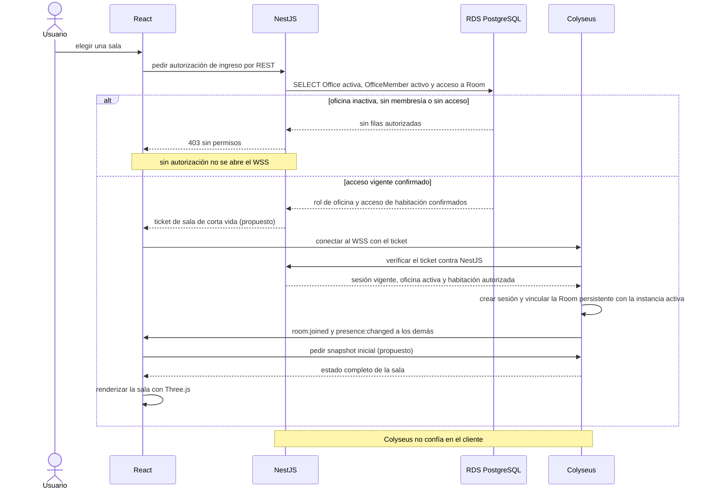
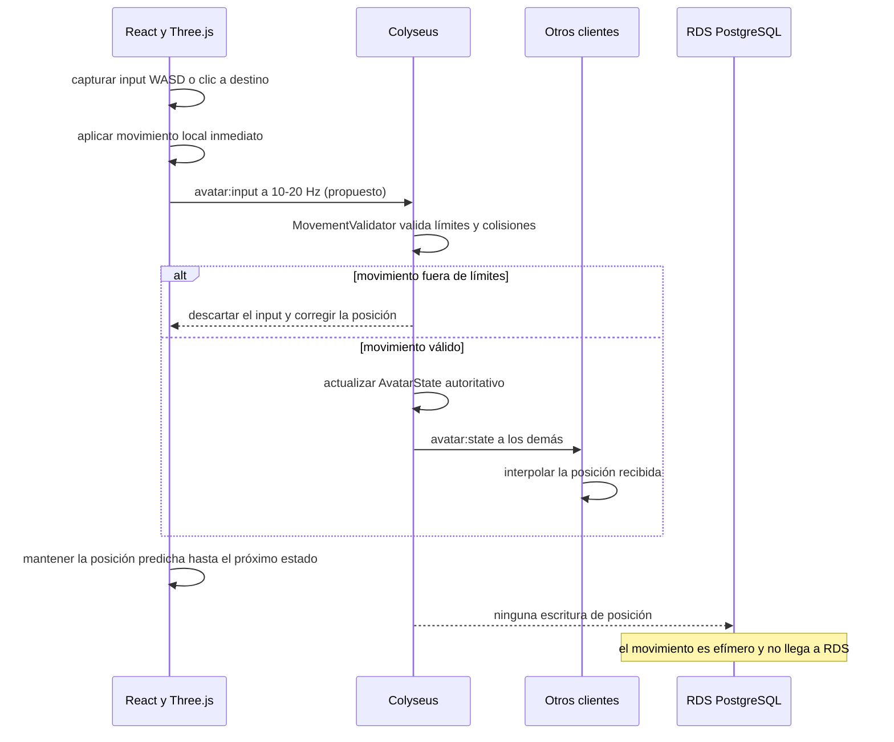
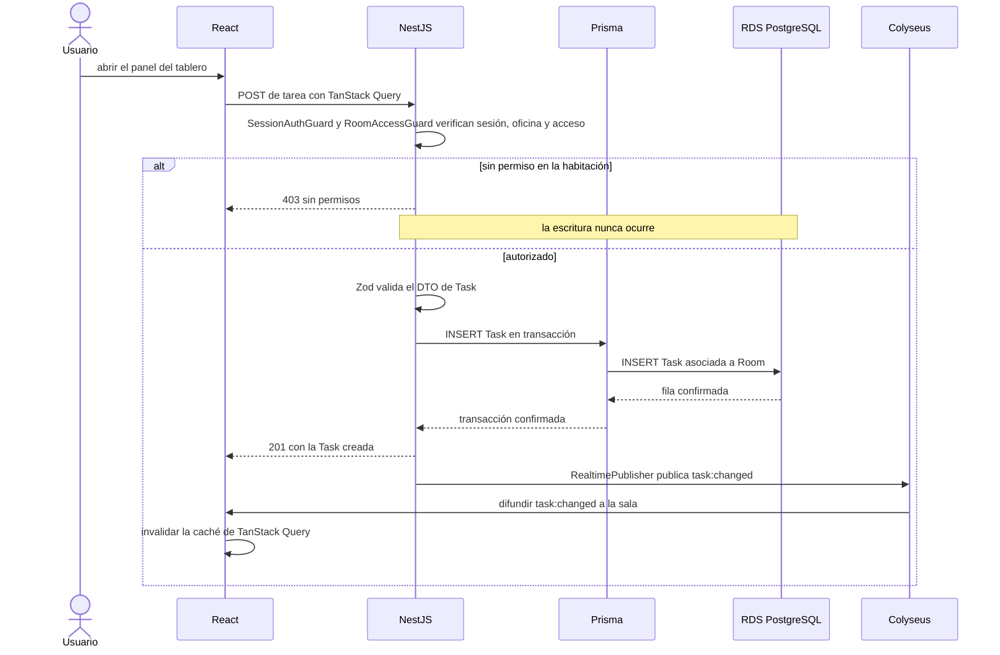

# Secuencias del núcleo (S1 a S7)

> Cuenta, ingreso a sala, movimiento, tareas, chat, repaso diario y reconexión. Parte del [índice de diagramas](../README.md).

**En este archivo**

- [1. Diagramas de secuencia](#1-diagramas-de-secuencia)
  - [1.1 S1 — Registro, login, oficina y principal](#11-s1--registro-login-oficina-y-principal)
  - [1.2 S2 — Ingreso a una sala](#12-s2--ingreso-a-una-sala)
  - [1.3 S3 — Movimiento de avatar](#13-s3--movimiento-de-avatar)
  - [1.4 S4 — Crear una tarea](#14-s4--crear-una-tarea)
  - [1.5 S5 — Mensaje de chat](#15-s5--mensaje-de-chat)
  - [1.6 S6 — Repaso diario del bot](#16-s6--repaso-diario-del-bot)
  - [1.7 S7 — Reconexión, token expirado y logout](#17-s7--reconexión-token-expirado-y-logout)

← [Clases por capa](../03-structural/class-design.md) · [Índice](../README.md) · [Secuencias de administración (S8 a S13)](./admin-flows.md) →

---

## 1. Diagramas de secuencia

Los siete escenarios de esta sección recorren el ciclo completo del producto: alta de cuenta y sesión, ingreso a una sala, movimiento de avatar, creación de una tarea, mensaje de chat, repaso diario del bot y las tres salidas del sistema —reconexión, token vencido y logout—. Cada diagrama aísla un camino y deja ver quién decide qué: NestJS es la autoridad de todo lo persistente, Colyseus la de lo efímero, y RDS nunca recibe una escritura del plano realtime ([documento maestro](../../../master-document.md)).

Todo lo que sigue es **diseño objetivo (to-be)**, no relevamiento de implementación: el repositorio solo contiene documentación y no hay código de aplicación ([estado del repositorio](../../../README.md)). Por eso no existen endpoints, verbos, DTOs ni payloads definitivos, y los eventos son ilustrativos y no definitivos ([documento maestro](../../../master-document.md)). Se rotulan con **(propuesto)** los contratos y parámetros que la fuente deja sin definir —tickets, tokens, formatos de error no documentados, frecuencia de envío, timeouts y backoff—; los nombres de componentes internos como guards, validadores y publicadores son nombres de diseño. Los únicos códigos de error documentados son 401 sin autenticación y 403 sin permisos ([documento maestro](../../../master-document.md)).

### 1.1 S1 — Registro, login, oficina y principal

El registro crea usuario, oficina propia, membresía de Dueño y habitación principal; además inicializa avatar, columnas por defecto y canales de chat según RF-AUT-001, RF-OFI-001 y RF-TAR-006. La principal pertenece a la oficina y todos sus miembros pueden acceder; no es una sala personal independiente. Agrupar el alta en una transacción es propuesta técnica para preservar RN-01/RN-04. La selección concreta de hash, sesión y validación backend no queda aprobada por este diagrama.

```mermaid
sequenceDiagram
    actor user as Usuario
    participant web as React
    participant api as NestJS
    participant orm as Prisma
    participant db as RDS PostgreSQL

    user->>web: completar formulario validado con Zod
    web->>api: POST de registro por HTTPS al ALB
    api->>api: validar DTO en servidor y aplicar hash seguro
    api->>orm: abrir transacción de alta (propuesto)
    orm->>db: INSERT User, Office, OfficeMember owner y Room principal
    alt email ya registrado
        db-->>api: violación de unicidad
        api-->>web: 409 email ya registrado (propuesto)
    else alta aceptada
        db-->>api: avatar, columnas y canales inicializados; alta confirmada
        api->>orm: INSERT Session con expiración
        orm-->>api: SessionToken emitido (propuesto)
        api-->>web: 201 con SessionToken y expiración
        web->>web: guardar el token en AuthStore
    end
    user->>web: enviar credenciales de login
    web->>api: POST de login por HTTPS
    alt credenciales inválidas
        api-->>web: 401 sin autenticación
    else credenciales válidas
        api-->>web: 200 con SessionToken
    end
```

Cliente y servidor validan entradas (RN-17); usar Zod también en backend es una propuesta, no una consecuencia de que los formularios React lo utilicen. El hash nunca se devuelve. Formato de sesión, mecanismo de almacenamiento cliente y código de conflicto son propuestas sujetas a diseño de autenticación.

### 1.2 S2 — Ingreso a una sala

Ingresar no es abrir un socket: es una autorización REST seguida de un handshake. El cliente pide la conexión a Colyseus por HTTPS/WSS, Colyseus valida identidad y autorización con el backend antes de vincular la sesión con la sala persistente, y recién entonces sincroniza la presencia ([documento maestro](../../../master-document.md)). Una sala del producto en PostgreSQL no equivale a la instancia `Room` de Colyseus ([documento maestro](../../../master-document.md)), y puertas y accesos también verifican permisos ([documento maestro](../../../master-document.md)).



El ticket de corta vida y el snapshot inicial no figuran en la fuente: el primero materializa la autorización previa sin reutilizar la sesión completa, el segundo es el mecanismo de sincronización que el documento no detalla. Lo que sí es regla es el orden: la autorización se verifica en el servidor ([documento maestro](../../../master-document.md)), y Colyseus revalida el ticket contra NestJS en lugar de aceptar la palabra del cliente. El `alt` de 403 corta antes de abrir el WSS, de modo que un usuario sin membresía nunca llega a Colyseus.

### 1.3 S3 — Movimiento de avatar

El movimiento es el caso donde el plano efímero se ve puro. Three.js detecta la intención, el cliente mueve localmente y Colyseus sincroniza; los demás clientes interpolan ([documento maestro](../../../master-document.md)). La regla que ordena todo el diagrama es explícita: no se escriben posiciones de cada fotograma en RDS ([documento maestro](../../../master-document.md)), y las posiciones transitorias y los estados interpolados no son filas persistentes ([documento maestro](../../../master-document.md)).



La predicción local hace que el avatar responda sin esperar al servidor, pero la posición autoritativa es la que emite `avatar:state`; el cliente solo interpola y corrige. La frecuencia de 10-20 Hz y la autoridad exacta del movimiento figuran entre los huecos declarados, por eso la frecuencia va marcada como propuesta. `RDS PostgreSQL` aparece únicamente para dibujar la ausencia: no hay tabla de posiciones ni escritura por tick, y si Colyseus se cae no se pierde nada persistente.

### 1.4 S4 — Crear una tarea

Crear una tarea es el patrón canónico de escritura persistente: el panel React manda la mutación, NestJS valida sesión, pertenencia y DTO, Prisma guarda en RDS y solo después se notifica a la sala ([documento maestro](../../../master-document.md)). Las tareas viven asociadas a una sala y admiten fechas, estados y responsables, con CRUD completo desde el panel ([documento maestro](../../../master-document.md)).



Los dos guards son la traducción del orden de verificación: primero autenticación, después permisos sobre la sala, y solo entonces validación de datos. El 403 corta antes de tocar Prisma, así que la escritura no existe ni parcialmente. La difusión de `task:changed` va después del 201 porque la regla es notificar una operación ya confirmada ([documento maestro](../../../master-document.md)); la invalidación de caché en el cliente es lo que reconcilia el estado REST con el evento recibido. RF-TAR-002 a RF-TAR-005 permiten crear, editar, mover y eliminar tareas a cualquier miembro con acceso, también tareas ajenas. La columna elegida pertenece al mismo tablero; la estructura de columnas la gestiona Líder/Admin/Dueño.

### 1.5 S5 — Mensaje de chat

El mensaje tiene un canal de oficina o de habitación, elegido por el usuario, con historial persistente (RF-CHA-001 a RF-CHA-007). Para respetar el camino único de escritura de la [02-system-architecture/realtime-colyseus.md](../02-system-architecture/realtime-colyseus.md#13-regla-de-consistencia-y-autoridad), **el envío va por REST a NestJS** y Colyseus solo difunde el mensaje ya confirmado a la sala; el historial también se recupera por REST ([documento maestro](../../../master-document.md)). Decisión de diseño (propuesto): reemplaza la versión anterior, donde Colyseus llamaba a NestJS para persistir.

```mermaid
sequenceDiagram
    actor user as Usuario
    participant web as React
    participant api as NestJS
    participant db as RDS PostgreSQL
    participant colyseus as Colyseus
    participant peers as Suscriptores autorizados del canal

    user->>web: elegir canal de oficina o habitación y escribir mensaje
    web->>api: POST de mensaje por HTTPS (propuesto)
    api->>api: sesión y membresía activa; acceso adicional si es canal de habitación
    alt sin sesión o sin autorización de canal
        api-->>web: 401 o 403, sin persistir
    else autorizado
        api->>api: validar el cuerpo con Zod
        api->>db: INSERT Message con destino único oficina o habitación
        db-->>api: fila confirmada
        api-->>web: 201 con id y timestamp del servidor
        api->>colyseus: RealtimePublisher notifica el mensaje confirmado
        colyseus->>peers: difundir chat:message solo al canal autorizado
        peers->>peers: ordenar por timestamp y renderizar
    end
    Note over colyseus,db: no se difunde antes de persistir
```

El orden es la garantía: el `INSERT` y la confirmación de RDS preceden a la difusión, y el mensaje que reciben los demás ya tiene id y timestamp del servidor, no del reloj del cliente. El contrato interno `PersistenceBridge` es una propuesta, porque la fuente no define endpoints internos entre Colyseus y NestJS. Tampoco están especificados el orden entre mensajes concurrentes ni la deduplicación ([documento maestro](../../../master-document.md)); ordenar por timestamp del servidor es la solución de diseño, no un dato del documento.

### 1.6 S6 — Repaso diario del bot

RF-BOT-003/004 y RF-BOT-006 a RF-BOT-009: solo lectura de datos autorizados, primera conexión autenticada del día y fallback estructurado. La fecha del servidor usa America/Argentina/Buenos_Aires, como las demás reglas del producto. La propuesta técnica debe distinguir reserva de generación y entrega completada: encontrar una reserva no prueba que el usuario ya recibió su repaso.

```mermaid
sequenceDiagram
    participant web as React
    participant api as NestJS
    participant db as RDS PostgreSQL
    participant bedrock as Amazon Bedrock

    web->>api: primera conexión autenticada; solicitar repaso
    api->>api: validar sesión y fecha de Buenos Aires
    api->>db: reclamar usuario y fecha de forma atómica (propuesto)
    alt entrega ya completada
        db-->>api: estado entregado
        api-->>web: no repetir presentación hoy
    else generación en curso
        db-->>api: reserva existente, no entrega confirmada
        api-->>web: estado pendiente; no generar duplicado
    else reserva obtenida
        api->>db: consultar tareas, reuniones y anuncios con permisos vigentes
        db-->>api: datos autorizados
        api->>api: construir repaso estructurado
        opt redacción IA habilitada (Could MVP)
            api->>bedrock: solicitar redacción con límite y timeout (propuestos)
            alt respuesta válida
                bedrock-->>api: texto para el repaso
            else error o timeout
                api->>api: conservar repaso estructurado sin IA
            end
        end
        api->>db: guardar resultado y estado de generación (propuesto)
        api-->>web: repaso privado del usuario, nunca difusión a la habitación
        web->>api: confirmar presentación (propuesto)
        api->>db: registrar entrega completada de usuario y fecha
    end
```

La clave única usuario/fecha es una propuesta para evitar duplicados; recuperación de reservas, reintentos y confirmación de presentación necesitan contrato técnico antes de implementar. No se afirma entrega exactamente una vez por insertar un marcador anticipado. RF-BOT-008 permite el resumen sin IA y RF-BOT-009 agrega redacción IA como Could; el proveedor no bloquea el resumen estructurado. El bot no crea, modifica ni elimina tareas, reuniones o anuncios, **aunque el usuario se lo pida** (RF-BOT-004); esas acciones son Evolución (RF-BOT-010). Persistir la propia entrega del repaso no habilita escritura de negocio por el bot.

### 1.7 S7 — Reconexión, token expirado y logout

Las tres salidas comparten participantes pero no consecuencia. La reconexión está contemplada y la gestiona Colyseus con verificación de permisos ([documento maestro](../../../master-document.md)); el token vencido termina la sesión del lado del cliente; el logout invalida el acceso protegido sin borrar los datos ([documento maestro](../../../master-document.md)), porque las sesiones vencen pero el contenido persiste ([documento maestro](../../../master-document.md)).

```mermaid
sequenceDiagram
    actor user as Usuario
    participant web as React
    participant colyseus as Colyseus
    participant api as NestJS

    alt reconexión tras un corte de socket
        colyseus-->>web: conexión WSS perdida
        web->>web: reintentar con backoff (propuesto)
        web->>colyseus: reconectar y presentar el ticket
        colyseus->>api: revalidar el ticket
        api-->>colyseus: ticket y sesión vigentes; oficina, membresía y acceso activos
        colyseus-->>web: restaurar la sala y difundir presence:changed
    else token expirado
        colyseus-->>web: rechazo realtime por sesión vencida (no código HTTP tras handshake)
        web->>web: limpiar AuthStore y cerrar el socket
        web->>web: redirigir al login
    else logout del usuario
        user->>web: cerrar sesión
        web->>api: POST de logout por HTTPS (propuesto)
        api->>api: invalidar la Session
        api-->>web: 204 sin contenido
        api->>colyseus: cerrar la sesión de sala
        colyseus-->>web: desconectar y difundir presence:changed
        web->>web: limpiar la caché de TanStack Query
    end
    Note over web,api: REST usa 401; realtime expresa autenticación fallida en su protocolo
```

El backoff no tiene algoritmo definido en la fuente ([documento maestro](../../../master-document.md)), por eso la rama de reconexión lo marca como propuesto: lo único documentado es que Colyseus revalida permisos antes de restaurar la presencia. En el token vencido no se reintenta: el cliente descarta el estado de autenticación, cierra el socket y vuelve al login. En el logout, la invalidación de la `Session` en NestJS es la que corta el acceso, y la desconexión de Colyseus solo propaga el cambio de presencia a la sala; la caché de TanStack Query se limpia para que ningún dato del usuario anterior quede visible.

---

← [Clases por capa](../03-structural/class-design.md) · [Índice](../README.md) · [Secuencias de administración (S8 a S13)](./admin-flows.md) →
