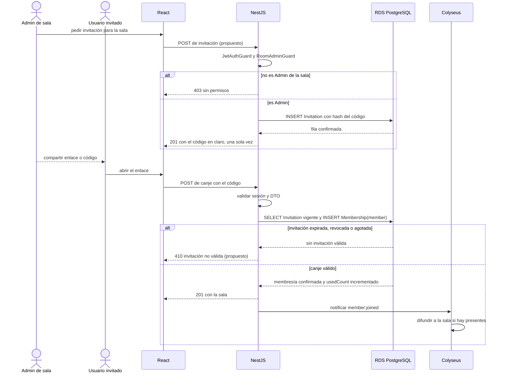
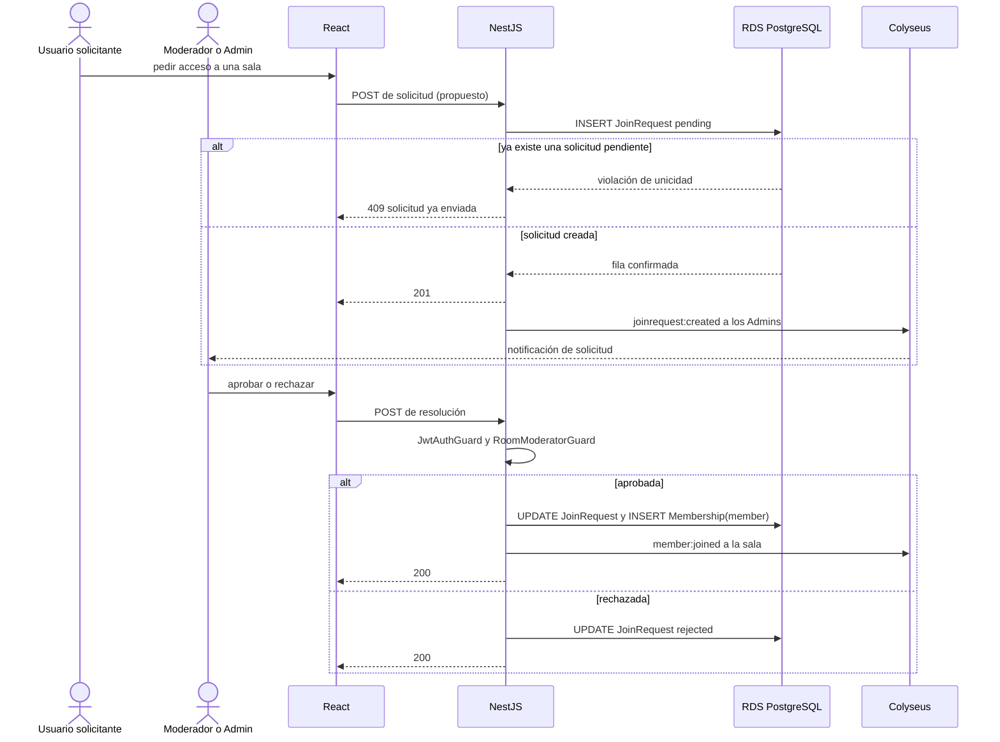
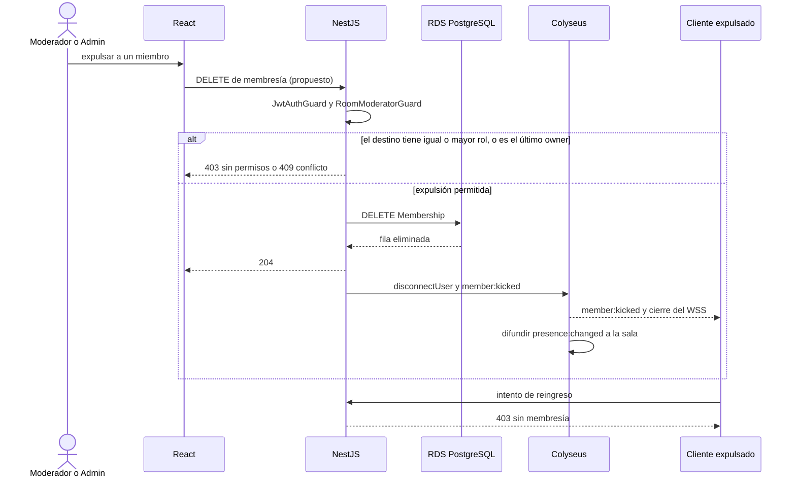
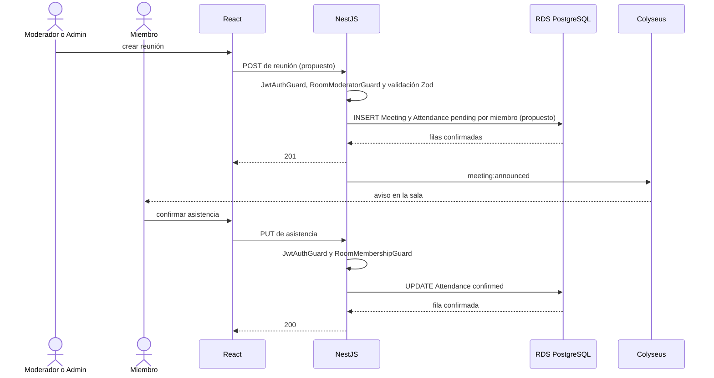
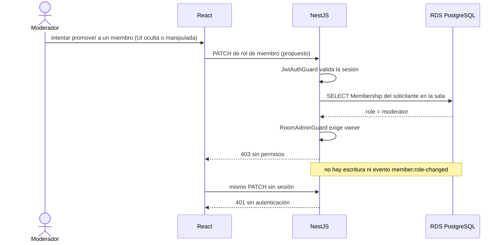

# Secuencias de administración (S8 a S12)

> Invitaciones, solicitudes de ingreso, expulsión, anuncios y control de permisos. Parte del [índice de diagramas](./README.md).

**En este archivo**

- [9. Escenarios de administración](#9-escenarios-de-administración)
  - [1.1 S8 — Admin crea una invitación y un miembro la canjea](#11-s8--admin-crea-una-invitación-y-un-miembro-la-canjea)
  - [1.2 S9 — Solicitud de ingreso y aprobación](#12-s9--solicitud-de-ingreso-y-aprobación)
  - [1.3 S10 — Moderador o Admin expulsa a un miembro](#13-s10--moderador-o-admin-expulsa-a-un-miembro)
  - [1.4 S11 — Publicar un anuncio o reunión y confirmar asistencia](#14-s11--publicar-un-anuncio-o-reunión-y-confirmar-asistencia)
  - [1.5 S12 — Moderador intenta una acción exclusiva del Admin](#15-s12--moderador-intenta-una-acción-exclusiva-del-admin)

← [Secuencias del núcleo (S1 a S7)](./06-sequences-core.md) · [Índice](./README.md) · [Convenciones transversales](./08-conventions.md) →

---

## 9. Escenarios de administración

Escenarios de gestión de la sala. Siguen las mismas convenciones que las [secuencias del núcleo](./06-sequences-core.md): REST hacia NestJS, difusión por Colyseus solo después de confirmar la escritura, y orden autenticación → autorización → validación → escritura.

### 1.1 S8 — Admin crea una invitación y un miembro la canjea

El código se devuelve en claro una sola vez y solo se guarda su hash. El incremento de `usedCount` y la creación de la `Membership` van en la misma transacción para que dos canjes simultáneos no superen `maxUses`.

### 1.2 S9 — Solicitud de ingreso y aprobación

### 1.3 S10 — Moderador o Admin expulsa a un miembro

Aunque el cliente expulsado conserve un ticket de sala viejo, Colyseus lo revalida contra NestJS (S2), y sin `Membership` la revalidación falla: la expulsión no depende de que la desconexión forzada llegue.

### 1.4 S11 — Publicar un anuncio o reunión y confirmar asistencia

### 1.5 S12 — Moderador intenta una acción exclusiva del Admin

Caso de prueba negativo para la matriz de la [01-use-cases §1.4](./01-use-cases.md#14-matriz-de-permisos-por-rol-propuesto): un Moderador intenta cambiar el rol de otro miembro (UC-24). El rechazo ocurre antes de validar el DTO y de tocar Prisma, y manipular el cliente no cambia el resultado.

---

← [Secuencias del núcleo (S1 a S7)](./06-sequences-core.md) · [Índice](./README.md) · [Convenciones transversales](./08-conventions.md) →
