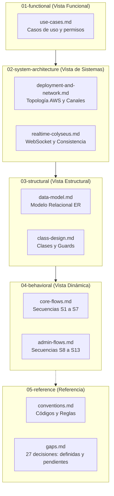

# Diagramas de Arquitectura y Diseño — IntegrarTEC 2026

> **Directorio de arquitectura de diseño** · Plataforma de salas de convivencia y organización  
> **Estado:** diseño objetivo alineado con la ERS; contratos técnicos propuestos, no implementación
> **Última actualización:** 28 de octubre de 2026

---

## 1. Organización de las Vistas de Arquitectura

El diseño se organiza en carpetas temáticas para facilitar su lectura progresiva, desde la visión funcional de negocio hasta los detalles de implementación y secuencias temporales:

### Índice General

| Módulo / Vista | Contenido | Archivos |
|---|---|---|
| [**01. Funcional**](./01-functional/README.md) | Actores (Dueño, Admin, Miembro y Líder de habitación), diagrama general de casos de uso y matriz de permisos por rol | [use-cases.md](./01-functional/use-cases.md) |
| [**02. Sistemas y Red**](./02-system-architecture/README.md) | Topología AWS (Amplify, ALB, ECS, RDS, S3, Bedrock), canales REST/WSS y ciclo Colyseus | [deployment-and-network.md](./02-system-architecture/deployment-and-network.md) · [realtime-colyseus.md](./02-system-architecture/realtime-colyseus.md) |
| [**03. Estructural**](./03-structural/README.md) | Diagrama entidad-relación de PostgreSQL (Prisma) y arquitectura de clases/guards en NestJS y React | [data-model.md](./03-structural/data-model.md) · [class-design.md](./03-structural/class-design.md) |
| [**04. Dinámica**](./04-behavioral/README.md) | Interacciones temporales: flujos principales (S1-S7) y flujos de administración y ciclo de oficina (S8-S13) | [core-flows.md](./04-behavioral/core-flows.md) · [admin-flows.md](./04-behavioral/admin-flows.md) |
| [**05. Referencia**](./05-reference/README.md) | Convenciones de errores, orden obligatorio de validación y matriz de seguimiento de huecos | [conventions.md](./05-reference/conventions.md) · [gaps.md](./05-reference/gaps.md) |

---

## 2. Lectura según el Objetivo

| Si tu objetivo es... | Rutas y diagramas recomendados | Qué obtendrás |
|---|---|---|
| **Definir alcance y roles** | [01-functional/use-cases.md](./01-functional/use-cases.md) | Cuáles son las capacidades exactas de Dueño, Admin, Miembro y Líder. |
| **Diseñar base de datos** | [03-structural/data-model.md](./03-structural/data-model.md) | Modelo conceptual/lógico e invariantes funcionales; no esquema Prisma aprobado. |
| **Implementar endpoints / WebSocket** | [02-system-architecture](./02-system-architecture/README.md) y [04-behavioral](./04-behavioral/README.md) | Qué llamadas son REST, qué eventos viajan por WSS y el orden de ejecución. |
| **Escribir pruebas de seguridad (R2)** | [01-functional/use-cases.md](./01-functional/use-cases.md) y [05-reference/conventions.md](./05-reference/conventions.md) | Escenarios que deben devolver 401 (sin sesión) y 403 (rol insuficiente). |
| **Preparar la defensa técnica (R8)** | [02-system-architecture/deployment-and-network.md](./02-system-architecture/deployment-and-network.md) y [04-behavioral/core-flows.md](./04-behavioral/core-flows.md) | Explicación clara de la separación de responsabilidades y flujo integral. |

---

## 3. Principios de Consistencia de los Diagramas

1. **Mermaid como formato editable:** Los diagramas son código Mermaid en Markdown. Son vistas derivadas de la ERS, las decisiones y las reglas; no una fuente de requisitos nuevos ni evidencia de implementación. La representación visual debe verificarse con un renderer compatible, no asumirse por usar Mermaid.
2. **Autoridad Única:** NestJS y PostgreSQL son la autoridad exclusiva de los datos persistentes (usuarios, salas, tareas, chat). Colyseus gestiona únicamente estado efímero en memoria (presencia y movimiento).
3. **Regla de Escritura y Difusión:** El cliente envía las acciones persistentes por HTTPS REST a NestJS; una vez confirmada la escritura en RDS, NestJS notifica a Colyseus para que difunda el evento a la sala.

---

## 4. Fuentes y Mantenimiento

- **Base funcional:** [ERS](../functional-requirements.md), [historias](../user-stories.md) y [decisiones](../requirements-decision.md). Roles, fases y prioridades vienen de sus RF/RN; los supuestos P# siguen visibles.
- **Documento Maestro:** [master-document.md](../../master-document.md) es la fuente de verdad del producto. Los diagramas ilustran su arquitectura objetivo.
- **Reglas del Proyecto:** Las especificaciones de [rules/security.md](../../rules/security.md) y [rules/project-requirements.md](../../rules/project-requirements.md) son de cumplimiento mandatorio.
- **Actualización:** Cuando una decisión de código altere un contrato o resuelva un ítem de [05-reference/gaps.md](./05-reference/gaps.md), el PR correspondiente debe actualizar el diagrama asociado.

La [guía de revisión](./review-guide.md) indica las ramas locales, sus bases y los controles observados, sin confundirlos con PRs publicados.

## 5. Alcance de esta alineación

Oficinas con principal y habitaciones adicionales; membresía de oficina separada de acceso y liderazgo; columnas configurables, tareas colaborativas, chat por oficina/habitación, asistencia MVP y bot de solo lectura. Se conserva la organización original de vistas, actualizando su contenido según la ERS de Luis. La propiedad no se transfiere; el Dueño puede dar de baja y recuperar durante 15 días. Three.js + R3F están elegidos y Buenos Aires es la zona del producto. No se implementa backend, migración ni infraestructura con estos documentos.
